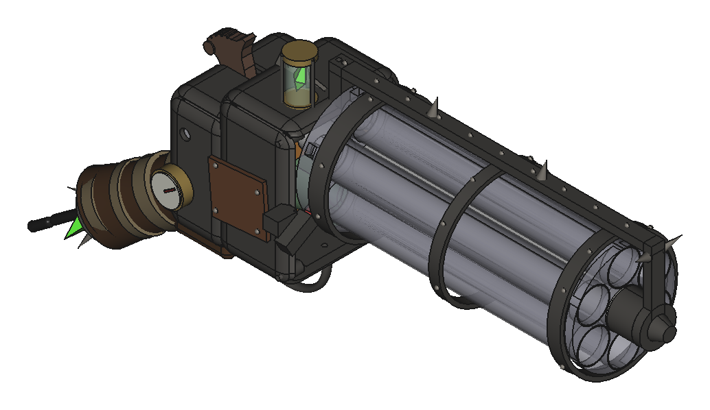
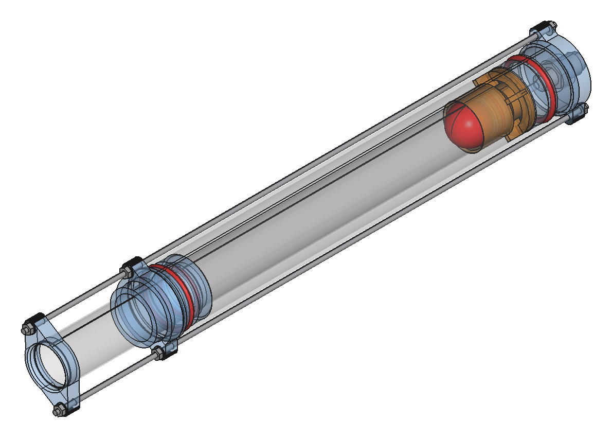

# Ratling

Проп-игрушка, а не настоящее оружие: съёмочный и косплейный реквизит в виде многоствольной
пневматики низкого давления. Печатные детали на 3D-принтере плюс покупные трубы, уплотнения и
фитинги. Все модели — параметрические скрипты FreeCAD на Python, с проверками геометрии и
выгрузкой деталей сразу в ориентации для печати.



## Что сейчас делается

Оба изделия на одном стволе: стальная трубка 25 × 0.6 (внутри Ø23.8). Рабочее давление 2 бар,
детали считаются на 5 бар.

**Гатлинг QEV** — главный приоритет. Камера на ствол, толстый короткий соосный dump (физика как у
проверенного модуля v4.4): труба камеры 50 × 1.5, короткий обрезок ствола, передняя крышка с
упором и самоцентрирующим фиттингом в настоящий ствол. Линейный затвор на двух рельсах, подача
пульки сверху; ручной стенд одной станции с гравитационным податчиком.
Решения: [docs/gatling.md](docs/gatling.md). **2026-11-17:** airtight-детали стенда напечатаны;
сборка ещё не начата.

**Пистолет «Наган»** — блок из шести стволов, курковый вариант в облике скавенов. Клапан v1.3
(корпус и крышка те же, что у стенда). По умолчанию без запирания. **2026-11-17:** корпус собран,
клапаны работают; нестабильна посадка блока на камеру-ось. Гайд:
[pistol/build/README.md](pistol/build/README.md). Вес со стальными стволами — **1.27 кг**.

**Модуль v4.4** (`module/stage3v4_coaxial_chamber.py`) — эталон соосного dump для гатлинга: ствол
внутри алюминиевой трубы камеры 38 × 1.5, клапан с резиновой диафрагмой сзади, стяжка двумя
шпильками M3. На стенде dump работает отлично (2026-11-12).



### Чего ждём

- Сборки стенда гатлинга (airtight уже есть) и обновления раскладки столов под податчик.
- Посадки блока пистолета на камеру-ось и стабилизации механизма.
- Трубы камеры гатлинга 50 × 1.5 и коллектора MQR6 (заказаны) — обмер по приходу.

Что из файлов живое, что ждёт теста, что заморожено: [docs/status.md](docs/status.md).
Брошенные генераторы лежат в [archive/](archive/README.md) и в разработку не берутся.
Что сделать руками (стенд, покупки, печать): [docs/human-todo.md](docs/human-todo.md).

## Как собрать модель

Нужен FreeCAD 1.0. Генератор запускается из консоли FreeCAD:

```python
REPO = '/path/to/ratling'
exec(open(REPO + '/gatling/linear_breech_bench.py').read())
```

Он печатает отчёт с проверками (`[OK ]` / `[FAIL]`), открывает модель и пишет STEP, STL и FCStd
в `exports/<имя>/`. Без окна то же самое делает `freecadcmd -c "..."`. Папка `exports/` в git
не хранится, её всегда можно собрать заново.

Столы для Bambu P2S: манифесты `plates/*.json` (группа печати на деталь) и драйвер
`tools/make_plates.py` → `tools/print_plate.py`. Слайсинг нужен Bambu Studio на macOS;
`python3 tools/make_plates.py --dry-run <id>` показывает план без него. Облачная машина
Cursor ставит FreeCAD сама (`sh tools/install_freecad.sh`,
[.cursor/environment.json](.cursor/environment.json)); картинку модели без экрана рисует
`tools/render_view.py` (см. [AGENTS.md](AGENTS.md)). Нарезки `.3mf` в облаке нет; подробности —
[docs/print.md](docs/print.md).

## Что где лежит

| Папка | Что там |
|---|---|
| `gatling/` | Гатлинг QEV: fat coax, станция, стенд, пакет, кулачок. |
| `pistol/` | Пистолет: курковый механизм и рама; в `pistol/build/` печать и сборка. |
| `module/` | Клапаны и соосный dump: `stage3v4_coaxial_chamber.py` (v4.4), `stage3_qev.py` (v1.1/v1.3). |
| `archive/` | Брошенные генераторы. Не образец для нового. |
| `selector/`, `ratling/`, `connectors/` | Поворотный селектор 1 → 25 (заморожен), общие функции FreeCAD, пробка для трубки 25 мм. |
| `plates/` | Манифесты печати: какая деталь в какую группу (`airtight` / `strong` / …). |
| `tools/` | Слайсинг столов (`make_plates.py`, `print_plate.py`), установка FreeCAD, рендер, вес. |
| `docs/` | Статус, human-todo, гатлинг, печать, вес. |
| `mitrailleuse/` | Старый пакет/ротор на диске; в текущий статус не входит, не развивать. |

## Документы

- [docs/status.md](docs/status.md): что живое, что ждёт теста, что заморожено, и принятые решения.
- [docs/human-todo.md](docs/human-todo.md): стенд, покупки и печать, которые делает владелец.
- [docs/gatling.md](docs/gatling.md): промежуточные решения гатлинга.
- [docs/print.md](docs/print.md): манифесты групп и сборка `.3mf` для Bambu P2S.
- [docs/weights.md](docs/weights.md): вес пистолета (и исторические цифры).
- [docs/requirements.md](docs/requirements.md), [docs/concepts.md](docs/concepts.md),
  [docs/test-plan.md](docs/test-plan.md): требования, концепты и план испытаний селектора.
- [AGENTS.md](AGENTS.md): заметки для ИИ-агентов.

## Принципы

1. Всё, что держит давление «на складе» (ресивер, регулятор, предохранительный клапан, шланги,
   фитинги), — покупное и рассчитано на своё давление.
2. Печатные детали задают геометрию и каналы и держат только малые объёмы; стенки толстые,
   заполнение 100 %.
3. Уплотнения, оси, подшипники и фитинги — стандартные и заменяемые.
4. Сначала маленький стенд, потом масштаб.
