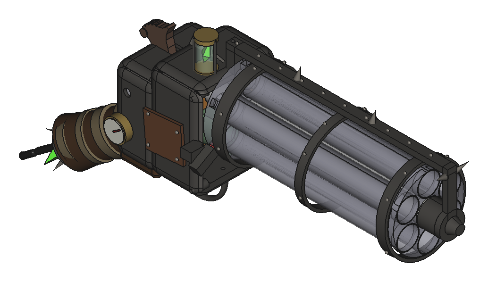
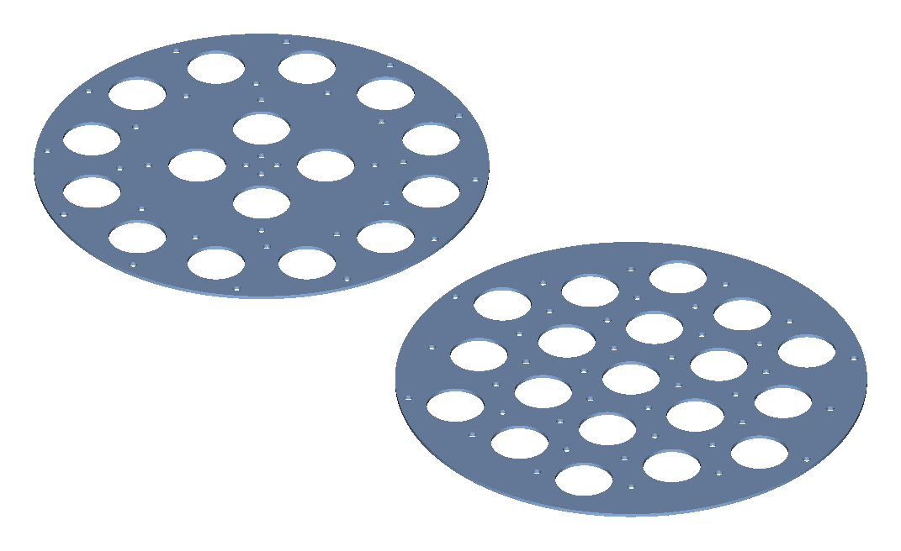
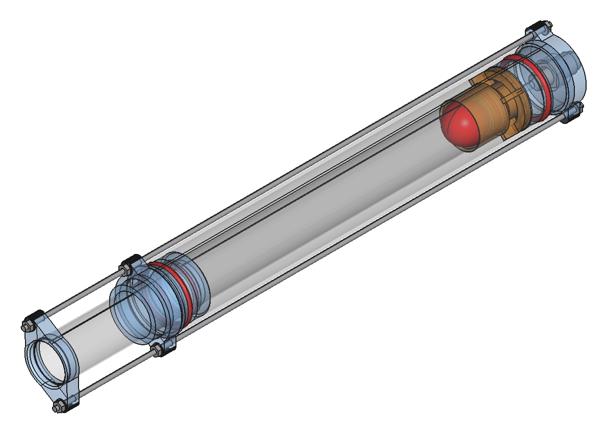

# Ratling

Многоствольная пневматика низкого давления: печатные детали на 3D-принтере плюс покупные трубы,
уплотнения и фитинги. Все модели — параметрические скрипты FreeCAD на Python, с проверками
геометрии и выгрузкой деталей сразу в ориентации для печати.



## Что сейчас делается

Оба изделия стоят на одном стволе: стальная трубка 25 × 0.6 (внутри Ø23.8). Рабочее давление
2 бар, детали считаются на 5 бар.

**Митральеза** — пакет одинаковых модулей, у каждого своя камера и свой клапан. Делается в двух
вариантах: 16 стволов кольцами 4 + 12 (около 5.6 кг) и 19 стволов сотами (около 6.7 кг).
Модуль у них один и тот же, различается только плита, которая держит пакет. Сейчас идут эскизы
компоновки.



**Модуль ствола v4.4** — ствол проходит внутри трубы камеры 38 × 1.5. Сзади стоит клапан с
резиновой диафрагмой: пока на пилоте есть давление, диафрагма закрывает седло, а камера
заряжается через дренажное отверстие. Стоит сбросить пилот, и камера одним рывком уходит в ствол.
Модуль стянут двумя шпильками M3, клея и саморезов нет.



**Пистолет «Наган»** — блок из шести стволов вращается вокруг камеры. Под большим пальцем
курок-рычаг: он поворачивает блок и запирает ствол, а спуск сбрасывает пилот клапана v1.1.
Есть полный гайд по печати и сборке: [pistol/build/README.md](pistol/build/README.md).

### Чего ждём

- Стендового теста клапана v1.1 вместе с плавающим уплотнением и вент-головкой. От него зависят
  пистолет и следующая версия клапана, v1.3.
- Трубок для v4.4, после них печать и тест модуля.

Что из файлов живое, а что заморожено или осталось историей: [docs/status.md](docs/status.md).

## Как собрать модель

Нужен FreeCAD 1.0. Генератор запускается из консоли FreeCAD:

```python
REPO = '/path/to/ratling'
exec(open(REPO + '/module/stage3v4_coaxial_chamber.py').read())
```

Он печатает отчёт с проверками (`[OK ]` / `[FAIL]`), открывает модель и пишет STEP, STL и FCStd
в `exports/<имя>/`. Без окна то же самое делает `freecadcmd -c "..."`. Папка `exports/` в git
не хранится, её всегда можно собрать заново.

Столы для Bambu P2S собирают скрипты `*_plates.sh` через `tools/print_plate.py`. Для этого нужен
Bambu Studio на macOS. На Linux-машине без FreeCAD его ставит `sh tools/install_freecad.sh`,
а картинку модели рисует `tools/render_view.py` (см. [AGENTS.md](AGENTS.md)).

## Что где лежит

| Папка | Что там |
|---|---|
| `module/` | Модули ствола с клапаном быстрого сброса. Живые: `stage3v4_coaxial_chamber.py` (v4.4, митральеза) и `stage3_qev.py` (v1.1, стенд и пистолет). В именах файлов исторически стоит «stage3». |
| `mitrailleuse/` | Раскладки пакета (`pack_layouts.py`) и плиты пакета (`pack_plate.py`). |
| `pistol/` | Пистолет: механизм, облик, анимации; в `pistol/build/` печать и сборка. |
| `selector/`, `ratling/`, `connectors/` | Поворотный селектор 1 → 25, с которого начинался проект (сейчас заморожен), общие функции FreeCAD, пробка для трубки 25 мм. |
| `tools/` | Слайсинг столов, установка FreeCAD, рендер картинок. |
| `docs/` | Статус модулей, раскладки пакета, вес, требования и концепты селектора. |

## Документы

- [docs/status.md](docs/status.md): что живое, что ждёт теста, что выброшено, и принятые решения.
- [docs/pack.md](docs/pack.md): раскладки на 15–19 стволов и разворот шпилек.
- [docs/weights.md](docs/weights.md): вес митральезы и пистолета, стальные и алюминиевые стволы.
- [docs/requirements.md](docs/requirements.md), [docs/concepts.md](docs/concepts.md),
  [docs/test-plan.md](docs/test-plan.md): требования, концепты и план испытаний селектора.
- [AGENTS.md](AGENTS.md): заметки для ИИ-агентов.

## Принципы

1. Всё, что держит давление «на складе» (ресивер, регулятор, предохранительный клапан, шланги,
   фитинги), — покупное и рассчитано на своё давление.
2. Печатные детали задают геометрию и каналы и держат только малые объёмы; стенки толстые,
   заполнение 100 %.
3. Уплотнения, оси, подшипники и фитинги — стандартные и заменяемые.
4. Сначала маленький стенд, потом масштаб.
