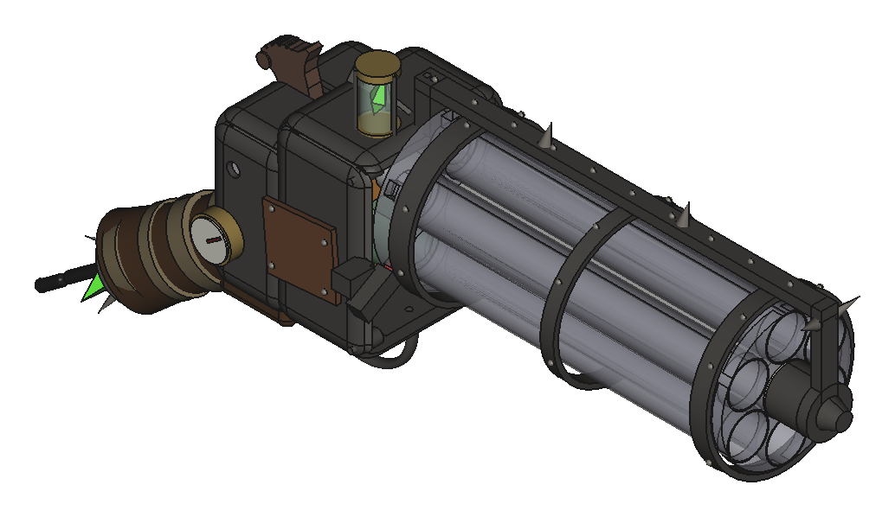
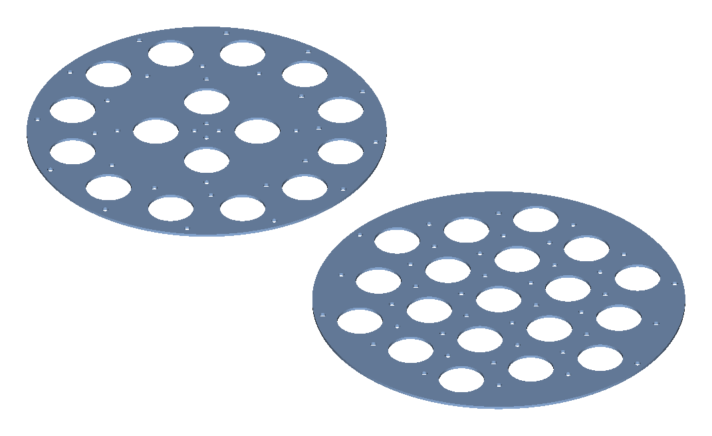
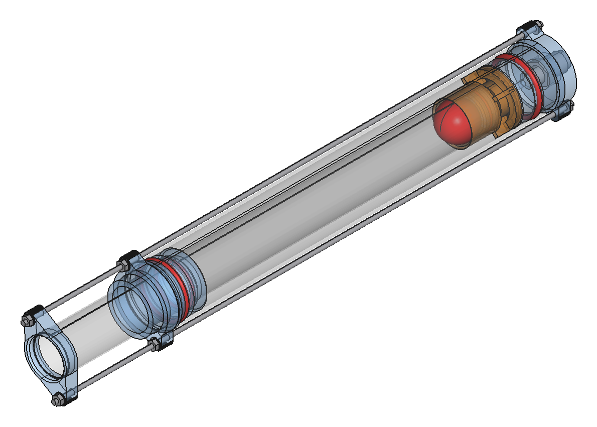

# Ratling

Проп-игрушка, а не настоящее оружие: съёмочный и косплейный реквизит в виде многоствольной
пневматики низкого давления. Печатные детали на 3D-принтере плюс покупные трубы, уплотнения и
фитинги. Все модели — параметрические скрипты FreeCAD на Python, с проверками геометрии и
выгрузкой деталей сразу в ориентации для печати.



## Что сейчас делается

Оба изделия стоят на одном стволе: стальная трубка 25 × 0.6 (внутри Ø23.8). Рабочее давление
2 бар, детали считаются на 5 бар.

**Митральеза**, концепт A («Монтиньи»): пакет стоит, кулачковый ротор заряжает стволы наперёд и
спускает их. Головка на ниппелях провалена на стенде Б (2026-11-10, ниппели текут); дальше ротор
вокруг 20 покупных клапанов 3/2, пока на бумаге ([docs/rotor.md](docs/rotor.md)). Делается в двух
вариантах на одном модуле: 16 стволов
кольцами 4 + 12 (раскладка J) и 19 стволов сотами (раскладка G). Рабочий вес без кожуха головки,
дульных насадок, рюкзака и ресивера — **9.06 кг** и **10.11 кг**
([docs/weights.md](docs/weights.md)). Прежний счёт «только модули и одна плита» был 5.63 / 6.69 кг.



**Модуль ствола v4.4** — ствол проходит внутри алюминиевой трубы камеры 38 × 1.5 (модель под
замер пришедшей трубы). Сзади клапан с резиновой диафрагмой: пока на пилоте есть давление,
диафрагма закрывает седло, а камера заряжается через дренажное отверстие. Сброс пилота — и камера
одним рывком уходит в ствол. Модуль стянут двумя шпильками M3: спереди дульный хомут из двух
половинок, сзади уши задней пробки. Клея и саморезов нет.



**Пистолет «Наган»** — блок из шести стволов, курковый вариант в облике скавенов. Клапан v1.3
(корпус и крышка те же, что у стенда). По умолчанию без запирания: на стенде без запора стреляло,
старый запор остаётся переключателем. Контрольный тест клапана v1.1 с плавающим уплотнением
пройден 2026-10-21. Гайд печати и сборки: [pistol/build/README.md](pistol/build/README.md).
Вес со стальными стволами — **1.27 кг**.

### Чего ждём

- Клапанов 3/2 (20 шт.): когда приедут — обмер и проверка покоя, потом головка. Стенд Б на
  ниппелях уже провален.
- Теста модуля v4.4 (трубки пришли).
- Печать корпуса пистолета (силуэт v12) и «руки».

Что из файлов живое, что ждёт теста, что заморожено: [docs/status.md](docs/status.md).
Брошенные генераторы лежат в [archive/](archive/README.md) и в разработку не берутся.
Что сделать руками (стенд, покупки, печать): [docs/human-todo.md](docs/human-todo.md).

## Как собрать модель

Нужен FreeCAD 1.0. Генератор запускается из консоли FreeCAD:

```python
REPO = '/path/to/ratling'
exec(open(REPO + '/module/stage3v4_coaxial_chamber.py').read())
```

Он печатает отчёт с проверками (`[OK ]` / `[FAIL]`), открывает модель и пишет STEP, STL и FCStd
в `exports/<имя>/`. Без окна то же самое делает `freecadcmd -c "..."`. Папка `exports/` в git
не хранится, её всегда можно собрать заново.

Столы для Bambu P2S собирают скрипты `*_plates.sh` через `tools/print_plate.py`. Для этого нужен
Bambu Studio на macOS. Облачная машина Cursor ставит FreeCAD сама
(`sh tools/install_freecad.sh`, [.cursor/environment.json](.cursor/environment.json));
картинку модели без экрана рисует `tools/render_view.py` (см. [AGENTS.md](AGENTS.md)).
Нарезки `.3mf` в облаке нет.

## Что где лежит

| Папка | Что там |
|---|---|
| `module/` | Модули ствола с клапаном быстрого сброса. Живые: `stage3v4_coaxial_chamber.py` (v4.4, митральеза) и `stage3_qev.py` (v1.1, стенд и пистолет). В именах файлов исторически стоит «stage3». |
| `mitrailleuse/` | Пакет, каркас, головка, ротор, зарядник и скин митральезы. Раскладки — `pack_layouts.py`, плиты — `pack_plate.py`. |
| `pistol/` | Пистолет: курковый механизм и рама; в `pistol/build/` печать и сборка. |
| `archive/` | Брошенные генераторы (модуль v2 и v3, казённик Schrader, рычажный пистолет и ранние эскизы). Не образец для нового. |
| `selector/`, `ratling/`, `connectors/` | Поворотный селектор 1 → 25, с которого начинался проект (сейчас заморожен), общие функции FreeCAD, пробка для трубки 25 мм. |
| `tools/` | Слайсинг столов, установка FreeCAD, рендер картинок, вес по STL. |
| `docs/` | Статус модулей, пакет, ротор, зарядник, вес, требования и концепты селектора. |

## Документы

- [docs/status.md](docs/status.md): что живое, что ждёт теста, что заморожено, и принятые решения.
- [docs/human-todo.md](docs/human-todo.md): стенд, покупки и печать, которые делает владелец.
- [docs/pack.md](docs/pack.md): раскладки на 15–19 стволов, каркас, задняя рама.
- [docs/rotor.md](docs/rotor.md): огневая головка и ротор концепта A.
- [docs/loader.md](docs/loader.md): зарядник с дула.
- [docs/skin.md](docs/skin.md): внешний вид, не детали.
- [docs/weights.md](docs/weights.md): вес митральезы и пистолета.
- [docs/requirements.md](docs/requirements.md), [docs/concepts.md](docs/concepts.md),
  [docs/test-plan.md](docs/test-plan.md): требования, концепты и план испытаний селектора.
- [AGENTS.md](AGENTS.md): заметки для ИИ-агентов.

## Принципы

1. Всё, что держит давление «на складе» (ресивер, регулятор, предохранительный клапан, шланги,
   фитинги), — покупное и рассчитано на своё давление.
2. Печатные детали задают геометрию и каналы и держат только малые объёмы; стенки толстые,
   заполнение 100 %.
3. Уплотнения, оси, подшипники и фитинги — стандартные и заменяемые.
4. Сначала маленький стенд, потом масштаб.
