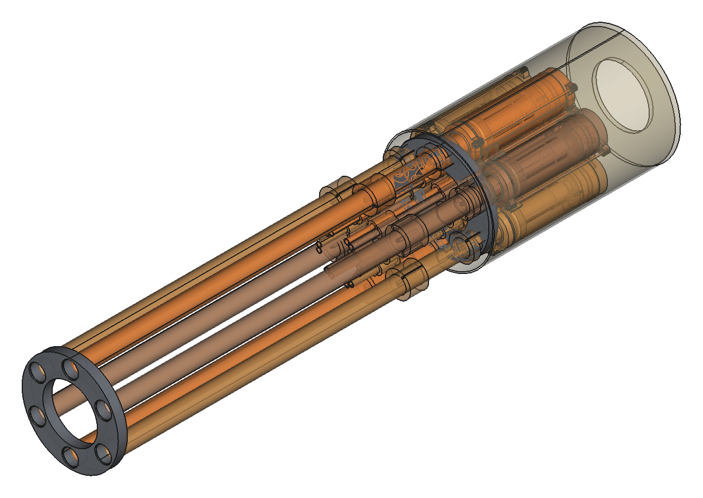
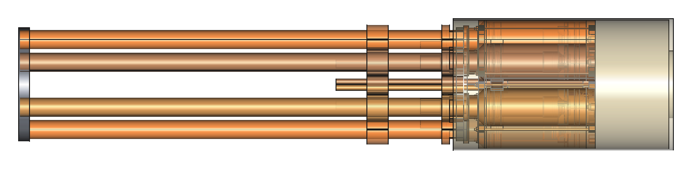

# Гатлинг QEV — промежуточные решения

Состояние на 2026-11-12. Это не митральеза и не пистоль: отдельная ветка
эскиза в папке `gatling/`. Живые генераторы:

- [`gatling/fat_coax_qev.py`](../gatling/fat_coax_qev.py) — толстый короткий соосный QEV
  (самостоятельный, не `exec` v4.4; физика dump та же);
- [`gatling/linear_breech.py`](../gatling/linear_breech.py) — одна станция: QEV на рельсах,
  фиксированный ствол, щель сверху под пульку (`exec` fat coax как библиотека);
- [`gatling/linear_breech_bench.py`](../gatling/linear_breech_bench.py) — ручной стенд станции:
  две маленькие опоры под рельсы (рельсы сами балка), T-ручка на салазках
  (`exec` linear_breech как библиотека);
- [`gatling/mqr_axis_sketch.py`](../gatling/mqr_axis_sketch.py) — ось + ступица + MQR на
  двух стойках;
- [`gatling/breech_pack.py`](../gatling/breech_pack.py) — **плотный пакет реального**
  `linear_breech` (6 станций, без лафета/ног стенда); стартовый набросок, не заморозка;
- [`gatling/breech_mechanism.py`](../gatling/breech_mechanism.py) — кулачок хода + фазы +
  подача + рукоять + шланги на том же пакете;
- [`gatling/gun_sketch.py`](../gatling/gun_sketch.py) — старый блок-силуэт (не главный вид);
- [`gatling/pack_sketch.py`](../gatling/pack_sketch.py) — технабросок пакета/оси
  (не вид изделия).

## Зафиксировано

1. **Камера на ствол**, не одна общая QEV (не Hotchkiss/револьвер на 1 камеру).
2. **Соосный dump**, не внешний бачон сбоку: на упаковке N=6 при 100 см³ соосный
   Ø38 даёт R_pack ≈ 59 мм и момент ×1; внешний Ø38 к оси — R_pack ≈ 86 мм и I ≈ ×1.8.
   Чем толще внешний, тем хуже инерция.
3. **Толстый короткий соосный** — компромисс «Ø↑ L↓» без выноса камеры наружу.
   Стартовый габарит трубы: **алюминий 50 × 1.5** (номинал ID 47), объём **100 см³**,
   седло **Ø16** как у v4.4 (стенд соосного dump уже ок на 2 бар).
4. **v1.3 бок о бок в текущий пистоль не идёт** (слабое истечение к 2 атм); для гатлинга
   опираемся на соосную физику v4.4, не на v1.3.
5. **Короткий обрезок + крышка с фиттингом**, не длинный ствол и не дульный хомут.
   Через камеру идёт обрезок 25 × 0.6 (~116 мм), упирается в губу передней крышки.
   Спереди у крышки плоский **упор** (диск шире рукава крышки и Ø25 ствола), в него торцом
   садится настоящий ствол;
   из упора выходит голый самоцентрирующий фиттинг (~Ø23.3 × 30 мм, зазор 0.25 мм,
   конус 8 мм к носику — ловит канал при осевом промахе ~1 мм; **без кольца** —
   уплотнения камеры в модуле). Шпильки кончаются на ярме крышки.
   Путь силы: седло → обрезок → губа крышки → ярмо → шпильки.
6. **Линейный затвор на рельсах** (эскиз станции): настоящий ствол на **двух** хомутах
   (казённик + насадка вперёд на 70 мм) — две точки, лучше соосность; оба сидят на рельсах.
   QEV ездит по двум Al-трубам Ø8 × 1 под модулем (+Y свободен под подачу): задние втулки
   у пробки и **носовые** под передним концом камеры. Ход **≈ 66 мм** = вылет фиттинга 30
   + Ø пульки 23.8 + запас 12: закрыто — упор в ствол и фиттинг внутри; открыто — щель
   сверху. Жёлоб подачи — **часть передней крышки QEV** (одна печать `front_cover_feed`):
   низкая полутруба Ø23.1 вперёд за кончик на ~26 мм, борта ниже экватора пульки
   (Y ≤ −2), чтобы не зажимать её; толкает кончик фиттинга, жёлоб только несёт.
   Салазки болтятся к ушам задней пробки (дыры M3).
7. **AirTAC M3R110 на пилоте** (как в пистолете, ролик снят, порты перевёрнуты:
   подача→R, глушитель→P, A→пилот): в люльке под рельсами, шток смотрит назад (−Z).
   На салазках L-образный палец с передней гранью **позади** штока: давит его вперёд
   только при **закрытии** (последние 2.5 мм, щелчок ≥ 2.0) → сброс пилота → dump.
   На открытии палец уходит назад, шток отпущен, пилот под давлением, камера заряжается.
8. **Шаг пакета на 6 стволов: 68 мм**; рельсы под трубой, до соседа на шаге ≥ 0.5 мм.
9. **Ручной стенд одной станции**: не длинная плита, а **две опоры** 76 × 6 × 16 мм
   (~31 см³ вместе) — передняя под насадкой ствола, задняя на концах рельс за открытым
   ходом; Al-трубы сами держат пролёт. Дыры M4 в подушках — прикрутить к столу.
   T-ручка на салазках в +Y. На стенде: открыть → пулька сверху → закрыть (AirTAC сброс)
   → выстрел.
10. **Роторный коллектор: клон MQR6** (заказан 2026-11-12). Шесть независимых контуров
    M5↔M5 (не вертлюг). Чертёж: [`docs/img/mqr6_dims.png`](img/mqr6_dims.png) —
    корпус Ø46 × L90, сквозное Ø6, ротор 6×M5 + 2×M4 DP10 на Ø38, статор 6×M5 + 4×M4
    DP10 на Ø38 и 2×M3 DP8 (13 мм), ступица статора Ø20 (−0.03), шаг портов статора
    8.2×5 = 41 мм. Поиск клонов: `MQR` / `MQRF` / 气动滑环.
    **Стыковка с осью пакета** (черновик): несущая ось и подшипники отдельно; ротор MQR на
    торце ступицы (2×M4); статор к раме (Ø20 + 4×M4); через MQR только подача на R каждого
    AirTAC; dump местный. 2D: [`docs/img/gatling_mqr_axis.svg`](img/gatling_mqr_axis.svg).
    3D-блоки оси: [`gatling/mqr_axis_sketch.py`](../gatling/mqr_axis_sketch.py) — вал на
    двух маленьких стойках + ступица + ротор (тёплый); статор + пластина (холодный).
    Опора пакета — подшипники, не MQR.
    **Плотный пакет реального стенда** (без лафета/ног): [`gatling/breech_pack.py`](../gatling/breech_pack.py)
    — 6× `linear_breech` (закрыто), геометрия из `fat_coax_qev` + рельсы/салазки/AirTAC.
    Ориентация: **рельсы/AirTAC к оси**, подача наружу (дубли рельсов у QEV и ног
    хомутов ствола у оси допустимы; зазор ядра 0.5 мм — камера/пробки/ярмо).
    Кольцо **R 58.5 мм** (стартовое; уши ярма/пробки r≈33). Сзади обрезано по торцу
    задней пробки (−≈116 мм). Ствол ≈578 мм (станция Д=750). Скин: плиты + голые стволы
    + казённый кожух только над QEV. Со скином ≈ **853 × 172 × 172 мм** — **набросок,
    не заморозка**: R / длина / кожух двигаются, если кулачок или подача не садятся.
    Хомуты ствола — flush M3 в стенке кольца, без выносных ушей.

### Ход одного QEV (со стенда)

Из [`linear_breech.py`](../gatling/linear_breech.py) / стенда:

| | мм | что |
|---|---|---|
| **STROKE** | **65.8** | `FIT_INSERT` 30 + Ø пульки 23.8 + запас 12 |
| закрыто (мёртвая точка) | dz = 0 | фиттинг в стволе, упор в казённый торец |
| открыто (мёртвая точка) | dz = −65.8 | щель под пульку, жёлоб на крышке |

Сброс пилота — от пальца салазок на AirTAC в последние 2.5 мм закрытия, не от кулачка.

### Закон «угол → ход» (бумага, без тела кулачка)

Угол φ — положение ствола в пакете (0° = выстрел). Ход u∈[0,1], dz = −STROKE·u.
Плавные рампы — полукосинус; полки — мёртвые точки стенда.

| φ | фаза | u | dz | что происходит |
|---|---|---|---|---|
| 330°…30° | **FIRE** | 0 | 0 | закрыто; dump при посадке |
| 30°…120° | **OPEN** | 0→1 | 0→−65.8 | извлечение фиттинга |
| 120°…240° | **LOAD** | 1 | −65.8 | окно подачи (бункер сверху) |
| 240°…330° | **CLOSE** | 1→0 | −65.8→0 | досылка пульки, посадка |

Окно подачи = полка LOAD (120° ширина). Соседи на 60°: в любой момент не больше
двух станций на полной полке OPEN/LOAD с близким Z — зазор ядра как у закрытого пакета.

Реализация кулачка и фаз: [`breech_mechanism.py`](../gatling/breech_mechanism.py).

**Кулачок (модель):** неподвижный **внешний лайнер** (канавка на R 103, Ø211) сзади
казны — барабан в ступице задевал веб L-пальца салазок на открытии. Палец толкателя
наружу (+Y). Печатный **рельс хода** (клетка вокруг Al-труб, L≈232) на полный ход 65.8;
сосед клеток ≥ 0.5 → **R 66** (старт 58.5). Кожух огибает лайнер и рельс, открытая
салазка внутри: **Ø216** (CLEAR 15; было 201 / старт пакета 172). Шланги порт→наружу
мимо дорожки и рельса (PORT_R_SHIFT 12). Рукоять **вбок**, не в окне LOAD. Сборка
перевёрнута на 180° вокруг Z — **бункер сверху (+X)**. Подача: **шнек** с приводом 1:1
от вала пакета (коническая пара), один заход, шаг ≈ Ø23.8 → **одна мягкая пулька за
оборот** в окно LOAD 120–240°. Длина станции 750. **Не заморозка.**






Прогон standalone `gatling/fat_coax_qev.py` (2026-11-12): камера **101 см³**, труба
**50 × 1.5 × 130 мм** (~80 г Al), модуль Ø50 (уши 66), длина до кончика фиттинга ≈ 202 мм,
обрезок 116 мм, упор Ø36.8, фиттинг Ø23.3 + конус 8 мм; все проверки `[OK]`.

Прогон `gatling/linear_breech.py` (2026-11-12): ход 65.8 мм, рельсы (±12, −30),
салазки с задними и носовыми втулками, жёлоб на крышке QEV, люлька AirTAC, хомут + передняя
насадка на стволе (пролёт 70 мм); все проверки `[OK]`.

Прогон `gatling/linear_breech_bench.py` (2026-11-12): две опоры, 31 см³, стойка по Z 376 мм
(передняя под насадкой ствола), зазор к открытым салазкам 4 мм; все проверки `[OK]`.

## Ещё не рисуем

- Обвязка редуктора и стойка хронографа на breech-стенде.
- Лафет/станок (не в этом проходе).
- Заморозка габарита пакета — только после стенда кулачка (см. [`human-todo.md`](human-todo.md)).

## Запуск

```sh
export LANG=C.UTF-8 LC_ALL=C.UTF-8
freecadcmd -c "REPO='$PWD'; exec(open('gatling/fat_coax_qev.py').read())"
freecadcmd -c "REPO='$PWD'; exec(open('gatling/linear_breech.py').read())"
freecadcmd -c "REPO='$PWD'; exec(open('gatling/linear_breech_bench.py').read())"
freecadcmd -c "REPO='$PWD'; exec(open('gatling/mqr_axis_sketch.py').read())"
freecadcmd -c "REPO='$PWD'; exec(open('gatling/breech_pack.py').read())"
freecadcmd -c "REPO='$PWD'; exec(open('gatling/breech_mechanism.py').read())"
freecadcmd -c "REPO='$PWD'; exec(open('gatling/gun_sketch.py').read())"
freecadcmd -c "REPO='$PWD'; exec(open('gatling/pack_sketch.py').read())"
```

Выгрузка: `exports/gatling_fat_coax_qev/` (`front_cover`, не `front_plug` / не хомут);
`exports/gatling_linear_breech/` (`carriage`, `barrel_clamp`, `barrel_collar`, `front_cover_feed`);
`exports/gatling_linear_breech_bench/` (`foot_front`, `foot_rear`, `carriage_handle`,
`rail_stop`, `barrel_clamp`, `barrel_collar`, `airtac_cradle`). Есть `[FAIL]` — не слайсить.

Печать стенда (PLA, на Mac с Bambu Studio):

```sh
sh gatling/linear_breech_bench_plates.sh
```

Два проекта в `exports/print/`: `gatling_breech_bench_airtight.3mf` (пробка, седло, крышка
с жёлобом — сопло 0.4, airtight) и `gatling_breech_bench_08.3mf` (опоры, салазки, упоры,
хомуты, люлька AirTAC, ярмо, шаблон, конус — сопло 0.8). Мембрана, трубы и AirTAC не печатаются.
