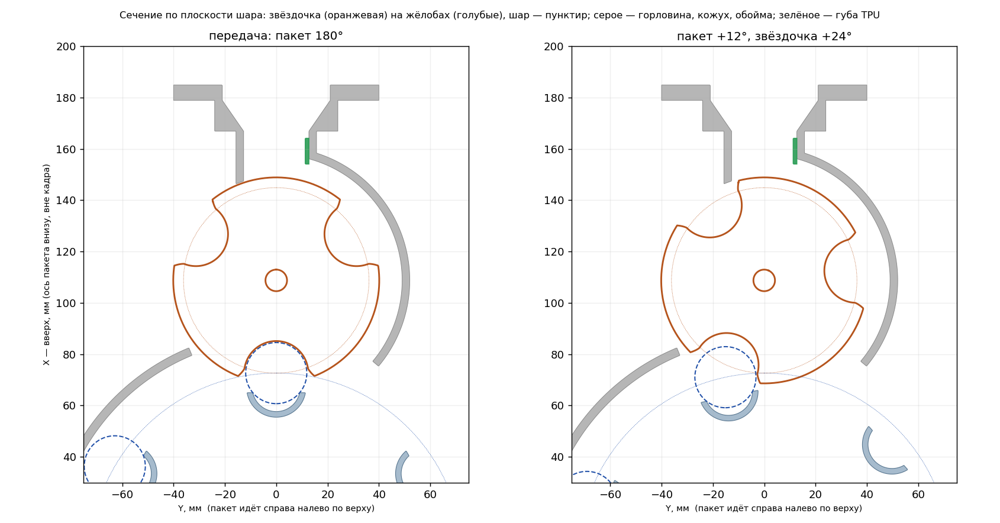

# Гатлинг QEV — промежуточные решения

Состояние на 2026-11-19. Это не митральеза и не пистоль: отдельная ветка
эскиза в папке `gatling/`. Живые генераторы:

- [`gatling/fat_coax_qev.py`](../gatling/fat_coax_qev.py) — толстый короткий соосный QEV
  (самостоятельный, не `exec` v4.4; физика dump та же);
- [`gatling/linear_breech.py`](../gatling/linear_breech.py) — одна станция: QEV на рельсах,
  фиксированный ствол, щель сверху под пульку (`exec` fat coax как библиотека). В версии стенда
  от 2026-11-16 труба камеры удлинена до **200 мм**, настоящий ствол — **400 мм**;
- [`gatling/linear_breech_bench.py`](../gatling/linear_breech_bench.py) — ручной стенд станции:
  две опоры, четыре регулируемых упора, гравитационный податчик с бункером, двухрычажная
  механическая связь с салазками и съёмные щитки (`exec` linear_breech как библиотека);
- [`gatling/feed_bench.py`](../gatling/feed_bench.py) — стенд подачи (этап 2): ручной диск с
  шестью жёлобами `front_cover_feed` на R 67 и звёздочка, сцепленная с ним 2:1, без воздуха;
- [`gatling/mqr_axis_sketch.py`](../gatling/mqr_axis_sketch.py) — ось + ступица + MQR на
  двух стойках;
- [`gatling/breech_pack.py`](../gatling/breech_pack.py) — **плотный пакет реального**
  `linear_breech` (6 станций, без лафета/ног стенда); стартовый набросок, не заморозка;
- [`gatling/breech_mechanism.py`](../gatling/breech_mechanism.py) — кулачок хода + фазы +
  подача + рукоять + шланги на том же пакете;
- [`gatling/gun_sketch.py`](../gatling/gun_sketch.py) — старый блок-силуэт (не главный вид);
- [`gatling/pack_sketch.py`](../gatling/pack_sketch.py) — технабросок пакета/оси
  (не вид изделия).

## План этапов

Записан 2026-11-19. Раньше нумерация была только в чате Cursor 13–14.11: в коде остались
пометки `stage 4/5/7`, в todo — «этап 5». Этапы 1, 3 и 6 восстановлены по порядку работ.

| № | Этап | Состояние на 2026-11-19 | Ждёт |
|---|---|---|---|
| 1 | Стенд одной станции: ход, подача, выстрел на 2 бар (`linear_breech_bench.py`) | airtight напечатан, механика нарезана; сборка 21–22.11 | трубу 50 × 1.5 |
| 2 | Подача мягких шаров на ходу: звёздочка, сцепленная с пакетом (`feed_bench.py`, ручной диск без воздуха) | решено 19.11; стенд нарисован, 31 `[OK]`, не напечатан | печать после линейного стенда |
| 3 | Кулачок: лайнер, салазка с пальцем, рельс хода на собранной станции | R 67 и лайнер Ø213 стоят; до печати решить рельс хода (вопрос 4) и нарисовать приспособление | стенд 1 |
| 4 | Подача на пакете: звёздочка 2:1 над верхней станцией | в `breech_mechanism.py` пока шнек ×6 — заменить звёздочкой; её привод от вала пакета не нарисован | этап 2 |
| 5 | Воздух на 2 станциях: MQR, ступица, 1 об/с, у MQR ≥ 1.8 бар | эскиз в `breech_mechanism.py` | этап 3, MQR, вторую станцию |
| 6 | Привод и спуск: рукоять, гашетки, рампа на штоки AirTAC | рукоять и две гашетки в эскизе, рампы нет | замеры стенда |
| 7 | Центр тяжести, ручка, ремень | эскиз | — |
| — | Заморозка габарита пакета → шесть станций → скин | — | этапы 3–5 |

### Что стенд должен измерить

Не только «работает или нет»: следующим этапам нужны числа. Чек-лист для сборки — в
[`human-todo.md`](human-todo.md).

| Замер | Как | Что решает |
|---|---|---|
| Скорость на 2 бар | хронограф или пробитие, 5–10 выстрелов | длина камеры пакета (200 или 130 мм) |
| Короткое нажатие штока AirTAC против удержания ~1 с | сравнить скорость | ширина полки FIRE у рампы спуска |
| Время перезарядки | манометр на тройнике в линии пилота, видео телефоном: от отпускания штока до 2 бар | потолок об/с |
| Сила хода | безмен на салазках: открыть и закрыть, с шаром | профиль кулачка, момент на рукояти |
| Подача | 50+ циклов: двойные, пропуски, зависания в бункере; то же с наклоном ±20° | идёт ли мягкий шар через горло Ø25.4 — такое же стоит над звёздочкой |
| Падение шара | замедленное видео: от открытия пальца до шара на жёлобе | настоящая скорость падения мягкого шара против расчёта заливки звёздочки (вопрос 6) |
| Партия шаров | Ø и масса 20 шт | зазоры горла, пальцев и жёлоба |
| Вес станции | весы | ×6 → вес пакета |
| MQR в линии (если придёт) | один канал неподвижно, повторить перезарядку | душит ли MQR вместе с M5 |

### Развилки после стенда

- **Выстрел.** Стабильно на 2 бар — станция становится модулем пакета, дальше правки только по
  замерам. Нет — чинить станцию, остальное ждёт.
- **Подача.** Решено — звёздочка (п. 11 «Зафиксировано»). Линейный стенд покажет, как мягкие
  шары идут из бункера через горло Ø25.4; такое же горло стоит над звёздочкой. Зависают в горле —
  мешалка в бункере или пружинный толкатель над звёздочкой. Двойной выпуск пальцами стенда к
  звёздочке не относится: её карман берёт один шар.
- **Скорость и перезарядка** → длина камеры пакета и целевые об/с → расход воздуха и источник.
- **Сила хода** → угол давления кулачка и передача рукояти; печать лайнера — после этого замера.

### Открытые вопросы

1. **Объём камеры.** Стенд собран на трубе 200 мм: по расчёту ≈188 см³ (101 + кольцо 47/25 ×
   70 мм ≈ 87). В «Зафиксировано» — 100 см³. Пакет уже взял 200 мм: при длине станции 750 ствол
   в пакете 508 мм (с камерой 130 мм был 578). Решать по скорости и перезарядке на стенде.
2. **Спуск в пакете не нарисован.** Шток AirTAC на угле FIRE никто не давит: гашетки эскиза —
   муфта пакета и стоп шнека. Нужна неподвижная рампа на 330–30° и гашетка, которая её отводит.
3. **AirTAC у оси.** Шесть клапанов с люльками и фитингами перекрываются у оси при любом R:
   11.3 см³ на пару соседей при R 67, фитинг порта A в 3 мм от оси. Так было с ориентации
   «рельсы к оси» (13.11); отчёты пакета и механизма печатают это строкой `hub (OPEN ISSUE)`.
   Кандидат: вынести клапаны за задние пробки штоками назад, туда же поставить рампу спуска
   (вопрос 2); линия A к пилоту гибкая на ходе. Не решено.
4. **Рельс хода против втулок.** Печатная клетка рельса хода обнимает Al-трубы там же, где ездят
   втулки салазок и носового хомута (1745 и 2312 мм³ перекрытия). До печати кулачка решить, по
   чему ездят салазки.
5. **Воздух.** Расчёт (изотерма, полный сброс): выстрел берёт около двух объёмов камеры
   атмосферного воздуха; 6 выстр/с — ~70 л/мин при 101 см³ и ~135 л/мин при 188 см³. Буфер
   0.75 л при просадке 0.2 бар отдаёт ~0.15 л, меньше одного выстрела: очередь держат источник
   и шланг. Источник воздуха гатлинга нигде не записан.
6. **Мягкие шары.** Решение по передаче на ходу принято (п. 11 «Зафиксировано»). Открыто: вес
   лёгкого шара мал против трения в горле Ø25.4 (0.8 мм на сторону), и бункер работает, пока
   изделие держат ровно. Заливка звёздочки из горловины зависит от оборотов (расчёт, свободное
   падение): шару с лопасти до дна кармана ~16 мм, это ~57 мс; от горловины до срезающей кромки
   карман проходит ~30° звёздочки — 42 мс при 1 об/с и 83 мс при 0.5 об/с. При 1 об/с шар падает
   только на ~9 мм, остальное дожимает губа TPU; при 0.5 об/с успевает сам (мягкий шар с трением
   падает медленнее). Это и проверяет стенд подачи (`feed_bench.py`).

## Зафиксировано

1. **Камера на ствол**, не одна общая QEV (не Hotchkiss/револьвер на 1 камеру).
2. **Соосный dump**, не внешний бачон сбоку: на упаковке N=6 при 100 см³ соосный
   Ø38 даёт R_pack ≈ 59 мм и момент ×1; внешний Ø38 к оси — R_pack ≈ 86 мм и I ≈ ×1.8.
   Чем толще внешний, тем хуже инерция.
3. **Толстый короткий соосный** — компромисс «Ø↑ L↓» без выноса камеры наружу.
   Стартовый габарит трубы: **алюминий 50 × 1.5** (номинал ID 47), объём **100 см³**,
   седло **Ø16** как у v4.4 (стенд соосного dump уже ок на 2 бар).
4. **v1.3 бок о бок в текущий пистоль не идёт** (слабое истечение к 2 атм); для гатлинга
   опираемся на соосную физику v4.4, не на v1.3.
5. **Короткий обрезок + крышка с фиттингом**, не длинный ствол и не дульный хомут.
   В standalone `fat_coax_qev` через камеру идёт обрезок 25 × 0.6 (~116 мм), упирающийся в губу
   передней крышки. Спереди у крышки плоский **упор** (диск шире рукава крышки и Ø25 ствола),
   в него торцом садится настоящий ствол; из упора выходит голый самоцентрирующий фиттинг
   (~Ø23.3 × 30 мм, зазор 0.25 мм, конус 8 мм к носику; **без кольца**). Шпильки кончаются
   на ярме крышки. Путь силы: седло → обрезок → губа крышки → ярмо → шпильки.
   Стендовая станция 2026-11-16 удлиняет только камеру, обрезок и прямые участки шпилек на 70 мм:
   труба камеры **200 мм**, обрезок **186 мм**, шпильки **232 мм**; standalone fat coax не изменён.
6. **Линейный затвор на рельсах** (эскиз станции): настоящий ствол **400 мм** на **двух** хомутах
   (казённик + насадка, пролёт **310 мм**) — две точки, лучше соосность; оба сидят на рельсах.
   QEV ездит по двум Al-трубам Ø8 × 1 под модулем (+Y свободен под подачу): задние втулки
   у пробки и **носовые** под передним концом камеры. Ход **≈ 66 мм** = вылет фиттинга 30
   + Ø пульки 23.8 + запас 12: закрыто — упор в ствол и фиттинг внутри; открыто — щель
   сверху. Жёлоб подачи — **часть передней крышки QEV** (одна печать `front_cover_feed`):
   низкая полутруба Ø23.1 вперёд за кончик на ~26 мм, борта ниже экватора пульки
   (Y ≤ −2), чтобы не зажимать её; толкает кончик фиттинга, жёлоб только несёт.
   Салазки болтятся к ушам задней пробки (дыры M3). Хомуты ствола переведены на поперечные
   болты вдоль Y; верхняя половина носового хомута исправлена и реально охватывает камеру.
7. **AirTAC M3R110 на пилоте** (как в пистолете, ролик снят, порты перевёрнуты:
   подача→R, глушитель→P, A→пилот): в люльке под рельсами, шток смотрит назад (−Z).
   Автонажим с салазок убран: шток давят **рукой или механизмом**. В стендовой станции
   клапан сдвинут на **16.5 мм** вперёд, чтобы открытый носовой хомут и задняя салазка
   не проходили сквозь него.
8. **Шаг пакета на 6 стволов: 68 мм**; рельсы под трубой, до соседа на шаге ≥ 0.5 мм.
9. **Ручной стенд одной станции**: две опоры 76 × 6 × 16 мм, теперь **55 см³** вместе,
   база по Z **676 мм**; Al-трубы держат пролёт. Дыры M4 в подушках — прикрутить к столу.
   Четыре разрезных упора с ушами под M3 задают оба конца хода; рельсы удлинены назад на 12 мм.
   **Гравитационный податчик**: неподвижный портал на обеих рельсах, два пальца и коромысло
   ±20°, бункер ID **74** / OD **80 мм** (конус 50 + стакан 40 мм). Двухрычажная связь
   с носовым хомутом выпускает шарик на **61.46 мм** открытия и возвращает коромысло при
   закрытии без пружины. Два съёмных щитка с лотком ограждают зону загрузки.
   Это геометрический эскиз: поштучную подачу мягких шариков, люфт и трение шарниров
   нужно проверить на стенде.
10. **Роторный коллектор: клон MQR6** (заказан 2026-11-12). Шесть независимых контуров
    M5↔M5 (не вертлюг). Чертёж: [`docs/img/mqr6_dims.png`](img/mqr6_dims.png) —
    корпус Ø46 × L90, сквозное Ø6, ротор 6×M5 + 2×M4 DP10 на Ø38, статор 6×M5 + 4×M4
    DP10 на Ø38 и 2×M3 DP8 (13 мм), ступица статора Ø20 (−0.03), шаг портов статора
    8.2×5 = 41 мм. Поиск клонов: `MQR` / `MQRF` / 气动滑环.
    **Стыковка с осью пакета** (черновик): несущая ось и подшипники отдельно; ротор MQR на
    торце ступицы (2×M4); статор к раме (Ø20 + 4×M4); через MQR только подача на R каждого
    AirTAC; dump местный. 2D: [`docs/img/gatling_mqr_axis.svg`](img/gatling_mqr_axis.svg).
    3D-блоки оси: [`gatling/mqr_axis_sketch.py`](../gatling/mqr_axis_sketch.py) — вал на
    двух маленьких стойках + ступица + ротор (тёплый); статор + пластина (холодный).
    Опора пакета — подшипники, не MQR.
    **Пакет реального стенда** (без лафета/ног): [`gatling/breech_pack.py`](../gatling/breech_pack.py)
    — 6× `linear_breech` (закрыто, вариант `PACK_STATION`), геометрия из `fat_coax_qev` +
    рельсы/салазки/AirTAC. Ориентация: **рельсы/AirTAC к оси**, подача наружу. С 2026-11-19
    зазор 0.5 мм до соседа держат все детали станции, кроме AirTAC: салазки и носовой хомут
    стоят на круглых лапах Ø15 вокруг рельсов (как хомуты ствола), а не на плите во всю пару
    рельсов. Предел R по лапам ≈ **66.3**, кольцо **R 67** — как у `breech_mechanism.py`.
    Шесть AirTAC у оси перекрываются при любом R (вопрос 3 в «Плане этапов»). Сзади обрезано
    по торцу задней пробки. Ствол **508 мм** при станции 750 (с камерой 130 мм был 578). Скин:
    плиты + голые стволы + казённый кожух только над QEV. Со скином **832 × 189 × 190 мм** —
    **набросок, не заморозка**. Хомуты ствола — flush M3 в стенке кольца, без выносных ушей.

11. **Подача шаров — звёздочка, сцепленная с пакетом** (решение владельца 2026-11-19). Шар на
    открытом жёлобе лежит на внутренних бортах: центр на **5.6 мм** выше оси ствола, то есть на
    **R 72.6** при R пакета 67 — от этого радиуса считаются звёздочка, обойма и кожух. Звёздочка
    с тремя карманами вращается вдвое быстрее пакета (**58/29, m 2.5**). Карманы стоят на
    **R 36.1** — половине радиуса центров шаров, межосевое расстояние **108.75** равно сумме, и
    пакет со звёздочкой катятся друг по другу, как шестерни: в точке передачи карман и жёлоб идут
    с одной скоростью (**0.995**), шар опускается на борта жёлоба, а не падает в движущуюся цель.
    Карманы нарезаны обкаткой — следом шара по всему зацеплению, поэтому шар выходит из кармана
    без задевания. Звёздочку заливает горловина Ø25.4 сверху; её кромка по ходу срезает лишнее
    на радиусе кожуха, следующий шар упирается в неё на 4.7 мм ниже центра; губа TPU на кромке —
    настройка под мягкие шары. Бросок в движущийся жёлоб (ветка `spin_hopper`) не продолжается:
    он работает только на малых оборотах (вопрос 6). Стенд — `feed_bench.py`.

    

    Сечение по плоскости шара из `feed_bench.py` (2026-11-19): слева момент передачи, справа
    пакет ушёл на 12° — шар едет с жёлобом, карман поднимается и отходит.

### Ход одного QEV (со стенда)

Из [`linear_breech.py`](../gatling/linear_breech.py) / стенда:

| | мм | что |
|---|---|---|
| **STROKE** | **65.8** | `FIT_INSERT` 30 + Ø пульки 23.8 + запас 12 |
| закрыто (мёртвая точка) | dz = 0 | фиттинг в стволе, упор в казённый торец |
| открыто (мёртвая точка) | dz = −65.8 | щель под пульку, жёлоб на крышке |

Сброс пилота на этом стенде — ручной, отдельным нажатием штока AirTAC после закрытия;
автоматического пальца на салазках нет.

### Закон «угол → ход» (бумага, без тела кулачка)

Угол φ — положение ствола в пакете (0° = выстрел). Ход u∈[0,1], dz = −STROKE·u.
Плавные рампы — полукосинус; полки — мёртвые точки стенда.

| φ | фаза | u | dz | что происходит |
|---|---|---|---|---|
| 330°…30° | **FIRE** | 0 | 0 | закрыто; dump при посадке |
| 30°…120° | **OPEN** | 0→1 | 0→−65.8 | извлечение фиттинга |
| 120°…240° | **LOAD** | 1 | −65.8 | окно подачи (бункер сверху) |
| 240°…330° | **CLOSE** | 1→0 | −65.8→0 | досылка пульки, посадка |

Окно подачи = полка LOAD (120° ширина). Соседи на 60°: в любой момент не больше
двух станций на полной полке OPEN/LOAD с близким Z — зазор ядра как у закрытого пакета.

Реализация кулачка и фаз: [`breech_mechanism.py`](../gatling/breech_mechanism.py).

**Кулачок (модель):** неподвижный **внешний лайнер** (канавка на R 104, Ø213) сзади
казны — барабан в ступице задевал веб L-пальца салазок на открытии. Палец толкателя
наружу (+Y). Печатный **рельс хода** (клетка вокруг Al-труб, L≈302) на полный ход 65.8;
сосед клеток ≥ 0.5 → R 66, лапы направляющих → **R 67** (старт 58.5). Клетка стоит там же,
где ездят втулки салазок (вопрос 4). Кожух огибает лайнер и рельс, открытая салазка внутри:
оболочка **Ø218** (CLEAR 15). В чертеже — **открытая рама** (кольца +
лонжероны), не сплошной кожух. Шланги PORT_R_SHIFT 12. Сборка перевёрнута 180° —
**бункер сверху** на кольце казённика с крышкой. **Шнек ×6** (bevel 1:1 + spur ×6 →
6 пулек Ø23.8 / оборот, середина ~180°). **Обойма** 170–310°. Рукоять сбоку; две
гашетки; **ручка в ЦТ** + ремень. **Воздух:** MQR на мягкой муфте; вал Ø16 на **2 подшипниках в дисках рамы**
(≈6202, OD36×14; MQR нагрузку не несёт); 6×M5→R; буфер ≈0.75 л; дедмен.
Длина станции 750. **Не заморозка.**


Прогон standalone `gatling/fat_coax_qev.py` (2026-11-12): камера **101 см³**, труба
**50 × 1.5 × 130 мм** (~80 г Al), модуль Ø50 (уши 66), длина до кончика фиттинга ≈ 202 мм,
обрезок 116 мм, упор Ø36.8, фиттинг Ø23.3 + конус 8 мм; все проверки `[OK]`.

Прогон `gatling/linear_breech.py` (2026-11-16, после импорта GPT): труба камеры **200 мм**,
обрезок **186 мм**, шпильки **232 мм**, настоящий ствол **400 мм**, рельсы **742 мм**,
пролёт хомутов **310 мм**; ход 65.8 мм. **35 `[OK]`, 0 `[FAIL]`**.

Прогон `gatling_linear_breech_bench.py` (2026-11-16): две опоры **55 см³**, база **676 мм**,
рельсы **754.4 мм**, четыре упора, бункер, рычажная связь и щитки. Подача рассчитана на выпуск
при **61.46 мм** открытия. **549 `[OK]`, 0 `[FAIL]`**, включая 33 положения привода.
Мягкие шарики, трение и люфт этими проверками не доказаны — нужен стендовый тест.

**Перекладка под станцию 200 мм (2026-11-19).** `[FAIL]` от 16.11 давала юбка нового носового
хомута: плита во всю пару рельсов смотрит к оси, и у соседей такие плиты (как и плиты салазок)
сходятся вплоть до R ≈ 73; длину 756 давали рельсы на 6 мм за дулом. В `linear_breech.py`
добавлен вариант `PACK_STATION`: салазки и носовой хомут на лапах Ø15 вокруг рельсов, рельсы
кончаются у дула. Он включается только в режиме библиотеки — отдельный запуск и стенд строят
прежние детали (STL стенда после правки совпали байт в байт, 549 `[OK]`). Прогоны:
`breech_pack.py` — **12 `[OK]`** (R 67, зазор станций 1.22 мм, станция 750 мм),
`breech_mechanism.py` — **27 `[OK]`** (R 67, лайнер Ø213, рама Ø218, 1033 × 306 × 280 мм).
Открыто и выведено в отчёты: AirTAC у оси (вопрос 3) и клетка рельса хода на месте втулок
(вопрос 4). Картинки пакета выше сделаны до перекладки, при R 58.5.

### Стенд подачи (звёздочка)

[`feed_bench.py`](../gatling/feed_bench.py), 2026-11-19. Диск с шестью жёлобами на R 67 крутят
рукоятью R 80. Вал Ø10 стоит в трёх 6000: два за диском, третий в передней плите. Звёздочка
толщиной 16 мм (лопасти R 40.1) сидит на валу Ø8 в 608; её шестерня 29 зубьев зацеплена с
колесом 58 на валу пакета, перед жёлобами. Над звёздочкой горловина и чашка на 34–39 шаров.
Кожух держит шар в кармане на 15–130° звёздочки. Обойма на 202–298° пакета держит шар на
жёлобе до угла, где его поймал бы кончик фиттинга. Толкатель на 304° сбрасывает шар в лоток.
Опорная и передняя плиты — фанера или МДФ (выгружены STEP), остальное печатается. Прогон:
**31 `[OK]`**. Звёздочка проходит мимо жёлоба с зазором 2.83 мм, после передачи отпускает шар
с зазором 0.59 мм, несомый шар опускается на борта, не врезаясь. Шестерни — без натяга, обойма
стоит в 1.5 мм от шара на бортах, все неподвижные детали держатся на плитах. Выгрузка:
`exports/gatling_feed_bench/` (`chute` ×6 — обычный PLA, не airtight). Из ветки
`cursor/gatling-feed-bench-2946` взяты диск, жёлоба, обойма, толкатель, лоток, чашка и рукоять.
При переносе исправлено: обойма считала шар лежащим на оси ствола (на бортах он упёрся бы в неё
на ~4 мм); опора чашки ни к чему неподвижному не крепилась (стойки «стояли на торце»
вращающегося диска); рукоять за оборот врезалась в опорную плиту и задний корпус подшипника
(4097 и 2483 мм³). Дозаторы ветки A1 (шнек) и A4 (пальцы) остаются в ней. Мягкие шары, заливку
на скорости и длину губы TPU модель не доказывает — это работа стенда.

## Ещё не рисуем

- Обвязка редуктора и стойка хронографа на breech-стенде.
- Лафет/станок (не в этом проходе).
- Заморозка габарита пакета — только после стенда кулачка (см. [`human-todo.md`](human-todo.md)).

## Запуск

```sh
export LANG=C.UTF-8 LC_ALL=C.UTF-8
freecadcmd -c "REPO='$PWD'; exec(open('gatling/fat_coax_qev.py').read())"
freecadcmd -c "REPO='$PWD'; exec(open('gatling/linear_breech.py').read())"
freecadcmd -c "REPO='$PWD'; exec(open('gatling/linear_breech_bench.py').read())"
freecadcmd -c "REPO='$PWD'; exec(open('gatling/feed_bench.py').read())"
freecadcmd -c "REPO='$PWD'; exec(open('gatling/mqr_axis_sketch.py').read())"
freecadcmd -c "REPO='$PWD'; exec(open('gatling/breech_pack.py').read())"
freecadcmd -c "REPO='$PWD'; exec(open('gatling/breech_mechanism.py').read())"
freecadcmd -c "REPO='$PWD'; exec(open('gatling/gun_sketch.py').read())"
freecadcmd -c "REPO='$PWD'; exec(open('gatling/pack_sketch.py').read())"
```

Выгрузка: `exports/gatling_fat_coax_qev/` (`front_cover`, не `front_plug` / не хомут);
`exports/gatling_linear_breech/` (`carriage`, `barrel_clamp`, `barrel_collar`, `front_cover_feed`);
`exports/gatling_linear_breech_bench/` (`foot_front`, `foot_rear`, `nose_clamp`, `link_*`,
`rail_stop_left/right`, `barrel_clamp`, `barrel_collar`, `airtac_cradle`, `feeder_*`).
`exports/gatling_feed_bench/` (`chute`, `disk`, `star`, `star_gear`, `pack_gear`, `guard`,
`feed_head`, `hopper`, `kicker_tray`, `crank`, `housing`; плиты `front_plate`, `base` — STEP под резку).
Прежних `carriage_handle` и общего `rail_stop` больше нет. Есть `[FAIL]` — не слайсить.

Печать стенда (PLA, на Mac с Bambu Studio). **2026-11-18 раскладка обновлена** для полного
податчика, рычажной связи, щитков и раздельных упоров. `make gatling-stl` пересобирает и проверяет
свежие STL; `make gatling-plates` дополнительно нарезает весь комплект. Только нарезка после
готовой выгрузки:

```sh
sh gatling/linear_breech_bench_plates.sh
```

Актуальные проекты в `exports/print/`:

- `gatling_breech_feeder_04.3mf` — рама и коромысло податчика, разные верхний и нижний пальцы,
  четыре детали рычажной связи: сопло **0.4**, 4 стенки, 30 % гироид, поддержки и брим 5;
  **1 стол, 1 ч 53 мин, 38 г**. Мелкие посадки и рабочие поверхности не переведены на 0.8.
- `gatling_breech_bench_08.3mf` — опоры, салазки, носовой хомут с журналом, два левых и два правых
  упора, хомуты ствола, люлька AirTAC, ярмо, шаблон, конус, нижняя планка портала, бункер и два
  щитка: сопло **0.8**, 2 стенки, 30 % гироид, поддержки и брим 5; **2 стола:
  3 ч 14 мин / 205 г + 2 ч 00 мин / 109 г**. Отверстия под рельсы и M3 после печати рассверлить.
- `gatling_breech_bench_airtight.3mf` — пробка, седло и крышка с жёлобом: сопло 0.4, airtight,
  **без поддержек**, брим 5; 6 ч 01 мин / 127 г. Эти детали уже напечатаны 2026-11-17, повторный
  запуск не нужен.

Оставшийся механический комплект: **7 ч 07 мин, 352 г PLA**. Мембрана, трубы и AirTAC не
печатаются. Старый `breech_mech_plates.sh` с ручным списком STL остаётся намеренно заблокированным:
в нём прежний общий `rail_stop`, неверный `nose_clamp` и нет податчика; `gatling_breech_mech_08.3mf`
и другие прежние `.3mf` не использовать.

Станочные детали (в стенд не входят, с 2026-11-15 их две): **задний толкатель салазок** (мост
стягивается шпильками QEV между задними шайбами и ушами казённика; рельсы — сквозь отверстия
Ø8.3 в его плите) и **носовой хомут-направляющая** на трубе камеры (разрез по Y=0, 2 × M3, по
образцу хомутов ствола; отверстия под рельсы в его юбке, верх открыт прорезью — камера проходит
в 1 мм над рельсом, губа 0.35 мм не печатается). Печатные гильзы вокруг рельс и продольные тяги
убраны: тяги шли внахлёст с рельсами (1050 мм³), теперь стык 0.00 мм³. `sh gatling/linear_breech_plates.sh`
→ `gatling_breech_carriage.3mf` (PLA, сопло 0.4, прочный, 2 ч 40 мин / 50 г, брим в проекте).
Остальные части станции (хомуты, насадка, люлька, крышка с жёлобом, пробка, седло, ярмо) уже на
стендовых столах.
