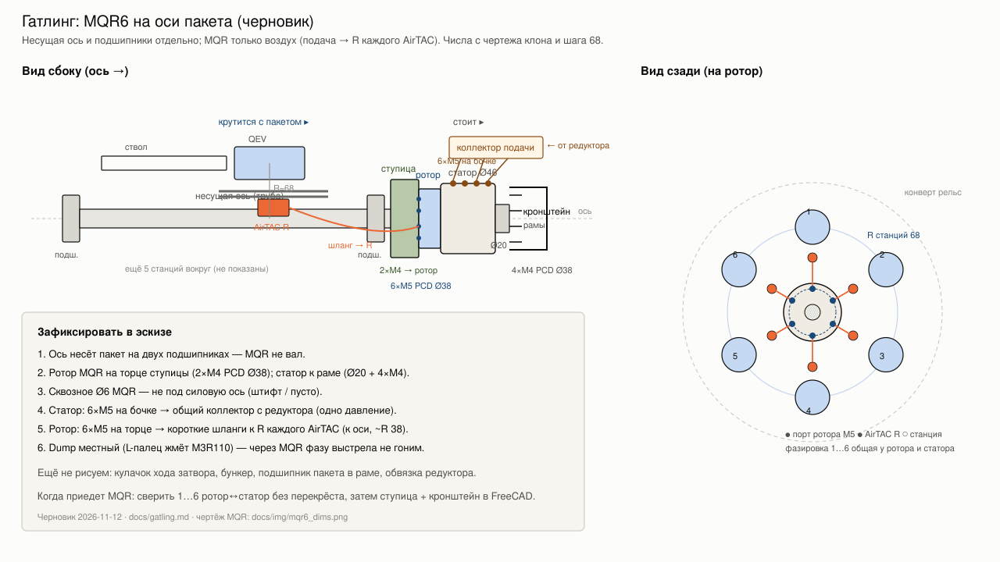

# Гатлинг QEV — промежуточные решения

Состояние на 2026-11-20. Это не митральеза и не пистоль: отдельная ветка
эскиза в папке `gatling/`. Живые генераторы:

- [`gatling/fat_coax_qev.py`](../gatling/fat_coax_qev.py) — толстый короткий соосный QEV
  (самостоятельный, не `exec` v4.4; физика dump та же);
- [`gatling/linear_breech.py`](../gatling/linear_breech.py) — одна станция: QEV на рельсах,
  фиксированный ствол, щель сверху под пульку (`exec` fat coax как библиотека). В версии стенда
  от 2026-11-16 труба камеры удлинена до **200 мм**, настоящий ствол — **400 мм**;
- [`gatling/linear_breech_bench.py`](../gatling/linear_breech_bench.py) — ручной стенд станции:
  две опоры, четыре регулируемых упора, гравитационный податчик с бункером, двухрычажная
  механическая связь с салазками и съёмные щитки (`exec` linear_breech как библиотека);
- [`gatling/feed_bench.py`](../gatling/feed_bench.py) — стенд подачи (этап 2): ручной диск с
  шестью жёлобами `front_cover_feed` на R 67 и звёздочка, сцепленная с ним 2:1, без воздуха;
- [`gatling/mqr_axis_sketch.py`](../gatling/mqr_axis_sketch.py) — ось + ступица + MQR на
  двух стойках;
- [`gatling/breech_pack.py`](../gatling/breech_pack.py) — **плотный пакет реального**
  `linear_breech` (6 станций, без лафета/ног стенда); стартовый набросок, не заморозка;
- [`gatling/breech_mechanism.py`](../gatling/breech_mechanism.py) — кулачок хода + фазы +
  AirTAC на салазках и рампа спуска + звёздочка с приводом + полая ось и MQR на том же пакете;
  зазоры по полному обороту — отдельным прогоном
  [`gatling/breech_mechanism_sweep.py`](../gatling/breech_mechanism_sweep.py);
- [`gatling/gun_sketch.py`](../gatling/gun_sketch.py) — старый блок-силуэт (не главный вид);
- [`gatling/pack_sketch.py`](../gatling/pack_sketch.py) — технабросок пакета/оси
  (не вид изделия).

## План этапов

Записан 2026-11-19. Раньше нумерация была только в чате Cursor 13–14.11: в коде остались
пометки `stage 4/5/7`, в todo — «этап 5». Этапы 1, 3 и 6 восстановлены по порядку работ.

| № | Этап | Состояние на 2026-11-19 | Ждёт |
|---|---|---|---|
| 1 | Стенд одной станции: ход, подача, выстрел на 2 бар (`linear_breech_bench.py`) | airtight напечатан, механика нарезана; сборка 21–22.11 | трубу 50 × 1.5 |
| 2 | Подача мягких шаров на ходу: звёздочка, сцепленная с пакетом (`feed_bench.py`, ручной диск без воздуха) | решено 19.11; стенд нарисован, 31 `[OK]`, не напечатан | печать после линейного стенда |
| 3 | Кулачок: лайнер, салазка с пальцем на собранной станции | R 67; 2026-11-20 лайнер Ø218 с глухой канавкой, салазки едут по Al-трубам (клетки нет, вопрос 4 закрыт); приспособление нарисовано — плоская развёртка канавки (`cam_fixture.py`, ниже) | стенд 1, печать приспособления |
| 4 | Подача на пакете: звёздочка 2:1 над верхней станцией | 2026-11-20 в `breech_mechanism.py`: звёздочка стенда, привод от венца на казённых хомутах, обойма по ходу шара | этап 2 |
| 5 | ~~Воздух на 2 станциях~~ — **отложен 2026-11-20** (владелец): воздух от большого отдельного ресивера толстым шлангом; MQR проверяет стенд 1 одним каналом. Вернуть, если стенд покажет, что MQR душит или ресивера не хватает на очередь | полая ось Al 38 × 1.5 на 6808 с линиями внутри остаётся в `breech_mechanism.py` | — |
| 6 | Привод и спуск: рукоять, гашетка, рампа на штоки AirTAC | 2026-11-20 рампа на 330–30° (AirTAC на салазках) неподвижна; управление сзади: кремнёвая рукоять под левую руку, один рычаг на две ступени — сначала воздух (дедмен), дожал — пули (трос к штырю в горловине); привод пакета от рукояти: вход на середине QEV, пара 20:20 → вал на r 135 → колесо 60 в венец 120, 0.5 оборота пакета на оборот рукояти; рычаг и ручка рукояти не нарисованы | замеры стенда (момент → числа зубьев) |
| 7 | Центр тяжести, ручка, ремень | эскиз | — |
| — | Заморозка габарита пакета → шесть станций → скин | — | этапы 3 и 4, MQR на стенде 1 |

### Что стенд должен измерить

Не только «работает или нет»: следующим этапам нужны числа. Чек-лист для сборки — в
[`human-todo.md`](human-todo.md).

| Замер | Как | Что решает |
|---|---|---|
| Скорость на 2 бар | хронограф или пробитие, 5–10 выстрелов | длина камеры пакета (200 или 130 мм) |
| Короткое нажатие штока AirTAC против удержания ~1 с | сравнить скорость | ширина полки FIRE у рампы спуска |
| Время перезарядки | по скорости: после отпускания штока выждать 0.25 / 0.5 / 1 / 2 с и выстрелить, по 3 на задержку; где скорость перестаёт расти — камера полная (манометр в линии пилота не годится: линия набирает 2 бар почти сразу, камера — через Ø1.0) | потолок об/с (вопрос 5) |
| Сила хода | безмен на салазках: открыть и закрыть, с шаром | профиль кулачка, момент на рукояти |
| Подача | 50+ циклов: двойные, пропуски, зависания в бункере; то же с наклоном ±20° | идёт ли мягкий шар через горло Ø25.4 — такое же стоит над звёздочкой |
| Падение шара | замедленное видео 240 кадр/с: от первого кадра, где шар сдвинулся, до жёлоба; падение 45.7 мм, свободно ~97 мс | ≤ ~140 мс — звёздочке на 0.5 об/с хватает падения (нужно ≥ 0.47 g на 16 мм за 83 мс); вопрос 6 |
| Партия шаров | Ø и масса 20 шт | зазоры горла, пальцев и жёлоба |
| Вес станции | весы | ×6 → вес пакета |
| MQR в линии (как придёт) | один канал неподвижно, повторить перезарядку; давление за MQR при перезарядке ≥ 1.8 бар | душит ли MQR вместе с M5. Этапа 5 нет: до пакета MQR проверяется только здесь |

### Развилки после стенда

- **Выстрел.** Стабильно на 2 бар — станция становится модулем пакета, дальше правки только по
  замерам. Нет — чинить станцию, остальное ждёт.
- **Подача.** Решено — звёздочка (п. 11 «Зафиксировано»). Линейный стенд покажет, как мягкие
  шары идут из бункера через горло Ø25.4; такое же горло стоит над звёздочкой. Зависают в горле —
  мешалка в бункере или пружинный толкатель над звёздочкой. Двойной выпуск пальцами стенда к
  звёздочке не относится: её карман берёт один шар.
- **Скорость и перезарядка** → длина камеры пакета и целевые об/с → расход воздуха и источник.
- **Сила хода** → угол давления кулачка и передача рукояти; печать лайнера — после этого замера.

### Открытые вопросы

1. **Объём камеры.** Стенд собран на трубе 200 мм: по расчёту ≈188 см³ (101 + кольцо 47/25 ×
   70 мм ≈ 87). В «Зафиксировано» — 100 см³. Пакет уже взял 200 мм: при длине станции 750 ствол
   в пакете 508 мм (с камерой 130 мм был 578). Решать по скорости и перезарядке на стенде.
2. **Спуск — решено 2026-11-20** (ниже, «Компоновка задней части»). Неподвижная рампа на
   330–30°, гашетка под пакетом.
3. **AirTAC у оси — решено 2026-11-20.** Клапан едет на салазках за мостом, шток назад; у оси
   больше ничего не сходится.
4. **Рельс хода — решено 2026-11-20.** Салазки и носовой хомут едут прямо по Al-трубам, как на
   стенде; печатной клетки нет, трубы кончаются в заднем диске на оси.
5. **Воздух.** Расчёт (изотерма, полный сброс): выстрел берёт около двух объёмов камеры
   атмосферного воздуха; 6 выстр/с — ~70 л/мин при 101 см³ и ~135 л/мин при 188 см³; на рабочем
   темпе 3 выстр/с (п. 12 «Зафиксировано») вдвое меньше — ~35 и ~68 л/мин. Буфера
   нет (снят 2026-11-20): бак 0.75 л при просадке 0.2 бар отдавал ~0.15 л, меньше одного
   выстрела, и очередь всё равно держали источник и шланг. Воздух идёт толстым шлангом от
   ресивера через дедмен прямо в статор MQR. Источник — **большой отдельный ресивер**
   (п. 13 «Зафиксировано»); его объём и давление ещё не записаны.
   Перезарядка (расчёт 2026-11-20, сверен с v1.1: 100 см³ за ~0.5 с): камера наполняется только
   через Ø1.0 в диафрагме (0.79 мм² против 5.5 у AirTAC), время растёт с объёмом — ~0.5 с на
   101 см³ и ~0.93 с на 188 см³ (изотерма/адиабата 0.7–1.5 с). AirTAC в гатлинге нормально
   открыт: камера заряжается весь оборот, кроме нажатия, ~330°. На 0.5 об/с это ~1.8 с — запас ~2×
   у 188 см³; потолок ~5.5 выстр/с у 188 см³ и ~10 у 101 см³. Рампа спуска (этап 6) должна
   давить шток коротко: удержание съедает время заряда.
6. **Мягкие шары.** Решение по передаче на ходу принято (п. 11 «Зафиксировано»). Открыто: вес
   лёгкого шара мал против трения в горле Ø25.4 (0.8 мм на сторону), и бункер работает, пока
   изделие держат ровно. Заливка звёздочки из горловины зависит от оборотов (расчёт, свободное
   падение): шару с лопасти до дна кармана ~16 мм, это ~57 мс; от горловины до срезающей кромки
   карман проходит ~30° звёздочки — 42 мс при 1 об/с и 83 мс при 0.5 об/с. При 1 об/с шар падает
   только на ~9 мм, остальное дожимает губа TPU; при 0.5 об/с успевает сам (мягкий шар с трением
   падает медленнее). Это и проверяет стенд подачи (`feed_bench.py`). Рабочий темп — 0.5 об/с
   (п. 12 «Зафиксировано»), запас по заливке там ~1.5×.
   Если понадобится 1 об/с (обсуждение 2026-11-19…20, по аналогам), в запасе два приёма без смены
   схемы: (а) **широкое дно бункера** — бункер над 90–120° хода звёздочки вместо круглой
   горловины, как высевающий диск сеялки: заливка 125–167 мс при 1 об/с; (б) **поджим столбика
   в горловине**, как в пейнтбольных подавалках (US7343909): лопасть в бункере от вала
   звёздочки через спиральную пружину, шар вталкивается в карман, а не падает; заодно меньше
   зависимость от наклона и зависаний. Вариант (б') — радиальный вентилятор в горловину.
   Проверено и отброшено: вращающийся вместе с пакетом бункер на оси (по патенту US8136515) —
   рельсы станций (12 × Ø8 на r 38.9) закрывают ядро: щели 16 и ~8 мм против шара Ø23.8, а
   центробежная сила при 1 об/с на r 72.6 — 0.3 g, меньше веса; магазины на каждой станции вдоль
   ствола — ~14 шаров на ствол, больше только змейкой с поворотами, рост рамы до ~Ø255.

### Компоновка задней части (решено 2026-11-20)

Владелец выбрал из трёх вариантов, проверенных пробными телами:

- K1 — клапан на пакете за открытой салазкой, 1087 мм;
- **K2 — клапан на салазках, 1071 мм**;
- K3 — шесть клапанов на раме и кулачок на оси, 1051 мм; но сброс пилота шёл бы через MQR, а это
  против п. 10 «dump местный».

Реализовано в [`breech_mechanism.py`](../gatling/breech_mechanism.py), числа из его отчёта:

- **AirTAC на салазках.** Кронштейн на заднем торце моста (ухо 30°, шпилька QEV), корпус на
  r 74.5–92.5, шток назад, фитинги в стороны. Линия A к пилоту жёсткая: 49 мм трубки 6 × 4,
  0.62 см³ при объёме пилота 1.69 см³; на стенде клапан тоже рядом с QEV. На ходе гнётся линия R
  (подача). Станции с клапанами и линиями расходятся с соседями на всех фазах.
- **Рампа спуска.** Неподвижная, на r 83.5 под пакетом (сектор FIRE), в 1 мм за свободным
  штоком. Касание 332–28°, переключение (2.0 мм хода, как у пистолета) 335.5–24.5°, полный
  нажим 2.5 мм на 340–20°; вне 330–30° нажима нет. При нажиме корпус клапана в 0.5 мм от рампы.
  С 2026-11-20 рампа стоит в позе нажима постоянно, стрельбу включает воздух (ниже, «Управление
  сзади»). Нажим толкает QEV вперёд, в упор ствола. Ширину полки FIRE решит замер
  «короткое нажатие против удержания».
- **Управление сзади — кремнёвая рукоять и один рычаг (2026-11-20, по просьбе владельца).**
  Рампа стоит **неподвижно в позе нажима** на колодке внутри лайнера (2 × M3 во вставки,
  отверстия глухие, стенки остаётся 2.5 мм). Пока есть воздух, стреляет каждая станция на 330–30°.
  - **Рукоять** деревянная, загибается вниз за задней плитой, как у кремнёвого пистолета; на конце
    латунное яблоко. Длина по оси 181 мм, сечение ~38 × 31 в шейке, ~54 × 40 у яблока. Плита R 50
    держит и статор MQR, и рукоять; к ободу заднего диска подшипника привязана четырьмя стойками Ø8
    (раньше плита висела в воздухе).
  - **Один рычаг, как у огнетушителя**: широкая пластина 14 × 24 по форме передней стороны
    рукояти, 91 мм, ось вверху сразу за плитой, свободный конец у яблока отстоит на 26 мм; ход 15°
    (22 мм на конце). Отпустил — пружина на оси раскрывает рычаг, пружина штыря закрывает
    горловину, пружина клапана — воздух.
  - **Ступень 1 (0…5°, 7 мм на конце) — воздух.** Рычаг давит толкатель дедмена в рукояти; к 5°
    клапан открыт полностью (3 мм), дальше сжимается пружина перебега толкателя (8 мм к 15°).
    Толкатель поставлен по реальному касанию: его торец встречает наклонную пластину краем.
  - **Ступень 2 (5…15°) — пули.** Короткий хвост рычага за осью, внутри корня рукояти, сначала
    выбирает 3 мм свободного хода троса, затем вынимает штырь Ø6 из горловины Ø25.4 на 6 мм. Трос
    654 мм: по верху слева, сквозь плиту в корень рукояти к упору. Отпустил — пружина вводит штырь на 5 мм, и столб шаров
    стоит; шар, уже прошедший ниже штыря, ещё подаётся.
  - **Воздух:** шланг от ресивера входит в яблоко; выход клапана идёт внутри рукояти вверх, сквозь
    плиту в торцевой порт статора MQR. Снаружи шлангов у руки нет.
  - Проверено геометрией: рычаг на 0…15° (шаг 2.5°) не задевает рукоять, яблоко, ось, плиту, трос,
    шланги, клапан; сжатый — в 3.4 мм от рукояти; толкатель в 0.47 от рычага в покое; к 5° клапан
    нажат на 3.00; трос выбирает 3.0 и тянет 6.00 к 15°; каналы внутри рукояти со стенкой от
    2.0 мм. Штырь закрыт — шар в любом месте сечения горловины на него налетает; открыт — проходит
    с зазором 1.0. Трос в 2.9 мм от статора. Кисть вокруг рукояти (R 36) дальше 5 мм от остального.
  - **Открыто:** что делают станции после отпускания воздуха. Дедмен 2/2 НЗ оставляет давление в
    линиях, и заряженные камеры отстреляют при проходе рампы (до шести выстрелов). Дедмен 3/2 со
    сбросом опустошит линии, но как поведут себя QEV при сбросе питания, покажет стенд 1.
  - В тот же день раньше были нарисованы и сняты: нижняя гашетка с направляющими, D-рукоять со
    скобами, мушкетная ложа с двумя спусками.
- **Привод звёздочки.** Вал к ней из-за пакета не провести: лайнер и пальцы салазок занимают
  r 101.5–107, а вал звёздочки стоит на r 104.75–112.75. Прямое зацепление 2:1 возможно только
  при колесе пакета R 72.6, а там стоят станции. Поэтому задняя плита ствола стала **венцом**:
  120 зубьев m 1.5 перед казёнными хомутами (прежняя плита заходила в закрытые QEV на ~22 см³).
  От него идёт неподвижная передача в коробке наверху: 40 | 18 → промежуточная 18 → 27 на валу
  звёздочки. Три внешних зацепления: звёздочка делает −2.000 оборота на оборот пакета.
- **Привод пакета от рукояти.** Вал рукояти поперёк стволов **справа** (+Y, если смотреть от стрелка),
  на высоте оси пакета (x 0), z 75 — середина закрытых QEV (по просьбе владельца; первый набросок
  стоял слева на z 302 перед хомутами). В коде привод рисуется слева и отражается (`CRANK_SIDE`).
  Коническая пара **20:20 m 2** переводит его на продольный вал вдоль пакета на **r 135**, снаружи
  рамы: вдоль QEV станции метут до r 96.3, а лонжерон рамы с этой стороны занимает r 100–108, так что на
  r 105 длинный вал не проходит. На продольном валу **колесо 60 m 1.5** в тот же венец 120, что
  крутит звёздочку. Итого **0.5 оборота пакета на оборот рукояти**: 60 об/мин → 3 выстр/с. Верх
  рукояти идёт назад, к стрелку. Валы Ø8 на 608: кронштейн пары (две плиты) стоит на лонжероне, бобышка у
  колеса 60 — на переднем кольце рамы. Зацепления без перекрытия по шагу зуба. Зубья пары строит
  `bevel_gear(back_cone=True)` в `ratling/gears.py` — полная высота зуба (плоская форма даёт
  половину при 45° и у колеса 48 пары 16:48 давала зубья 0.2 мм). Числа зубьев черновые: момент
  даст стенд. Рычаг и ручка рукояти — позже; вал выходит до y +218, место под руку держит
  справочное тело (ручка на R 80, кулак R 45 × 100): до ближайшей части изделия (рама) 97 мм.
- **Обойма** идёт за шаром по ходу закрытия, 202–279°, в 1.5 мм над ним. Кончается в вырезе
  казённого хомута, когда центр шара вошёл в ствол на 2 мм.
- **Лайнер Ø218 с глухой канавкой** (дно 2 мм). Прежняя канавка в лайнере Ø213 прорезала стенку
  насквозь: лайнер распадался на два кольца, а лонжероны рамы стояли на орбите пальцев. Теперь
  лайнер сам рама вокруг кулачка, лонжероны начинаются перед ним.
- **Полая ось Al 38 × 1.5** (труба камеры со стенда митральезы) на двух 6808 (40 × 52 × 7) с
  проставкой 1 мм, между подшипниками 57 мм. Шесть линий 1/8" (6 мм) идут внутри оси от окон в
  ступице пакета к ротору MQR, и ни одна вращающаяся линия не пересекает неподвижную деталь.
  Прежние линии за оборот проходили сквозь диск подшипника, буфер и раму.
  MQR остаётся сзади. Гильза с MQR внутри вплотную к пакету дала бы ~942 мм, но из имеющихся
  труб её не сделать: нужен внутренний диаметр от 58–66 мм.
- **Габарит** 1222 × 330 × 418 мм (было 1033 × 306 × 280; 1085 × 423 × 365 до заднего управления). Ширину задают коробка передачи
  звёздочки слева (y −112) и выход вала рукояти справа (y +218); рычаг с ручкой добавят ещё. Длина
  выросла из-за хода клапанов назад, заднего узла и рукояти за ним (+137 мм); высота — из-за чашки
  бункера со стенда подачи (верх r 224 вместо 160) и шланга от ресивера, который свисает из яблока
  рукояти.

Не нарисовано: болты кронштейна клапана, коллектор 1→6 на статоре MQR, рычаг и ручка рукояти. Шар лежит на бортах жёлоба на 5.6 мм выше оси
ствола и при досылке встречает торец ствола. Это поведение самой станции, его покажет стенд 1.

## Зафиксировано

1. **Камера на ствол**, не одна общая QEV (не Hotchkiss/револьвер на 1 камеру).
2. **Соосный dump**, не внешний бачон сбоку: на упаковке N=6 при 100 см³ соосный
   Ø38 даёт R_pack ≈ 59 мм и момент ×1; внешний Ø38 к оси — R_pack ≈ 86 мм и I ≈ ×1.8.
   Чем толще внешний, тем хуже инерция.
3. **Толстый короткий соосный** — компромисс «Ø↑ L↓» без выноса камеры наружу.
   Стартовый габарит трубы: **алюминий 50 × 1.5** (номинал ID 47), объём **100 см³**,
   седло **Ø16** как у v4.4 (стенд соосного dump уже ок на 2 бар).
4. **v1.3 бок о бок в текущий пистоль не идёт** (слабое истечение к 2 атм); для гатлинга
   опираемся на соосную физику v4.4, не на v1.3.
5. **Короткий обрезок + крышка с фиттингом**, не длинный ствол и не дульный хомут.
   В standalone `fat_coax_qev` через камеру идёт обрезок 25 × 0.6 (~116 мм), упирающийся в губу
   передней крышки. Спереди у крышки плоский **упор** (диск шире рукава крышки и Ø25 ствола),
   в него торцом садится настоящий ствол; из упора выходит голый самоцентрирующий фиттинг
   (~Ø23.3 × 30 мм, зазор 0.25 мм, конус 8 мм к носику; **без кольца**). Шпильки кончаются
   на ярме крышки. Путь силы: седло → обрезок → губа крышки → ярмо → шпильки.
   Стендовая станция 2026-11-16 удлиняет только камеру, обрезок и прямые участки шпилек на 70 мм:
   труба камеры **200 мм**, обрезок **186 мм**, шпильки **232 мм**; standalone fat coax не изменён.
6. **Линейный затвор на рельсах** (эскиз станции): настоящий ствол **400 мм** на **двух** хомутах
   (казённик + насадка, пролёт **310 мм**) — две точки, лучше соосность; оба сидят на рельсах.
   QEV ездит по двум Al-трубам Ø8 × 1 под модулем (+Y свободен под подачу): задние втулки
   у пробки и **носовые** под передним концом камеры. Ход **≈ 66 мм** = вылет фиттинга 30
   + Ø пульки 23.8 + запас 12: закрыто — упор в ствол и фиттинг внутри; открыто — щель
   сверху. Жёлоб подачи — **часть передней крышки QEV** (одна печать `front_cover_feed`):
   низкая полутруба Ø23.1 вперёд за кончик на ~26 мм, борта ниже экватора пульки
   (Y ≤ −2), чтобы не зажимать её; толкает кончик фиттинга, жёлоб только несёт.
   Салазки болтятся к ушам задней пробки (дыры M3). Хомуты ствола переведены на поперечные
   болты вдоль Y; верхняя половина носового хомута исправлена и реально охватывает камеру.
7. **AirTAC M3R110 на пилоте** (как в пистолете, ролик снят, порты перевёрнуты:
   подача→R, глушитель→P, A→пилот): в люльке под рельсами, шток смотрит назад (−Z).
   Автонажим с салазок убран: шток давят **рукой или механизмом**. В стендовой станции
   клапан сдвинут на **16.5 мм** вперёд, чтобы открытый носовой хомут и задняя салазка
   не проходили сквозь него.
8. **Шаг пакета на 6 стволов: 68 мм**; рельсы под трубой, до соседа на шаге ≥ 0.5 мм.
9. **Ручной стенд одной станции**: две опоры 76 × 6 × 16 мм, теперь **55 см³** вместе,
   база по Z **676 мм**; Al-трубы держат пролёт. Дыры M4 в подушках — прикрутить к столу.
   Четыре разрезных упора с ушами под M3 задают оба конца хода; рельсы удлинены назад на 12 мм.
   **Гравитационный податчик**: неподвижный портал на обеих рельсах, два пальца и коромысло
   ±20°, бункер ID **74** / OD **80 мм** (конус 50 + стакан 40 мм). Двухрычажная связь
   с носовым хомутом выпускает шарик на **61.46 мм** открытия и возвращает коромысло при
   закрытии без пружины. Два съёмных щитка с лотком ограждают зону загрузки.
   Это геометрический эскиз: поштучную подачу мягких шариков, люфт и трение шарниров
   нужно проверить на стенде.
10. **Роторный коллектор: клон MQR6** (заказан 2026-11-12). Шесть независимых контуров
    M5↔M5 (не вертлюг). Чертёж: [`docs/img/mqr6_dims.png`](img/mqr6_dims.png) —
    корпус Ø46 × L90, сквозное Ø6, ротор 6×M5 + 2×M4 DP10 на Ø38, статор 6×M5 + 4×M4
    DP10 на Ø38 и 2×M3 DP8 (13 мм), ступица статора Ø20 (−0.03), шаг портов статора
    8.2×5 = 41 мм. Поиск клонов: `MQR` / `MQRF` / 气动滑环.
    **Стыковка с осью пакета** (черновик): несущая ось и подшипники отдельно; ротор MQR на
    торце ступицы (2×M4); статор к раме (Ø20 + 4×M4); через MQR только подача на R каждого
    AirTAC; dump местный. С 2026-11-20 ось полая, **Al 38 × 1.5** на 2 × 6808: шесть линий подачи
    идут внутри неё от ступицы пакета к ротору MQR (подробнее — «Компоновка задней части»). 2D: [`docs/img/gatling_mqr_axis.svg`](img/gatling_mqr_axis.svg).
    3D-блоки оси: [`gatling/mqr_axis_sketch.py`](../gatling/mqr_axis_sketch.py) — вал на
    двух маленьких стойках + ступица + ротор (тёплый); статор + пластина (холодный).
    Опора пакета — подшипники, не MQR.
    **Пакет реального стенда** (без лафета/ног): [`gatling/breech_pack.py`](../gatling/breech_pack.py)
    — 6× `linear_breech` (закрыто, вариант `PACK_STATION`), геометрия из `fat_coax_qev` +
    рельсы/салазки/AirTAC. Ориентация: **рельсы/AirTAC к оси**, подача наружу. С 2026-11-19
    зазор 0.5 мм до соседа держат все детали станции, кроме AirTAC: салазки и носовой хомут
    стоят на круглых лапах Ø15 вокруг рельсов (как хомуты ствола), а не на плите во всю пару
    рельсов. Предел R по лапам ≈ **66.3**, кольцо **R 67** — как у `breech_mechanism.py`.
    Шесть AirTAC у оси перекрываются при любом R (вопрос 3 в «Плане этапов»). Сзади обрезано
    по торцу задней пробки. Ствол **508 мм** при станции 750 (с камерой 130 мм был 578). Скин:
    плиты + голые стволы + казённый кожух только над QEV. Со скином **832 × 189 × 190 мм** —
    **набросок, не заморозка**. Хомуты ствола — flush M3 в стенке кольца, без выносных ушей.

11. **Подача шаров — звёздочка, сцепленная с пакетом** (решение владельца 2026-11-19). Шар на
    открытом жёлобе лежит на внутренних бортах: центр на **5.6 мм** выше оси ствола, то есть на
    **R 72.6** при R пакета 67 — от этого радиуса считаются звёздочка, обойма и кожух. Звёздочка
    с тремя карманами вращается вдвое быстрее пакета (**58/29, m 2.5**). Карманы стоят на
    **R 36.1** — половине радиуса центров шаров, межосевое расстояние **108.75** равно сумме, и
    пакет со звёздочкой катятся друг по другу, как шестерни: в точке передачи карман и жёлоб идут
    с одной скоростью (**0.995**), шар опускается на борта жёлоба, а не падает в движущуюся цель.
    Карманы нарезаны обкаткой — следом шара по всему зацеплению, поэтому шар выходит из кармана
    без задевания. Звёздочку заливает горловина Ø25.4 сверху; её кромка по ходу срезает лишнее
    на радиусе кожуха, следующий шар упирается в неё на 4.7 мм ниже центра; губа TPU на кромке —
    настройка под мягкие шары. Бросок в движущийся жёлоб (ветка `spin_hopper`) не продолжается:
    он работает только на малых оборотах (вопрос 6). Стенд — `feed_bench.py`. В пакете
    (2026-11-20) звёздочку крутит венец на казённых хомутах через неподвижную передачу
    120 → 40 | 18 → 18 → 27 (m 1.5), шар передаётся в 180° (LOAD).

    

    Сечение по плоскости шара из `feed_bench.py` (2026-11-19): слева момент передачи, справа
    пакет ушёл на 12° — шар едет с жёлобом, карман поднимается и отходит.

12. **Темп — 3 выстр/с, пакет 0.5 об/с** (решение владельца 2026-11-20). Для ларпа и нёрф-игр
    этого достаточно. На 0.5 об/с карман проходит горловину за 83 мс, шару на 16 мм нужно ~57 мс:
    звёздочка заливается падением, без доработок. Быстрее — только если результат не устроит, и
    тогда сначала доработки звёздочки (вопрос 6), а не другая схема подачи.

13. **Воздух — большой отдельный ресивер** (решение владельца 2026-11-20). Толстый шланг от него
    идёт через дедмен прямо в статор MQR; буферного бака на изделии нет (0.75 л при просадке
    0.2 бар отдавал ~0.15 л — меньше выстрела). Отдельного стенда воздуха на двух станциях (этап 5)
    нет: дросселирование MQR проверяет стенд 1 одним каналом. Вернуть этап, если стенд покажет, что
    MQR душит перезарядку или ресивера не хватает на очередь.

### Ход одного QEV (со стенда)

Из [`linear_breech.py`](../gatling/linear_breech.py) / стенда:

| | мм | что |
|---|---|---|
| **STROKE** | **65.8** | `FIT_INSERT` 30 + Ø пульки 23.8 + запас 12 |
| закрыто (мёртвая точка) | dz = 0 | фиттинг в стволе, упор в казённый торец |
| открыто (мёртвая точка) | dz = −65.8 | щель под пульку, жёлоб на крышке |

Сброс пилота на этом стенде — ручной, отдельным нажатием штока AirTAC после закрытия;
автоматического пальца на салазках нет.

### Закон «угол → ход» (бумага, без тела кулачка)

Угол φ — положение ствола в пакете (0° = выстрел). Ход u∈[0,1], dz = −STROKE·u.
Плавные рампы — полукосинус; полки — мёртвые точки стенда.

| φ | фаза | u | dz | что происходит |
|---|---|---|---|---|
| 330°…30° | **FIRE** | 0 | 0 | закрыто; dump при посадке |
| 30°…120° | **OPEN** | 0→1 | 0→−65.8 | извлечение фиттинга |
| 120°…240° | **LOAD** | 1 | −65.8 | окно подачи (бункер сверху) |
| 240°…330° | **CLOSE** | 1→0 | −65.8→0 | досылка пульки, посадка |

Окно подачи = полка LOAD (120° ширина). Соседи на 60°: в любой момент не больше
двух станций на полной полке OPEN/LOAD с близким Z — зазор ядра как у закрытого пакета.

Реализация кулачка и фаз: [`breech_mechanism.py`](../gatling/breech_mechanism.py).

**Кулачок (модель):** неподвижный **внешний лайнер** сзади казны (канавка на R 104) —
барабан в ступице задевал веб L-пальца салазок на открытии. Палец толкателя наружу (+Y).
С 2026-11-20 лайнер **Ø218 с глухой канавкой** и служит рамой вокруг кулачка; салазки едут по
Al-трубам (клетки рельса хода нет), R **67** задают лапы направляющих. В чертеже — **открытая
рама** (кольца + лонжероны перед лайнером), не сплошной кожух. Модель строится сразу в итоговой
позе: **бункер и звёздочка сверху**, сектор выстрела с рампой снизу, рукоять справа (+Y),
**ручка** сверху перед коробкой передачи + петли ремня. **Воздух:** полая ось Al 38 × 1.5 на
2 × 6808, линии 1/8" внутри к ротору MQR на мягкой муфте (MQR нагрузку не несёт); буфера нет,
толстый шланг от ресивера через дедмен в статор MQR. Длина станции 750. **Не заморозка.**




Прогон standalone `gatling/fat_coax_qev.py` (2026-11-12): камера **101 см³**, труба
**50 × 1.5 × 130 мм** (~80 г Al), модуль Ø50 (уши 66), длина до кончика фиттинга ≈ 202 мм,
обрезок 116 мм, упор Ø36.8, фиттинг Ø23.3 + конус 8 мм; все проверки `[OK]`.

Прогон `gatling/linear_breech.py` (2026-11-16, после импорта GPT): труба камеры **200 мм**,
обрезок **186 мм**, шпильки **232 мм**, настоящий ствол **400 мм**, рельсы **742 мм**,
пролёт хомутов **310 мм**; ход 65.8 мм. **35 `[OK]`, 0 `[FAIL]`**.

Прогон `gatling_linear_breech_bench.py` (2026-11-16): две опоры **55 см³**, база **676 мм**,
рельсы **754.4 мм**, четыре упора, бункер, рычажная связь и щитки. Подача рассчитана на выпуск
при **61.46 мм** открытия. **549 `[OK]`, 0 `[FAIL]`**, включая 33 положения привода.
Мягкие шарики, трение и люфт этими проверками не доказаны — нужен стендовый тест.

**Перекладка под станцию 200 мм (2026-11-19).** `[FAIL]` от 16.11 давала юбка нового носового
хомута: плита во всю пару рельсов смотрит к оси, и у соседей такие плиты (как и плиты салазок)
сходятся вплоть до R ≈ 73; длину 756 давали рельсы на 6 мм за дулом. В `linear_breech.py`
добавлен вариант `PACK_STATION`: салазки и носовой хомут на лапах Ø15 вокруг рельсов, рельсы
кончаются у дула. Он включается только в режиме библиотеки — отдельный запуск и стенд строят
прежние детали (STL стенда после правки совпали байт в байт, 549 `[OK]`). Прогоны:
`breech_pack.py` — **12 `[OK]`** (R 67, зазор станций 1.22 мм, станция 750 мм),
`breech_mechanism.py` — **27 `[OK]`** (R 67, лайнер Ø213, рама Ø218, 1033 × 306 × 280 мм).
Открытые тогда AirTAC у оси (вопрос 3) и клетка рельса хода (вопрос 4) решены 2026-11-20
(«Компоновка задней части»). Картинки пакета выше сделаны до перекладки, при R 58.5.

**Прогоны 2026-11-20:** `breech_pack.py` — **13 `[OK]`** (без группы AirTAC; задняя плита перед
хомутами, 0.60 мм до QEV и хомутов), `breech_mechanism.py` — **32 `[OK]`** за ~2 мин,
1085 × 306 × 365 мм (после снятия буфера — **31 `[OK]`**, 1085 × 314 × 365); полный оборот — `breech_mechanism_sweep.py`, **24 `[OK]`** за ~4.5 мин (12 параллельных процессов
`freecadcmd`; позы пишутся в BREP и считаются независимо). Стенд не
менялся: 549 `[OK]`, STL байт в байт.

### Стенд подачи (звёздочка)

[`feed_bench.py`](../gatling/feed_bench.py), 2026-11-19. Диск с шестью жёлобами на R 67 крутят
рукоятью R 80. Вал Ø10 стоит в трёх 6000: два за диском, третий в передней плите. Звёздочка
толщиной 16 мм (лопасти R 40.1) сидит на валу Ø8 в 608; её шестерня 29 зубьев зацеплена с
колесом 58 на валу пакета, перед жёлобами. Над звёздочкой горловина и чашка на 34–39 шаров.
Кожух держит шар в кармане на 15–130° звёздочки. Обойма на 202–298° пакета держит шар на
жёлобе до угла, где его поймал бы кончик фиттинга. Толкатель на 304° сбрасывает шар в лоток.
Опорная и передняя плиты — фанера или МДФ (выгружены STEP), остальное печатается. Прогон:
**31 `[OK]`**. Звёздочка проходит мимо жёлоба с зазором 2.83 мм, после передачи отпускает шар
с зазором 0.59 мм, несомый шар опускается на борта, не врезаясь. Шестерни — без натяга, обойма
стоит в 1.5 мм от шара на бортах, все неподвижные детали держатся на плитах. Выгрузка:
`exports/gatling_feed_bench/` (`chute` ×6 — обычный PLA, не airtight). Из ветки
`cursor/gatling-feed-bench-2946` взяты диск, жёлоба, обойма, толкатель, лоток, чашка и рукоять.
При переносе исправлено: обойма считала шар лежащим на оси ствола (на бортах он упёрся бы в неё
на ~4 мм); опора чашки ни к чему неподвижному не крепилась (стойки «стояли на торце»
вращающегося диска); рукоять за оборот врезалась в опорную плиту и задний корпус подшипника
(4097 и 2483 мм³). Дозаторы ветки A1 (шнек) и A4 (пальцы) остаются в ней. Мягкие шары, заливку
на скорости и длину губы TPU модель не доказывает — это работа стенда.

### Приспособление кулачка (этап 3)

[`cam_fixture.py`](../gatling/cam_fixture.py), 2026-11-20. На стенде ось пакета проходит в 22 мм
над столом, и кольцо лайнера Ø218 при повороте ушло бы под стол на 87 мм. Поэтому канавка
**развёрнута в плоскость**: пластина несёт ту же кривую z(s), s = 104 мм × угол, и её толкают
рукой поперёк стенда. Палец встречает ту же стенку с тем же углом давления, что в лайнере
(до **32.3°**), значит сила на пластине × 0.104 м — момент, который одна станция берёт с рукояти.
Само кольцо этим не проверяется, оно печатается сразу для изделия.

- **Палец Ø5** — на полукольце, которое зажимается гайками двух шпилек QEV на заднем торце
  салазок (нужно ~5 мм резьбы сверх гайки). Кончик на r 37, как у толкателя в пакете.
- **Пластина** 244 × 84 × 10 мм: канавка 22–128° закона (8° полки FIRE, рампа OPEN 30–120°,
  8° полки LOAD), обратный ход — рампа CLOSE (она зеркальна OPEN). Концы канавки — упоры хода.
  Сверху риски через 10°, длинные на 30° и 120°; окно в верхней плите над пальцем.
- **Портал** на столе вокруг хвоста стенда: две П-стойки (на пазах M4, ±4 мм вдоль ствола —
  выставить полку FIRE на севший QEV), верхняя плита и четыре ролика **623** на торцах пластины
  у пальца (x ±18). Осевая реакция идёт в ролики, а не в трение скольжения. Стенд не меняется:
  на время теста ослабить закрытые упоры, положение «закрыто» задаёт кулачок.
- **Не проверяет** AirTAC на салазках и линию R на ходе: на стенде клапан стоит в люльке под
  рельсами. Это остаётся до салазок пакета (`PACK_STATION`).

| Угол | Пластина от начала, мм | Салазки назад, мм |
|---|---|---|
| 22° | 0 | 0 |
| 30° | 14.5 | 0 |
| 50° | 50.8 | 7.7 |
| 75° | 96.2 | 32.9 |
| 100° | 141.6 | 58.1 |
| 120° | 177.9 | 65.8 |

Прогон: **17 `[OK]`** за ~1 мин (палец в канавке на каждом градусе с зазором 0.50, пластина в
2.06 мм от стенда, портал в 4.54 мм от станции на всём ходе); `orient_check` — 5 деталей `[OK]`
без поддержек. Объёмы: пластина 197 см³, верх 92, стойки по 71, полукольцо 7.

## Ещё не рисуем

- Обвязка редуктора и стойка хронографа на breech-стенде.
- Лафет/станок (не в этом проходе).
- Заморозка габарита пакета — только после стенда кулачка (см. [`human-todo.md`](human-todo.md)).

## Запуск

```sh
export LANG=C.UTF-8 LC_ALL=C.UTF-8
freecadcmd -c "REPO='$PWD'; exec(open('gatling/fat_coax_qev.py').read())"
freecadcmd -c "REPO='$PWD'; exec(open('gatling/linear_breech.py').read())"
freecadcmd -c "REPO='$PWD'; exec(open('gatling/linear_breech_bench.py').read())"
freecadcmd -c "REPO='$PWD'; exec(open('gatling/feed_bench.py').read())"
freecadcmd -c "REPO='$PWD'; exec(open('gatling/mqr_axis_sketch.py').read())"
freecadcmd -c "REPO='$PWD'; exec(open('gatling/breech_pack.py').read())"
freecadcmd -c "REPO='$PWD'; exec(open('gatling/breech_mechanism.py').read())"
freecadcmd -c "REPO='$PWD'; exec(open('gatling/breech_mechanism_sweep.py').read())"   # полный оборот, ~4.5 мин, SWEEP_WORKERS=12
freecadcmd -c "REPO='$PWD'; exec(open('gatling/gun_sketch.py').read())"
freecadcmd -c "REPO='$PWD'; exec(open('gatling/pack_sketch.py').read())"
```

Выгрузка: `exports/gatling_fat_coax_qev/` (`front_cover`, не `front_plug` / не хомут);
`exports/gatling_linear_breech/` (`carriage`, `barrel_clamp`, `barrel_collar`, `front_cover_feed`);
`exports/gatling_linear_breech_bench/` (`foot_front`, `foot_rear`, `nose_clamp`, `link_*`,
`rail_stop_left/right`, `barrel_clamp`, `barrel_collar`, `airtac_cradle`, `feeder_*`).
`exports/gatling_feed_bench/` (`chute`, `disk`, `star`, `star_gear`, `pack_gear`, `guard`,
`feed_head`, `hopper`, `kicker_tray`, `crank`, `housing`; плиты `front_plate`, `base` — STEP под резку).
Прежних `carriage_handle` и общего `rail_stop` больше нет. Есть `[FAIL]` — не слайсить.

Печать стенда (PLA, на Mac с Bambu Studio). **2026-11-18 раскладка обновлена** для полного
податчика, рычажной связи, щитков и раздельных упоров. `make gatling-stl` пересобирает и проверяет
свежие STL; `make gatling-plates` дополнительно нарезает весь комплект. Только нарезка после
готовой выгрузки:

```sh
sh gatling/linear_breech_bench_plates.sh
```

Актуальные проекты в `exports/print/`:

- `gatling_breech_feeder_04.3mf` — рама и коромысло податчика, разные верхний и нижний пальцы,
  четыре детали рычажной связи: сопло **0.4**, 4 стенки, 30 % гироид, поддержки и брим 5;
  **1 стол, 1 ч 53 мин, 38 г**. Мелкие посадки и рабочие поверхности не переведены на 0.8.
- `gatling_breech_bench_08.3mf` — опоры, салазки, носовой хомут с журналом, два левых и два правых
  упора, хомуты ствола, люлька AirTAC, ярмо, шаблон, конус, нижняя планка портала, бункер и два
  щитка: сопло **0.8**, 2 стенки, 30 % гироид, поддержки и брим 5; **2 стола:
  3 ч 14 мин / 205 г + 2 ч 00 мин / 109 г**. Отверстия под рельсы и M3 после печати рассверлить.
- `gatling_breech_bench_airtight.3mf` — пробка, седло и крышка с жёлобом: сопло 0.4, airtight,
  **без поддержек**, брим 5; 6 ч 01 мин / 127 г. Эти детали уже напечатаны 2026-11-17, повторный
  запуск не нужен.

Оставшийся механический комплект: **7 ч 07 мин, 352 г PLA**. Мембрана, трубы и AirTAC не
печатаются. Старый `breech_mech_plates.sh` с ручным списком STL остаётся намеренно заблокированным:
в нём прежний общий `rail_stop`, неверный `nose_clamp` и нет податчика; `gatling_breech_mech_08.3mf`
и другие прежние `.3mf` не использовать.

Станочные детали (в стенд не входят, с 2026-11-15 их две): **задний толкатель салазок** (мост
стягивается шпильками QEV между задними шайбами и ушами казённика; рельсы — сквозь отверстия
Ø8.3 в его плите) и **носовой хомут-направляющая** на трубе камеры (разрез по Y=0, 2 × M3, по
образцу хомутов ствола; отверстия под рельсы в его юбке, верх открыт прорезью — камера проходит
в 1 мм над рельсом, губа 0.35 мм не печатается). Печатные гильзы вокруг рельс и продольные тяги
убраны: тяги шли внахлёст с рельсами (1050 мм³), теперь стык 0.00 мм³. `sh gatling/linear_breech_plates.sh`
→ `gatling_breech_carriage.3mf` (PLA, сопло 0.4, прочный, 2 ч 40 мин / 50 г, брим в проекте).
Остальные части станции (хомуты, насадка, люлька, крышка с жёлобом, пробка, седло, ярмо) уже на
стендовых столах.
