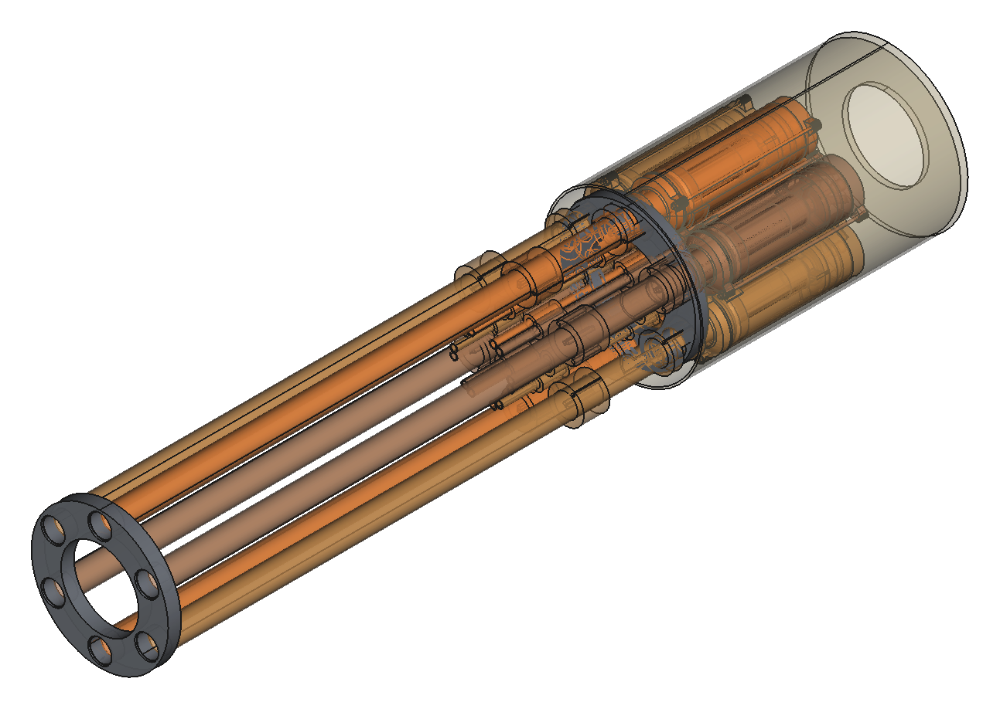
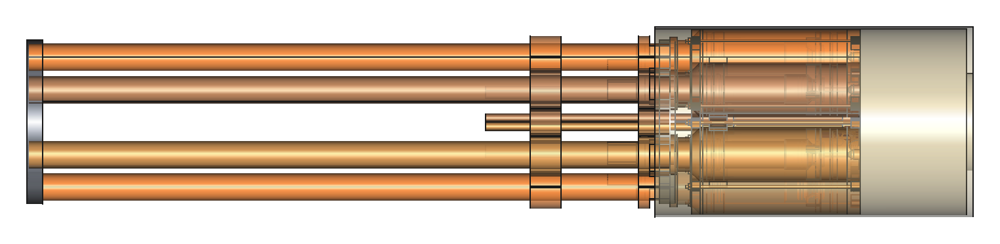

# Гатлинг QEV — промежуточные решения

Состояние на 2026-11-21. Это не митральеза и не пистоль: отдельная ветка
эскиза в папке `gatling/`. Живые генераторы:

- [`gatling/fat_coax_qev.py`](../gatling/fat_coax_qev.py) — толстый короткий соосный QEV
  (самостоятельный, не `exec` v4.4; физика dump та же);
- [`gatling/linear_breech.py`](../gatling/linear_breech.py) — одна станция: QEV на рельсах,
  фиксированный ствол, щель сверху под пульку (`exec` fat coax как библиотека). В версии стенда
  от 2026-11-16 труба камеры удлинена до **200 мм**, настоящий ствол — **400 мм**;
- [`gatling/linear_breech_bench.py`](../gatling/linear_breech_bench.py) — ручной стенд станции:
  две опоры, четыре регулируемых упора, гравитационный податчик с бункером, двухрычажная
  механическая связь с салазками и съёмные щитки (`exec` linear_breech как библиотека);
- [`gatling/feed_bench.py`](../gatling/feed_bench.py) — стенд подачи (этап 2): ручной диск с
  шестью жёлобами `front_cover_feed` на R 67 и звёздочка, сцепленная с ним 2:1, без воздуха;
- [`gatling/mqr_axis_sketch.py`](../gatling/mqr_axis_sketch.py) — ось + ступица + MQR на
  двух стойках;
- [`gatling/breech_pack.py`](../gatling/breech_pack.py) — **плотный пакет реального**
  `linear_breech` (6 станций, без лафета/ног стенда); стартовый набросок, не заморозка;
- [`gatling/breech_mechanism.py`](../gatling/breech_mechanism.py) — кулачок хода + фазы +
  AirTAC на салазках и рампа спуска + звёздочка с приводом + полая ось и MQR на том же пакете;
  зазоры по полному обороту — отдельным прогоном
  [`gatling/breech_mechanism_sweep.py`](../gatling/breech_mechanism_sweep.py), стыки деталей —
  [`gatling/breech_joints.py`](../gatling/breech_joints.py) (каждое касание закрыто крепежом или
  объявлено, «Крепёж» ниже);
- [`gatling/gun_sketch.py`](../gatling/gun_sketch.py) — старый блок-силуэт (не главный вид);
- [`gatling/pack_sketch.py`](../gatling/pack_sketch.py) — технабросок пакета/оси
  (не вид изделия).

## План этапов

Записан 2026-11-19. Раньше нумерация была только в чате Cursor 13–14.11: в коде остались
пометки `stage 4/5/7`, в todo — «этап 5». Этапы 1, 3 и 6 восстановлены по порядку работ.

| № | Этап | Состояние на 2026-11-19 | Ждёт |
|---|---|---|---|
| 1 | Стенд одной станции: ход, подача, выстрел на 2 бар (`linear_breech_bench.py`) | airtight напечатан, механика нарезана; сборка 21–22.11 | трубу 50 × 1.5 |
| 2 | Подача мягких шаров на ходу: звёздочка, сцепленная с пакетом (`feed_bench.py`, ручной диск без воздуха) | решено 19.11; стенд нарисован, 31 `[OK]`, не напечатан | печать после линейного стенда |
| 3 | Кулачок: лайнер, салазка с пальцем на собранной станции | R 67; 2026-11-20 лайнер Ø218 с глухой канавкой, салазки едут по Al-трубам (клетки нет, вопрос 4 закрыт); приспособление нарисовано — плоская развёртка канавки (`cam_fixture.py`, ниже) | стенд 1, печать приспособления |
| 4 | Подача на пакете: звёздочка 2:1 над верхней станцией | 2026-11-20 в `breech_mechanism.py`: звёздочка стенда, привод от венца на казённых хомутах, обойма по ходу шара | этап 2 |
| 5 | ~~Воздух на 2 станциях~~ — **отложен 2026-11-20** (владелец): воздух от большого отдельного ресивера толстым шлангом; MQR проверяет стенд 1 одним каналом. Вернуть, если стенд покажет, что MQR душит или ресивера не хватает на очередь | полая ось Al 38 × 1.5 на 6808 с линиями внутри остаётся в `breech_mechanism.py` | — |
| 6 | Привод и спуск: рукоять, гашетка, рампа на штоки AirTAC | **нарисован 2026-11-20**: рампа на 330–30° (AirTAC на салазках) неподвижна; управление сзади: кремнёвая рукоять под левую руку, один рычаг на две ступени — сначала воздух (дедмен), дожал — пули (трос к штырю в горловине); привод пакета от рукояти: вход на середине QEV, пара 20:20 → вал на r 135 → колесо 60 в венец 120, 0.5 оборота пакета на оборот рукояти; кривошип R 80 и ручка Ø26 × 92 на своей оси, крутится по часовой со стороны ручки (как дрель / гибкий вал) | замеры стенда (момент → числа зубьев) |
| 7 | Центр тяжести, ручка, ремень, тринога | **нарисован 2026-11-20**: масса по телам 8.30 кг, ЦТ (8, 7, 95); ручка-мост над ЦТ (стойки на лайнере и на коробке звёздочки, ЦТ ± 160), кольца ремня на стойках; снизу под ЦТ — киль с впадиной под шар Ø50 для триноги (ниже, «Масса и центр тяжести») | вес станции со стенда, MQR6 на весах; выбор триноги |
| — | Заморозка габарита пакета → шесть станций → скин | — | этапы 3 и 4, MQR на стенде 1 |

### Что стенд должен измерить

Не только «работает или нет»: следующим этапам нужны числа. Чек-лист для сборки — в
[`human-todo.md`](human-todo.md).

| Замер | Как | Что решает |
|---|---|---|
| Скорость на 2 бар | хронограф или пробитие, 5–10 выстрелов | длина камеры пакета (200 или 130 мм) |
| Короткое нажатие штока AirTAC против удержания ~1 с | сравнить скорость | ширина полки FIRE у рампы спуска |
| Время перезарядки | по скорости: после отпускания штока выждать 0.25 / 0.5 / 1 / 2 с и выстрелить, по 3 на задержку; где скорость перестаёт расти — камера полная (манометр в линии пилота не годится: линия набирает 2 бар почти сразу, камера — через Ø1.0) | потолок об/с (вопрос 5) |
| Сила хода | безмен на салазках: открыть и закрыть, с шаром | профиль кулачка, момент на рукояти |
| Подача | 50+ циклов: двойные, пропуски, зависания в бункере; то же с наклоном ±20° | идёт ли мягкий шар через горло Ø25.4 — такое же стоит над звёздочкой |
| Падение шара | замедленное видео 240 кадр/с: от первого кадра, где шар сдвинулся, до жёлоба; падение 45.7 мм, свободно ~97 мс | ≤ ~140 мс — звёздочке на 0.5 об/с хватает падения (нужно ≥ 0.47 g на 16 мм за 83 мс); вопрос 6 |
| Партия шаров | Ø и масса 20 шт | зазоры горла, пальцев и жёлоба |
| Вес станции | весы | ×6 → вес пакета |
| MQR в линии (как придёт) | один канал неподвижно, повторить перезарядку; давление за MQR при перезарядке ≥ 1.8 бар | душит ли MQR вместе с M5. Этапа 5 нет: до пакета MQR проверяется только здесь |

### Развилки после стенда

- **Выстрел.** Стабильно на 2 бар — станция становится модулем пакета, дальше правки только по
  замерам. Нет — чинить станцию, остальное ждёт.
- **Подача.** Решено — звёздочка (п. 11 «Зафиксировано»). Линейный стенд покажет, как мягкие
  шары идут из бункера через горло Ø25.4; такое же горло стоит над звёздочкой. Зависают в горле —
  мешалка в бункере или пружинный толкатель над звёздочкой. Двойной выпуск пальцами стенда к
  звёздочке не относится: её карман берёт один шар.
- **Скорость и перезарядка** → длина камеры пакета и целевые об/с → расход воздуха и источник.
- **Сила хода** → угол давления кулачка и передача рукояти; печать лайнера — после этого замера.

### Открытые вопросы

1. **Объём камеры.** Стенд собран на трубе 200 мм: по расчёту ≈188 см³ (101 + кольцо 47/25 ×
   70 мм ≈ 87). В «Зафиксировано» — 100 см³. Пакет уже взял 200 мм: при длине станции 750 ствол
   в пакете 508 мм (с камерой 130 мм был 578). Решать по скорости и перезарядке на стенде.
2. **Спуск — решено 2026-11-20** (ниже, «Компоновка задней части»). Неподвижная рампа на
   330–30°, гашетка под пакетом.
3. **AirTAC у оси — решено 2026-11-20.** Клапан едет на салазках за мостом, шток назад; у оси
   больше ничего не сходится.
4. **Рельс хода — решено 2026-11-20.** Салазки и носовой хомут едут прямо по Al-трубам, как на
   стенде; печатной клетки нет, трубы кончаются в заднем диске на оси.
5. **Воздух.** Расчёт (изотерма, полный сброс): выстрел берёт около двух объёмов камеры
   атмосферного воздуха; 6 выстр/с — ~70 л/мин при 101 см³ и ~135 л/мин при 188 см³; на рабочем
   темпе 3 выстр/с (п. 12 «Зафиксировано») вдвое меньше — ~35 и ~68 л/мин. Буфера
   нет (снят 2026-11-20): бак 0.75 л при просадке 0.2 бар отдавал ~0.15 л, меньше одного
   выстрела, и очередь всё равно держали источник и шланг. Воздух идёт толстым шлангом от
   ресивера через дедмен прямо в статор MQR. Источник — **большой отдельный ресивер**
   (п. 13 «Зафиксировано»); его объём и давление ещё не записаны.
   Перезарядка (расчёт 2026-11-20, сверен с v1.1: 100 см³ за ~0.5 с): камера наполняется только
   через Ø1.0 в диафрагме (0.79 мм² против 5.5 у AirTAC), время растёт с объёмом — ~0.5 с на
   101 см³ и ~0.93 с на 188 см³ (изотерма/адиабата 0.7–1.5 с). AirTAC в гатлинге нормально
   открыт: камера заряжается весь оборот, кроме нажатия, ~330°. На 0.5 об/с это ~1.8 с — запас ~2×
   у 188 см³; потолок ~5.5 выстр/с у 188 см³ и ~10 у 101 см³. Рампа спуска (этап 6) должна
   давить шток коротко: удержание съедает время заряда.
6. **Мягкие шары.** Решение по передаче на ходу принято (п. 11 «Зафиксировано»). Открыто: вес
   лёгкого шара мал против трения в горле Ø25.4 (0.8 мм на сторону), и бункер работает, пока
   изделие держат ровно. Заливка звёздочки из горловины зависит от оборотов (расчёт, свободное
   падение): шару с лопасти до дна кармана ~16 мм, это ~57 мс; от горловины до срезающей кромки
   карман проходит ~30° звёздочки — 42 мс при 1 об/с и 83 мс при 0.5 об/с. При 1 об/с шар падает
   только на ~9 мм, остальное дожимает губа TPU; при 0.5 об/с успевает сам (мягкий шар с трением
   падает медленнее). Это и проверяет стенд подачи (`feed_bench.py`). Рабочий темп — 0.5 об/с
   (п. 12 «Зафиксировано»), запас по заливке там ~1.5×.
   Если понадобится 1 об/с (обсуждение 2026-11-19…20, по аналогам), в запасе два приёма без смены
   схемы: (а) **широкое дно бункера** — бункер над 90–120° хода звёздочки вместо круглой
   горловины, как высевающий диск сеялки: заливка 125–167 мс при 1 об/с; (б) **поджим столбика
   в горловине**, как в пейнтбольных подавалках (US7343909): лопасть в бункере от вала
   звёздочки через спиральную пружину, шар вталкивается в карман, а не падает; заодно меньше
   зависимость от наклона и зависаний. Вариант (б') — радиальный вентилятор в горловину.
   Проверено и отброшено: вращающийся вместе с пакетом бункер на оси (по патенту US8136515) —
   рельсы станций (12 × Ø8 на r 38.9) закрывают ядро: щели 16 и ~8 мм против шара Ø23.8, а
   центробежная сила при 1 об/с на r 72.6 — 0.3 g, меньше веса; магазины на каждой станции вдоль
   ствола — ~14 шаров на ствол, больше только змейкой с поворотами, рост рамы до ~Ø255.

### Компоновка задней части (решено 2026-11-20)

Владелец выбрал из трёх вариантов, проверенных пробными телами:

- K1 — клапан на пакете за открытой салазкой, 1087 мм;
- **K2 — клапан на салазках, 1071 мм**;
- K3 — шесть клапанов на раме и кулачок на оси, 1051 мм; но сброс пилота шёл бы через MQR, а это
  против п. 10 «dump местный».

Реализовано в [`breech_mechanism.py`](../gatling/breech_mechanism.py), числа из его отчёта:

- **AirTAC на салазках.** Кронштейн на заднем торце моста (ухо 30°, шпилька QEV), корпус на
  r 74.5–92.5, шток назад, фитинги в стороны. Линия A к пилоту жёсткая: 49 мм трубки 6 × 4,
  0.62 см³ при объёме пилота 1.69 см³; на стенде клапан тоже рядом с QEV. На ходе гнётся линия R
  (подача). Станции с клапанами и линиями расходятся с соседями на всех фазах.
- **Рампа спуска.** Неподвижная, на r 83.5 под пакетом (сектор FIRE), в 1 мм за свободным
  штоком. Касание 332–28°, переключение (2.0 мм хода, как у пистолета) 335.5–24.5°, полный
  нажим 2.5 мм на 340–20°; вне 330–30° нажима нет. При нажиме корпус клапана в 0.5 мм от рампы.
  С 2026-11-20 рампа стоит в позе нажима постоянно, стрельбу включает воздух (ниже, «Управление
  сзади»). Нажим толкает QEV вперёд, в упор ствола. Ширину полки FIRE решит замер
  «короткое нажатие против удержания».
- **Управление сзади — кремнёвая рукоять и один рычаг (2026-11-20, по просьбе владельца).**
  Рампа стоит **неподвижно в позе нажима** на колодке внутри лайнера (2 × M3 во вставки,
  отверстия глухие, стенки остаётся 2.5 мм). Пока есть воздух, стреляет каждая станция на 330–30°.
  - **Рукоять** деревянная, загибается вниз за задней плитой, как у кремнёвого пистолета; на конце
    латунное яблоко. Длина по оси 181 мм, сечение ~38 × 31 в шейке, ~54 × 40 у яблока. Плита R 50
    держит и статор MQR, и рукоять; к ободу заднего диска подшипника привязана четырьмя стойками Ø8
    (раньше плита висела в воздухе).
  - **Один рычаг, как у огнетушителя**: широкая пластина 14 × 24 по форме передней стороны
    рукояти, 91 мм, ось вверху сразу за плитой, свободный конец у яблока отстоит на 26 мм; ход 15°
    (22 мм на конце). Отпустил — пружина на оси раскрывает рычаг, пружина штыря закрывает
    горловину, пружина клапана — воздух.
  - **Ступень 1 (0…5°, 7 мм на конце) — воздух.** Рычаг давит толкатель дедмена в рукояти; к 5°
    клапан открыт полностью (3 мм), дальше сжимается пружина перебега толкателя (8 мм к 15°).
    Толкатель поставлен по реальному касанию: его торец встречает наклонную пластину краем.
  - **Ступень 2 (5…15°) — пули.** Короткий хвост рычага за осью, внутри корня рукояти, сначала
    выбирает 3 мм свободного хода троса, затем вынимает штырь Ø6 из горловины Ø25.4 на 6 мм. Трос
    654 мм: по верху слева, сквозь плиту в корень рукояти к упору. Отпустил — пружина вводит штырь на 5 мм, и столб шаров
    стоит; шар, уже прошедший ниже штыря, ещё подаётся.
  - **Воздух:** шланг от ресивера входит в яблоко; выход клапана идёт внутри рукояти вверх, сквозь
    плиту в торцевой порт статора MQR. Снаружи шлангов у руки нет.
  - Проверено геометрией: рычаг на 0…15° (шаг 2.5°) не задевает рукоять, яблоко, ось, плиту, трос,
    шланги, клапан; сжатый — в 3.4 мм от рукояти; толкатель в 0.47 от рычага в покое; к 5° клапан
    нажат на 3.00; трос выбирает 3.0 и тянет 6.00 к 15°; каналы внутри рукояти со стенкой от
    2.0 мм. Штырь закрыт — шар в любом месте сечения горловины на него налетает; открыт — проходит
    с зазором 1.0. Трос в 2.9 мм от статора. Кисть вокруг рукояти (R 36) дальше 5 мм от остального.
  - **Открыто:** что делают станции после отпускания воздуха. Дедмен 2/2 НЗ оставляет давление в
    линиях, и заряженные камеры отстреляют при проходе рампы (до шести выстрелов). Дедмен 3/2 со
    сбросом опустошит линии, но как поведут себя QEV при сбросе питания, покажет стенд 1.
  - В тот же день раньше были нарисованы и сняты: нижняя гашетка с направляющими, D-рукоять со
    скобами, мушкетная ложа с двумя спусками.
- **Привод звёздочки.** Вал к ней из-за пакета не провести: лайнер и пальцы салазок занимают
  r 101.5–107, а вал звёздочки стоит на r 104.75–112.75. Прямое зацепление 2:1 возможно только
  при колесе пакета R 72.6, а там стоят станции. Поэтому задняя плита ствола стала **венцом**:
  120 зубьев m 1.5 перед казёнными хомутами (прежняя плита заходила в закрытые QEV на ~22 см³).
  От него идёт неподвижная передача в коробке наверху: 40 | 18 → промежуточная 18 → 27 на валу
  звёздочки. Три внешних зацепления: звёздочка делает −2.000 оборота на оборот пакета.
- **Привод пакета от рукояти.** Вал рукояти поперёк стволов **справа** (+Y, если смотреть от стрелка),
  на высоте оси пакета (x 0), z 75 — середина закрытых QEV (по просьбе владельца; первый набросок
  стоял слева на z 302 перед хомутами). В коде привод рисуется слева и отражается (`CRANK_SIDE`).
  Коническая пара **20:20 m 2** переводит его на продольный вал вдоль пакета на **r 135**, снаружи
  рамы: вдоль QEV станции метут до r 96.3, а лонжерон рамы с этой стороны занимает r 100–108, так что на
  r 105 длинный вал не проходит. На продольном валу **колесо 60 m 1.5** в тот же венец 120, что
  крутит звёздочку. Итого **0.5 оборота пакета на оборот рукояти**: 60 об/мин → 3 выстр/с. Рукоять
  крутится **по часовой, если смотреть со стороны ручки** (верх идёт вперёд) — с 2026-11-20, по
  решению владельца: так её крутит дрель «вперёд» или гибкий вал от неё (многие гибкие валы
  работают только в эту сторону), так крутили рукоять Gatling справа, и правше так быстрее.
  Для этого коническая шестерня продольного вала стоит **за** точкой пересечения осей (зубьями
  вперёд), продольный вал проходит вперёд в 8.6 мм от шестерни и вала кривошипа, а плита
  кронштейна с 608 — за шестернёй (z 42–51). Прежде шестерня стояла впереди, и верх рукояти шёл
  назад. Неверный знак пары проверка зацепления ловит (88.7 мм³ перекрытия против 0). Валы Ø8 на 608: кронштейн пары (две плиты) стоит на лонжероне, бобышка у
  колеса 60 — на переднем кольце рамы. Зацепления без перекрытия по шагу зуба. Зубья пары строит
  `bevel_gear(back_cone=True)` в `ratling/gears.py` — полная высота зуба (плоская форма даёт
  половину при 45° и у колеса 48 пары 16:48 давала зубья 0.2 мм). Числа зубьев черновые: момент
  даст стенд. Вал выходит до y +218, место под руку держит справочное тело (ручка на R 80, кулак
  R 45 × 100): до ближайшей части изделия (рама) 97 мм.
  **Кривошип и ручка** (2026-11-20): ступица Ø22 на конце вала Ø8 (установочный винт M4 на
  лыску), в 8 мм от бобышки подшипников; плечо R 80, толщина 10. Ручка — втулка Ø26 × 92 на
  собственной стальной оси Ø6: головка с внутренней стороны плеча, снаружи шайба и гайка,
  по 1 мм зазора с торцов, 0.25 на сторону в отверстии — ручка крутится в ладони. Кривошип с
  ручкой целиком лежит в справочном теле руки; на полном обороте (шаг 10°) он дальше 5 мм от
  всего неподвижного и от пакета, а свип сверяет все позы кривошипа со всеми позами пакета.
  Кривошип съёмный: вместо него на 22 мм конца вала можно надеть патрон гибкого вала. Рукоять
  рассчитана на 60 об/мин (3 выстр/с), потолок перезарядки ~5.5 выстр/с — ~110 об/мин на валу
  рукояти; дрель даёт 300–450 об/мин и больше, поэтому привод гибким валом — через редуктор
  ~4:1 или медленный мотор (не нарисовано).
- **Обойма** идёт за шаром по ходу закрытия, 202–279°, в 1.5 мм над ним. Кончается в вырезе
  казённого хомута, когда центр шара вошёл в ствол на 2 мм.
- **Лайнер Ø218 с глухой канавкой** (дно 2 мм). Прежняя канавка в лайнере Ø213 прорезала стенку
  насквозь: лайнер распадался на два кольца, а лонжероны рамы стояли на орбите пальцев. Теперь
  лайнер сам рама вокруг кулачка, лонжероны начинаются перед ним.
- **Полая ось Al 38 × 1.5** (труба камеры со стенда митральезы) на двух 6808 (40 × 52 × 7) с
  проставкой 1 мм, между подшипниками 57 мм. Шесть линий 1/8" (6 мм) идут внутри оси от окон в
  ступице пакета к ротору MQR, и ни одна вращающаяся линия не пересекает неподвижную деталь.
  Прежние линии за оборот проходили сквозь диск подшипника, буфер и раму.
  MQR остаётся сзади. Гильза с MQR внутри вплотную к пакету дала бы ~942 мм, но из имеющихся
  труб её не сделать: нужен внутренний диаметр от 58–66 мм.
- **Масса и центр тяжести (этап 7, 2026-11-20).** Масса считается в генераторе по телам, итог и
  таблица по телам — в отчёте и в `exports/gatling_breech_mechanism/gatling_breech_mechanism_mass.txt`.
  Печать PETG 1.27 г/см³: сплошная оболочка плюс заполнение профиля. Оболочка
  V·(1 − e^(−A·t/V)) при t 1.9 мм подогнана к `tools/print_mass.py` на 19 телах этой модели
  (`strong`, 5 стенок, 60 %): ±6 % на тело, сумма сходится до 1 %. Детали QEV под давлением
  (задняя пробка, кольцо седла, передняя крышка) — `airtight`, 100 %, поток 1.05. Сталь 7.85:
  стволы и обрезки 25 × 0.6, валы, шпильки, оси, кольца ремня. Al 2.70: трубы камер 50 × 1.5,
  рельсы 8 × 1, ось 38 × 1.5. Рукоять — дерево 0.70. Шланги — PU 1.2 по сечению стенки.
  Покупное по паспорту или **оценкой**: AirTAC M3R110 60 г (оценка, как в `weights.md`), его
  фитинги и глушитель 17 г (оценка), фитинг пилота 8 г (оценка), кольца и гайки M3 на станцию 7 г
  (оценка), 6808 — 26 г (оценка), 608 — 12 г, клон MQR6 350 г (оценка: корпус Al Ø46 × 90),
  дедмен 20 г (оценка), латунное яблоко 80 г (оценка: литая оболочка ~1.5 мм; сплошное было бы
  ~250 г), оболочка троса 25 г/м (оценка).

  | Узел | Масса, г | ЦТ узла, z мм |
  |---|---|---|
  | Шесть станций (стволы 1083, камеры 741, рельсы 598, пробки и крышки 953, AirTAC 462 с фитингами) | 5105 | 166 |
  | Рама: лайнер, кольца и лонжероны, передняя плита, задний диск, рампа | 681 | 104 |
  | Подача: звёздочка, головка, чашка, обойма, задвижка | 235 | 180 |
  | Передача звёздочки: венец 120, коробка, шестерни, валы | 384 | 235 |
  | Привод пакета: колесо 60, пара, валы, кронштейны, 608, кривошип с ручкой | 381 | 116 |
  | Воздух: ось, диски с 6808, муфта, задняя плита со стойками, MQR6, линии | 771 | −268 |
  | Управление: рукоять, яблоко, рычаг, дедмен, шланги, трос | 323 | −431 |
  | Ручка для переноски и кольца ремня | 225 | 89 |
  | Киль с впадиной под шар триноги | 195 | 82 |
  | **Итого** | **8299** | **95** |

  **С 2026-11-21** (крепёж и передний подшипник, «Крепёж» ниже) по узлам: станции 4561 г (z 117;
  насадок и рельсов до дула больше нет), рама 745 (z 136), подача 186, передача звёздочки со
  ступицей, 61836 и его корпусом 2752 (z 264), привод пакета 379, воздух 839, управление 322, ручка
  262, киль 193, **крепёж 1008** (z −32). **Итого 11.25 кг**, по материалу: печать 4.15, сталь 2.90,
  Al 1.07, дерево 0.15, покупное (оценки) 2.87, прочее 0.10. **ЦТ (5.0, 4.5, 96.4)**: подшипник
  спереди и шпильки сзади почти уравновесились. Габарит 1223 × 441 × 467 мм. После второго прохода
  крепежа (вернулась головка подачи, два 608 вала звёздочки, коллектор, «Доделка крепежа») —
  **11.51 кг, ЦТ (6.1, 4.9, 92.2)**, габарит тот же. Со шкурой EVA до рукояти (2026-11-22, раздел
  «Шкура EVA»): **11.94 кг, ЦТ (5.9, 4.7, 86.7)**. Шкура с торцевым кольцом весит 278 г. Паук
  задней плиты, пояса под клей и корпус 61836 Ø254 — ещё ~210 г. Убран двойной счёт наклонных
  шпилек. ЦТ ушёл на 5.5 мм назад, ручка и гнездо триноги переставлены под него (z 87). Габарит
  1223 × 446 × 467 мм: шкура R 132 шире рамы на 5 мм.

  По материалу: печать 3.61 кг, сталь 1.89, Al 1.42, дерево 0.15, покупное (оценки) 1.12, прочее
  (шланги, TPU, резина) 0.10. Не входят шары в чашке, скин, болты и шланг до ресивера.
  **ЦТ (x 8, y 7, z 95)** — на середине закрытых QEV, в 20 мм впереди оси рукояти; вбок он
  смещён на 7 мм к рукояти. Самое неточное в нём — оценка MQR6 и яблока (сзади, z ≈ −300…−470):
  100 г там сдвигают ЦТ на ~6 мм назад. Станцию взвесить на стенде, MQR6 — как придёт.
- **Ручка для переноски — мост над ЦТ (2026-11-20).** Прежняя ручка стояла на геометрической
  середине между лайнером и передней плитой (z 306) и ни на чём не держалась. Над ЦТ стоит чашка
  бункера (z 115–246, верх на x 224), а неподвижное сверху есть только лайнер и коробка
  передачи звёздочки. Поэтому ручка — мост: задняя стойка на лайнере (z −65), передняя на коробке
  (z 256, лапка на её передней грани), обе в 160 мм от ЦТ. Перекладина Ø24 на x 261 — кулак вокруг
  неё (справочное тело R 32 × 100, по центру над ЦТ) проходит над чашкой в 5 мм. С ручкой и
  килем ЦТ поднимается на 3 мм, вдоль и вбок почти не сдвигается (0.5 / 0.0 мм). Стойки в 4.8 мм от чашки,
  трос задвижки идёт слева в стороне от них. Печать `strong`, 225 г с кольцами.
  С 2026-11-21 передняя стойка стоит на корпусе подшипника 61836 (z 281), задняя — на лайнере на
  z −88 (ЦТ ± 184), обе на 2 × M3×20 («Крепёж»).
- **Ремень (2026-11-20).** Стальное кольцо (проволока Ø5, внутренний Ø27) вокруг каждой стойки
  ручки: петли стоят по обе стороны ЦТ на равном расстоянии (z −65 и z 256), натянутый ремень
  тянет кольца вверх по стойкам, а не вдоль изделия. Кольца в 0.5 мм от стоек.
- **Площадка под триногу (2026-11-20, по просьбе владельца).** Тринога ещё не выбрана, поэтому
  под ЦТ — впадина под шар Ø50. Снизу между лайнером и передним кольцом неподвижного нет (только
  лонжероны на 150° и 210°), поэтому вдоль низа идёт **киль** 30 × 15 мм от лайнера (z −68) до
  переднего кольца (z 214), снаружи радиуса лайнера, а на нём под ЦТ — колодка Ø70 со
  сферической впадиной R 25.25 глубиной 15 (зев Ø46, зазор 0.25 на шар). Шар сидит во впадине
  ниже своего экватора, держит его зажим триноги. Шар со стойкой Ø25, наклонённые на 20° в любую
  сторону, проходят дальше 5 мм от изделия. Киль до станций — 2.3 мм через стенку лайнера. Печать
  `strong`, 195 г. Под конкретную триногу колодку поменять (резьба 3/8″, площадка, вилка).
- **Габарит** 1222 × 426 × 467 мм (было 1222 × 330 × 418 до кривошипа и ручки для переноски;
  1033 × 306 × 280 и 1085 × 423 × 365 раньше). Ширину задают коробка передачи звёздочки слева
  (y −112) и гайка ручки кривошипа справа (y +314), высоту — перекладина ручки для переноски
  сверху (x +273) и шланг от ресивера, свисающий из яблока (x −194). Длина выросла из-за хода
  клапанов назад, заднего узла и рукояти за ним (+137 мм).

Не нарисовано: лыски и сверловка валов — только в тексте («Крепёж»). Коллектор 1→6 и опоры вала
звёздочки нарисованы 2026-11-21 («Доделка крепежа»). Шар лежит на бортах жёлоба на 5.6 мм выше оси
ствола и при досылке встречает торец ствола. Это поведение самой станции, его покажет стенд 1.

### Крепёж и передняя опора пакета (2026-11-21)

Опыт пистолета: крепёж дорисовывали в конце, заход за заходом. Здесь все печатные детали
связаны сразу. Правило владельца: **болты M3 только трёх длин (6, 20, 50) с гайками** в
шестигранных гнёздах AF 5.9 (головка в колодце, дно под головкой и гайкой ≥ 3 мм), без вставок,
печатной резьбы и клея; **каркас — голые шпильки M6** с гайкой и шайбой с обеих сторон каждого
элемента. Помощник [`ratling/fasteners.py`](../ratling/fasteners.py) подбирает длину и глубину
колодцев под окно пакета (материал между головкой и гайкой = L − 2.4 − 0…2 мм). Аудит
[`breech_joints.py`](../gatling/breech_joints.py) раскладывает модель на тела (две станции по
деталям: на рампе и под подачей), находит все касания и требует, чтобы каждое было закрыто
крепежом или объявлено с причиной. Отчёт — `exports/gatling_breech_mechanism/*_joints.txt`.

**Консоль пакета не держала.** Пакет 5.5 кг с ЦТ на z 174 висел на двух 6808 сзади (z −170 и
−228). Момент на переднем подшипнике 18.6 Н·м при 1 g и 56 при 3 g. Реакции 381 и 327 Н при 1 g
(запас 61808 по C0 3.45 кН при 3 g — 3.0), ось Al 38 × 1.5 — 12 и 37 МПа. Это держит. Не держал
стык пакета с осью: задний диск 6 мм на оси с зазором и 12 рельсов в зазорных отверстиях — это
шарнир, а не заделка. Пара сил на толщине 6 мм — ~4 кН. Даже ось до обода с двумя ступицами
(жёсткий пакет, жёсткие гнёзда) даёт прогиб обода **0.58 мм при 1 g** (1.75 при 3 g, у звёздочки
0.36 / 1.08) против 0.375 мм зазора у корня зубьев m 1.5. Податливость печатных гнёзд 6808 сюда
не входит. Решение владельца — **подшипник 61836 (180 × 225 × 22)**. Он встаёт только перед
коробкой передачи (z 261–283). За ободом лежат обойма и переднее кольцо, в плоскостях обода —
шестерни A и 60, во второй плоскости звёздочка доходит до r 87. Масса 1.7–2.0 кг (в модели
1.75, оценка); лёгкая замена того же диаметра — тонкий четырёхточечный KA070XP0
(177.8 × 190.5 × 6.35).

**Что поменялось в устройстве:**

- **Ступица пакета — одна печать:** обод 120, нижние половины шести казённых хомутов за ним,
  труба Ø160/171 вперёд внутри коробки (внутри стволы до r 79.5, снаружи звёздочка от r 87) и
  посадка Ø180. Внутреннее кольцо — на заплечике и под передним прижимным кольцом (6 × M3×20,
  гайки вставляются изнутри между стволами). Наружное — в корпусе с буртиком, заднее кольцо
  прижимают шпильки корпуса. Верхние половины хомутов — по 2 × M3×20 на лапах (прежние
  отверстия шли через серп стенки, головке было не на чем сесть).
- **Рельсы кончаются глухими гнёздами** в лапах хомутов ступицы (20 мм) и в заднем диске
  (10 мм). Насадки ствола из пакета убраны: они держались только за рельсы, стволы держат
  ступица и дульная плита. Дульная плита зажимает каждый ствол M3×20 поперёк прорези.
- **Задний диск** 16 мм, был **6 кусков**: пазы под линии R шли от расточки до края. Теперь пазы
  только с r 34.5, где их пересекает открытая линия; разрезная ступица на оси, M3×20 поперёк
  прорези. Ось держится в переднем 6808 двумя разрезными кольцами (задний 6808 плавает). Наружное
  кольцо переднего 6808 — буртик в диске и прижимное кольцо 3 × M3×20.
- **Каркас на шпильках M6** на r 118.5 (гайки до лайнера 3.7 мм). Пролёты: диски 6808 → задние
  лапы лайнера (45/135/225/315°); передние лапы лайнера → переднее кольцо (150/210/270°, дальше
  до корпуса 61836) и до плиты A кронштейна привода (97.5°: на 90° шпилька проходила сквозь
  коническую шестерню); переднее кольцо → корпус 61836 (300°) и → коробка передачи (−39°, 13°);
  четыре наклонные стойки к задней плите (с 2026-11-22 их нет: шпильки 45/135/225/315° идут прямо
  до задней плиты-паука, «Шкура EVA»). Печатные лонжероны и стойки убраны. Лапу бобышки
  колеса 60 держат 2 × M3×20 в переднее кольцо.
- **Лайнер — две половины**, разъём 0°/180°. Пальцы ставятся вместе со станциями, и цельное
  кольцо на них не надеть. Сзади — пары лап с M3×20 сверху и снизу. Спереди разъём перекрывают
  основание ручки (сверху), киль и колодка рампы (снизу).
- **Канавка лайнера** — один канал вдоль закона, открытый к расточке. Был 36 лунками через 10°,
  а их устье Ø3.3 у расточки уже пальца Ø5 (палец врезался на 4.4 мм³ в каждой позе). **Палец** —
  штифт Ø5 в глухом гнезде бобышки кронштейна. Вынуть его не даёт дно канавки (0.3 мм за
  кончиком). Прежний стержень пальца шёл вперёд за мост и ни на чём не держался.
- **Кронштейн AirTAC** — плита на обеих шпильках за мостом салазок (висел на одной в 1 мм от
  салазок), стенка вдоль корпуса с гнёздами гаек, бобышка пальца. AirTAC — 2 × M3×20 в его
  отверстия Ø3.3 (+9 мм по ширине и центральное; −9 занимает линия A). Корпус 18 мм, гайка — на
  его грани, **резьбы 2.0 из 2.4 мм**. Это единственный болт короче своего окна (записан в
  проверке). Шпильки QEV в пакете — **M3 × 245**: ухо пробки | мост | плита кронштейна | шайба |
  гайка.
- **Рампа** — ушки вне дорожки штоков на ψ ±20°, головки M3×20 на 0.5 мм ниже лица рампы
  (корпус клапана идёт в 1.0 над ними). Колодка — 2 × M3×20 сквозь стенку лайнера вне канавки,
  гайки снаружи, вставок нет.
- **Ручка для переноски:** передняя стойка на корпусе 61836 (на коробке задняя съезжала с
  лайнера: ЦТ ушёл вперёд). Основания 11 мм, по 2 × M3×20: сзади в лайнер, гайки в гнёздах
  расточки; спереди в стенку корпуса, гайки в пазах с переднего торца. Стойки на z −88 и 281
  (ЦТ ± 184).
- **Киль:** 2 × M3×20 в лайнер (в 4 мм за поясом канавки) и 2 в переднее кольцо.
- **Подача:** обойма стояла ни на чём — две перемычки к переднему кольцу (30° и 84°), по M3×20.
  Головка подачи проходит переднее кольцо тонкой стенкой обечайки — бобышка на стенке (−26°) и
  M3×20. Корпус задвижки (был на клею) доведён колонной до кольца головки. Два M3×20 со дна чашки
  проходят её дно, кольцо головки и колонну (задний) или бобышку под кольцом (передний). Губа
  TPU — в кармане стенки. Вал звёздочки — кольцо между звёздочкой и передним кольцом, M3×20
  поперёк вала.
- **Передачи:** шестерни A + B — один блок на неподвижной оси. Ось паразитки заходила в плоскость
  A на 2 мм (50 мм³), теперь кончается перед ней. Звёздочка, её шестерня, колесо 60 и конические —
  на **лысках** (D-вал), их держат стенки, плиты и 608. Кривошип — M3×20 поперёк ступицы и вала
  (был винт M4).
- **Задний узел:** корень рукояти — в стакане на задней плите (раньше заходил в неё на 913 мм³),
  2 × M3×20 с боков, гайки в пазах дерева, пазы открыты к плите. Стенки со стороны пальцев нет:
  там ходит рычаг. Статор MQR — его 4 × M4 DP10, муфта к ротору — его 2 × M4 (покупная резьба).
  Окна в оси идут по трассам линий (линии проходили сквозь стенку оси, 293 мм³).

**Перечень крепежа (модель, после второго прохода ниже):** **94 × M3×20 и 1 × M3×50**, 95 гаек M3
(M3×6 не понадобились; в первом проходе было 80 × M3×20); шпильки M6 — **15 шт., 2638 мм**: 3 × 365,
4 × 180, 4 × 140, 1 × 120, 1 × 105, 2 × 45 (с 2026-11-22 — 11 шт., 2479 мм: 3 × 365, 4 × 275,
1 × 120, 1 × 105, 2 × 45, гаек и шайб по 62; «Шкура EVA»); гаек и шайб M6 по **70** (было 74: у стяжек коробки
вместо двух гаек в одном зазоре — бобышки); стяжки QEV M3 × 242 — 12 шт. (24 гайки, 12 шайб: передние гайки с 2026-11-22 в гнёздах ярма);
M4 — 4 × 12 и 2 × 16. Подшипники: 61836, 2 × 6808, **6 × 608** (4 привода рукояти, 2 вала
звёздочки). Масса крепежа 1.03 кг.

**Объявлено без болта** (аудит, полный список — в отчёте): скольжение салазок и носового хомута
по рельсам; стопорный торец QEV на стволе; подшипники (61836, 6808, 608) в своих гнёздах и
поворотный коллектор MQR; зацепления; лыски там, где деталь держат подшипник и болт соседа;
палец кулачка; ось блока A+B и ручка кривошипа на болте M6; пакет QEV на своих шпильках; цанги
шлангов и резьба фитингов; губа TPU в кармане; латунное яблоко на рукояти; кольца ремня вокруг
стоек; дедмен в закрытом кармане между половинами рукояти; бочонок троса в хвосте рычага;
оболочка Боудена в своих гнёздах. Что из этого раньше держалось только «на стенках» — ниже,
«Доделка крепежа».

**Прогоны 2026-11-21 (первый проход):** `breech_mechanism.py` — **62 `[OK]`** за ~3 мин; `breech_joints.py` —
326 касаний, 97 пар видов деталей, **все закрыты крепежом или объявлены**, необъявленных
перекрытий нет (~13 мин); `breech_mechanism_sweep.py` — **39 `[OK]`** (крепёж станций движется с
ними, шпильки и болты рамы стоят; ближе всего гайки рампы — 1.00, ступица против неподвижного —
1.00); `linear_breech.py` 37, `breech_pack.py` 13, стенд 551 `[OK]`.

**Открыто:** лыски и поперечные отверстия Ø3.2 в валах — работа при сборке (human-todo); резьба
AirTAC 2.0 из 2.4 мм — проверить на стенде, не тянет ли (запасной хомут — ниже, в модель не
поставлен); шкура EVA — на контактный клей, точек крепления не будет (нарисована 2026-11-22,
«Шкура EVA» ниже).

### Доделка крепежа (2026-11-21, второй проход)

Цель прохода: стыки, которые первый проход только «объявил», должны держаться по-настоящему.
Теперь аудит толкает каждую деталь на валу или оси вдоль её оси в обе стороны, пока она не
встретит другое тело (таблица `AXIAL` в [`breech_joints.py`](../gatling/breech_joints.py), предел
**1 мм** суммарного люфта). Кроме того, аудит падает на теле, которое ничего не касается и не
объявлено свободным (`FREE`).

**Что нашлось по пути (ошибки первого прохода):**

- **Головка подачи выпала из модели.** От горловины, кожуха звёздочки и кольца чашки (57 см³)
  осталась бобышка на 1 см³. `removeSplitter()` после выреза под два болта чашки давал битое
  тело, а следующий `fuse` с бобышкой оставлял только её. Чашка и губа TPU в аудите «ничего не
  касались», но это только печаталось, без `[FAIL]`. Теперь вырезы крепежа идут через
  `cut_fast()`. Он пробует результат с `removeSplitter`, без него и поштучно и берёт первый
  целый, не тяжелее исходного и не легче его за вычетом резаков. Проверка перечисляет, где
  чистка не прошла.
- **Две гайки M6 в одном месте.** Между передним кольцом и коробкой 8.4 мм, а на стяжках
  коробки стояли гайка с шайбой на каждой грани: две стопки по 6.6 мм влезали друг в друга на
  4.8. Теперь коробка стоит на бобышках до кольца. Шпилька стягивает кольцо, бобышку и заднюю
  плиту коробки крайними гайками; проверка «ни одна гайка в другой» даёт 0.00 мм³.
- **Переднее кольцо было разрезано сверху.** Отверстие вала звёздочки Ø8.6 шире стенки кольца
  (4 мм), и сверху кольцо было C-образным.
- **Прижимное кольцо переднего 6808** стояло в 5.5 мм от наружного кольца, буртика в диске не
  было. «Держал» только пресс.

**Пункты задания:**

- **Ось рычага.** Это латунная трубка 5 × 0.45, её концы на 3 мм в цековках ушек. Сквозь неё идёт
  **M3×50** с гайкой в гнезде: стопка 48.6 мм, болт стягивает ушки на торцы трубки, рычаг крутится
  на трубке. Ушки стали **12 мм** (были 4): только так набирается окно 45.6–47.6 под 50 мм.
  Голый штифт Ø5 в 4-мм деревянных ушках держался только прессом.
- **Рукоять — две половины по y = 0.** В цельном дереве нельзя положить дедмен, трос и шланги во
  внутренние каналы. Половины стягивают болт оси рычага и **2 × M3×20 поперёк**, которые генератор
  ставит там, где колодцы дальше всего от каналов (запас 5.2 мм при требовании 1.5). Корень по
  бокам держат прежние 2 × M3×20 в стакане плиты.
- **Дедмен** лежит в закрытом кармане между половинами, с упором в заплечики с обоих концов
  (люфт 0.30). Шланги его больше не «держат».
- **Конец троса** — бочонок Ø4 поперёк кончика хвоста рычага, как у тормозной ручки. Бобышка Ø10,
  стенка 2.9 мм, прорезь 1.6 к тросу. **Оболочка Боудена** у задвижки сидит в гнезде глубиной 5 мм
  под корпусом (раньше упиралась в плоское дно). В рукояти она упирается в заплечик канала у
  упора. Оболочка лежит между двумя гнёздами и ни из одного не выходит.
- **Паразитка** крутится на стальной трубке 6 × 1. Трубку стягивает **M3×20 изнутри**: головка с
  шайбой Ø9 × 0.8 (DIN 9021) в выточке задней грани паразитки, трубка, передняя плита, гайка в
  гнезде бобышки перед коробкой. Без шайбы головка Ø5.5 прошла бы в отверстие паразитки Ø6.2:
  первая проба аудита показала люфт 2.29 мм до шестерни A. Головка утоплена на 0.2 мм, до шестерни
  A в плоскости 1 — 2.2 мм. Консольного штифта в 4-мм
  плите больше нет. **Ось блока A+B** сидит в глухом отверстии задней плиты (дно 2 мм), её
  передний конец в 0.5 мм под задним прижимным кольцом 61836. Раньше ось могла выехать назад.
  Бобышки A+B и паразитки отстоят от плит на 0.3.
- **Вал звёздочки** (он же пункт 5, «опоры валов»):
  - сверху кольцо закрывает подушка с **608**. Подшипник вставляется сзади, спереди его держит
    дно гнезда, сзади крышка на 2 × M3×20 (головки на крышке 3 мм, гайки на передней грани подушки);
  - звёздочка посажена на вал **M3×20 поперёк своей ступицы** (бывшее кольцо вала, теперь одна
    печать со звёздочкой). Буртик ступицы и стальная втулка 10 × 1 сквозь дно гнезда зажимают
    внутреннее кольцо 608 вместе с **кольцом вала** перед подушкой (M3×20 поперёк, в зазоре
    между кольцом рамы и коробкой). Люфт вала 0.15;
  - второй **608 плавает** в задней плите коробки: вставляется сзади, дно гнезда спереди.
    Осевой нагрузки на нём нет, вал держит первый;
  - передняя плита коробки только пропускает вал;
  - **шестерня звёздочки** стоит на лыске. Ступица Ø18 сквозь плоскость 1 упирается в дно
    гнезда 608, бобышка — в переднюю плиту, по 0.3 с каждой стороны. Раньше она болталась на
    3.0 между гранями вращающейся ступицы пакета. Зубья шестерни A проходят мимо её ступицы
    в 0.70.
- **Продольный вал и колесо 60.** Колесо 60 стоит на **M3×20 поперёк ступицы Ø22 × 10**
  (вал удлинён), за плитой A — **кольцо на M3×20**. Каждое упирается во внутреннее кольцо своего
  608 буртиком Ø9.6 сквозь губу 1 мм. Люфт по 0.15 на каждом. Раньше перед колесом было 11 мм
  свободы и 2 мм вала. **Коническая продольного вала** — на лыске: её распор (от вершины конуса)
  уходит буртиком на 608 плиты A, впереди зацепление.
- **Вал рукояти.** Коническая рукояти — на **M3×20 поперёк ступицы Ø24**, её распор наружу
  уходит буртиком на внутренний 608. Между наружным 608 и ступицей кривошипа стоит печатная
  проставка, она держит вал внутрь. Прежде вал вытягивался из своих 608 за ручку.
  608 привода рукояти заперты в гнёздах губами по 1 мм с обеих сторон. Так было и в первом
  проходе: вставлять их надо печатью с паузой (human-todo).
- **6808.** Кольца подшипников теперь отдельные тела. Каждое наружное кольцо стоит между буртиком
  своего диска (ID 47: внутреннее кольцо 6808 до r 21.8 его не касается) и ножкой прижимного
  кольца на 3 × M3×20. **Задний 6808 закреплён**, не «подтверждён»: его кольцо такое же, на
  передней грани диска. Ступица диска выдвинута на 4 мм вперёд, чтобы стопка была те же 20 мм.
  Внутреннее кольцо заднего по-прежнему скользит по оси: подшипник плавает, нагрузки вдоль оси
  на нём нет. Пакет вдоль оси держат сразу двое: передний 6808 (кольца оси) и 61836 (ступица).
  Разница удлинений на ~440 мм (сталь шпилек против Al и PETG пакета) при +20 °C — ~0.1 мм. Это
  в пределах внутреннего зазора подшипников, но если стенд покажет натяг, передний 6808 тоже
  можно отпустить плавать.

**Коллектор 1→6 (по просьбе владельца).** У статора MQR6 шесть отдельных портов M5 и нет общего
(раньше шланг дедмена был нарисован «в торцевой порт», которого нет). Коллектор — покупной
алюминиевый (оценка 64 × 16 × 10, вход G1/8 снизу, шесть M5 сверху). Он стоит на выступе задней
плиты со стороны +y на 2 × M3×20 сквозь свои отверстия, гайки на задней грани выступа. Выход
дедмена выходит из корня рукояти вбок, проходит стенку стакана и поднимается сквозь плиту во вход
коллектора. Шесть шлангов PU 4 × 2.5 идут вверх и поперёк к фитингам M5 в портах статора; каждый
шланг взят на свой порт так, что шланги не пересекаются (0.61 мм между ними). Положение ряда
портов — **допущение**: +y, по центру корпуса, шаг 8.2 (чертёж). Сверить, когда придёт MQR6.
Цанги коллектора в модели Ø7 стоят вплотную на шаге 7. Настоящие M5 под трубку 4 мм шире, поэтому
коллектор брать с шагом от ~9 мм, и под него модель придётся поправить.

**Запасной хомут AirTAC (в модель не поставлен, ждёт стенда).** Сейчас M3×20 проходит сквозь
корпус 18 мм, и гайка берёт 2.0 из 2.4 мм резьбы. Если стенд покажет, что не держит:
- корпус 27 (поперёк) × 18 (по радиусу) × 46.5; на гранях ±x стоят фитинги на 15 (R, Ø12),
  23 (A, Ø10) и 31 мм (глушитель P, Ø8) от торца штока. Со стороны штока рампа в 0.5 мм, так что
  свободна полоса **37–45 мм** от торца штока на обеих гранях — между глушителем и плитой
  кронштейна;
- в этой полосе П-образный хомут: перемычка 3 мм по внутренней грани корпуса, ноги 8 мм шириной
  вдоль граней ±x до стенки кронштейна. Стенку в полосе расширить до x ±21.5;
- **2 × M3×20 вдоль ног** сквозь ногу и стенку: стопка 21 + 5.8 = 26.8, головка утоплена в ногу
  на 6.8 (дно 14.2), гайка в гнезде стенки на 2.8 (дно 3.0), между ними 17.2 — в окне 15.6–17.6.
  Хомут прижимает корпус к стенке, и свои отверстия клапана остаются фиксаторами. Как у
  `Valve_clamp` пистолета, нагрузку несёт печатная скоба, а не резьба на краю;
- что проверить, когда рисовать: перемычке нужно 3 мм над внутренней гранью, а фитинг пилота
  сейчас в 1.0 мм от неё. Полоса 37–45 должна лежать вне его, иначе перемычку разбить на две
  узкие по сторонам.

**Шкура EVA — на контактный клей** (решение владельца 2026-11-21), как обшивка пистолета: EVA
поверх печатных колец, точек под болты и клёпки на раме не ставим. Нарисована 2026-11-22 — раздел
«Шкура EVA» ниже.

**Стенд:** carriage.stl и nose_clamp.stl после ded9380 новые, `.3mf` старые (bench_08 от 18.11,
carriage от 15.11). Владелец 2026-11-21: **пока не перенарезать**. Приспособление кулачка
перевыгружено: 18 `[OK]`, STL те же байт в байт.

**Прогоны (второй проход):** `breech_mechanism.py` — **99 `[OK]`** за ~4 мин;
`breech_joints.py` — **396 касаний, 133 пары видов деталей, все закрыты крепежом или объявлены**,
свободных тел без объявления нет, **осевые люфты всех 14 групп в пределе 1 мм** (~9–15 мин): вал
звёздочки 0.15, её шестерня 0.60, A+B 0.60, ось A+B 0.50, паразитка 0.50, продольный вал 0.30,
его коническая 0.63 (до зацепления), вал рукояти 0.15, рычаг 0.60, дедмен 0.30, трубка оси
рычага, трубка паразитки и кольца 6808 — 0; `breech_mechanism_sweep.py` — **45 `[OK]`** за ~10 мин при 10
процессах, параллельно с аудитом (переднее кольцо с подушкой — 12.31 до станций, шестерня
звёздочки — 10.01, звёздочка — 2.83). Масса **11.51 кг**, ЦТ (6.1, 4.9, 92.2): головка подачи
вернулась, два 608, коллектор. По узлам: станции 4561 г, рама 755, подача 249, передача
звёздочки 2783, привод пакета 390, воздух 962, управление 326, ручка 266, киль 193, крепёж 1026.

### Шкура EVA (2026-11-22)

Просьба владельца: кожа из EVA, которая закрывает весь магазин, то есть пакет из шести станций
(открытая рама на шпильках). Вторая просьба в тот же день: шкура до самой рукояти, без конуса
сзади, цилиндром до MQR. Решение 2026-11-21 остаётся: контактный клей, точек крепления на раме нет.
Всё в [`breech_mechanism.py`](../gatling/breech_mechanism.py), блок «EVA skin over the pack».

- **Что это.** Труба из EVA **5 мм** от заднего торца задней плиты (MQR, корень рукояти) до
  переднего торца корпуса 61836: z −372…286, 658 мм. Внутренний R **127** лежит на вершинах
  проушин шпилек (R шпилек 118.5 + 8.5), наружный R 132. Шов внизу, под килем. Сзади торец
  закрыт **кольцом EVA** 5 мм на заднем торце плиты, R 54–132. В середине остаётся ступица плиты с
  корнем рукояти; отверстие кольца обходит рукоять, рычаг во всём его ходе, шланги и трос с запасом
  2 мм. Четыре отверстия в кольце — под гайки шпилек. Развёртка трубы по средней линии R 129.5 —
  лист **814 × 657 мм**, 0.51 м², 256 г; кольцо — 22 г (EVA 0.10 г/см³, оценка). Выкройка 1:1 в мм,
  вид снаружи, кольцо рядом: `exports/gatling_breech_mechanism/eva_skin_pattern.svg`. Жёлтым на ней
  отмечены пояса под клей, красным пунктиром — разрезы для надевания.
- **Задняя часть рамы стала цилиндром.** Четыре наклонные шпильки от заднего диска 6808 к плите
  R 50 (конус) убраны. Шпильки залива 1 (45/135/225/315°) идут прямо от лайнера через оба диска
  6808 до задней плиты, по гайке с каждой стороны её проушины. Плита стала «пауком» Ø254: прежняя
  ступица R 50 со статором MQR, рукоятью и коллектором, четыре спицы 18 × 12 к проушинам шпилек и
  обод R 125–127 под клей. Спицы обходят болты ступицы. Шпильки M6 теперь 11 шт., 2.48 м
  (4 × 275 вместо 4 × 180 и 4 × 140), гаек и шайб по 62. Заодно убран двойной счёт: наклонные
  шпильки входили в массу и как сталь в крепеже, и как печатный PETG.
- **На чём держится.** Шкура клеится на печатные пояса, всего **~637 см²**. Это обод 2 мм
  (R 125–127) на рёбрах через 30° в обоих поясах проушин лайнера (по 10 мм), на обоих дисках 6808
  и на переднем кольце (14 мм); обод паука (12 мм); корпус 61836 и его наружное прижимное кольцо,
  их Ø250 стал **Ø254**. На переднем кольце обода нет сверху, на −50…21°: там стоят коробка
  звёздочки и головка подачи. В заднем поясе лайнера его нет на 30° по обе стороны разъёма: там ключ
  заходит к болтам половин. Торцевое кольцо клеится на задний торец паука и встык к трубе. Все
  детали с поясами в пределах Ø254 и влезают на стол P2S (256) с запасом 1 мм. Лайнер печатать на
  торце, тогда обод — вертикальная стенка. Если класть половину на плоскость разъёма, верх обода
  повиснет.
- **Окна.** Окно получает всё, что проходит сквозь трубу: след детали в трубе (угол × z) плюс 2 мм.
  Вращающиеся детали считаются по их ометанию. Полоска EVA уже 12 мм между окнами или до края
  уходит вместе с окнами. Получилось шесть отверстий:
  - сверху «гриб» — коробка звёздочки, головка подачи со звёздочкой и основание передней стойки
    ручки; открыт к переднему краю;
  - справа «двутавр» вдоль привода рукояти: плита A с конической и кольцом вала, продольный вал в
    прорези 11 мм, колесо 60 с кронштейном. От окна колеса к переднему краю разрез 33 мм;
  - задняя стойка ручки вместе с болтами её основания. Разреза нет: ручка снимается и ставится после
    шкуры, ключ к болтам проходит через окно;
  - выход троса задвижки: трос продевается в окно;
  - бобышка триноги на шве.
  Шкура лежит без окна на торцах бобышек шпилек под плитой A и под коробкой (R 127, касание).
- **Что поменялось вокруг.** Трос задвижки над лайнером опущен на 6 мм (x 122 → 116): он лежал
  на R 128 и прошёл бы сквозь шкуру и пояса. Заднее кольцо ремня лежит на шкуре (0.5 мм), а не на
  основании стойки под ней. Углы киля подрезаны на 0.3 мм под ободами. В ободе переднего кольца
  прорезаны окна под ключ к радиальным болтам: перемычки обоймы и киль. Рёбер у троса (−15°) в
  поясах нет. Ручка и гнездо триноги ставятся по ЦТ уже со шкурой (оценка простой трубой и
  кольцом): она весит 0.28 кг сзади и сдвинула бы ЦТ на 3 мм от середины ручки. Задняя стойка ручки
  от этого ушла на 11 мм назад (z −107). Её основание обходит проушину разъёма лайнера сверху с
  зазором 0.5: заходило в неё на 1 мм, это нашёл аудит стыков.
- **Под шкурой** остаются гайки шпилек рамы и M3 киля, перемычек обоймы, головки подачи и оси
  паразитки. Поэтому шкура клеится последней, когда пакет собран.
- **Проверки в генераторе:** шкура одно тело и лежит на проушинах; касается поясов лайнера, дисков
  6808, переднего кольца, обода паука и корпуса подшипника. До всего, что сквозь неё проходит или
  лежит под ней, ≥ 0.96 мм (ближе всех трос в своём окне). До пакета 20 мм (станции до R 106.7),
  кривошип за оборот дальше 5 мм. Торцевое кольцо — одно тело на торце паука, до рукояти, рычага за
  весь ход, шлангов, троса и гаек шпилек ≥ 2 мм; левая рука на рукояти от него дальше 5 мм. Все
  пояса умещаются на столе P2S. Шкура с кольцом добавлены в аудит стыков (клей объявлен) и в
  список неподвижного свипа.
- **Прогоны 2026-11-22:** генератор — 104 `[OK]`, 0 `[FAIL]`; аудит стыков — 145 пар видов
  деталей, все касания закрыты крепежом или объявлены, осевые люфты в пределе 1 мм (14 групп).
  Свип полного оборота после шкуры не перезапускался: пояса лежат на R ≥ 125, станции доходят до
  R 106.7, трос сдвинут внутрь, но до станций около 10 мм.
- **Как клеить:** лист 5 мм не меньше 850 × 700 (труба) и 270 × 270 (кольцо). Вырезать по
  выкройке, углы окон скруглить пробойником r 2–3. Клей нанести на пояса и на изнанку листа по
  жёлтым полосам. Обернуть, разрез у колеса 60 и шов склеить встык. Кольцо клеить на торец паука и
  встык к трубе.

### Канавки колец камеры и гнёзда гаек QEV (2026-11-22)

Кольцо 42 × 3 не лезло в трубу камеры. Причина: в `8afc18e` (печать без поддержек) наклонили
**обе** стенки канавки, и упора не осталось — кольцо, которое край трубы тащит назад, выкатывалось
по стенке 50° из канавки. Упор нужен со стороны низкого давления: давление и край трубы при
сборке толкают кольцо в одну сторону — у задней пробки назад, у крышки вперёд.

- **Задняя пробка** (печать как стоит): упор смотрит вверх, он прямой; дальняя стенка — потолок,
  наклон 1.2.
- **Крышка** (печать хвостовиком вниз): упор — потолок. Он наклонный от дна и кончается прямой
  **губой 1.2 мм** у наружного Ø хвостовика: губа ловит кольцо, висит всего 1.2 мм. Дальняя
  стенка прямая (пол). Канавка ствола 24 × 2.5 не тронута. Нависания крышки с жёлобом 272 → 448 мм²
  (губа), в манифесте `allow_overhang` 480.
- Канавка **на 0.18 мм глубже**: обжатие 18 → 12 % (`CH_SQUEEZE`, у кольца хвостовика седла
  прежние 18 %), дно Ø41.72, кольцо 42 сжато по ID на 0.7 % (допуск −1 %). Труба ещё не
  замерена: если ID не 47, задать `CH_ID`. Если кольцо и так сидит туго, лучше 40 × 3
  (растяжение 4 %).

Гайки шпилек: **передние — в шестигранных гнёздах ярма** (AF 5.9 × 2.8 как в
`ratling/fasteners.py`, дно 5.2 мм, уши ярма R 4.6 — стенка 1.2 мм у углов; R 4.9 уже задевает
раму и борта подачи стенда). Задние остаются с шайбой: на ушах пробки (standalone) или за мостом
салазок (стенд) — ими затягивают. Обе гайки в гнёздах шпильку не стянут (вращая шпильку, она
ввинчивается в обе одинаково). Шайба под передней гайкой не помещается в гнездо, гайка давит на
дно 32 МПа при 5 бар (13 МПа при рабочих 2). Шпильки: standalone 162 → **158**, станция 240 → **237**, пакет 245 → **242**. Пакет (`breech_mechanism.py`): 104 `[OK]`, как до правки.

**Жёлоб снят с носа QEV (2026-11-22, решение владельца).** На стенд печатается крышка без жёлоба
(`front_cover_plain.stl` из `linear_breech.py`, 80 мм вместо 105); пулька пока кладётся руками.
Куда ставить неподвижный лоток, не решено: прямо за стволом его место занимает упор крышки (ствол
упирается в него торцом), так что нужен казённик с лотком, чей задний торец станет упором, и фиттинг
~56 мм вместо 30 (ход остаётся ~66). Модель станции, стенда и пакета пока несёт старый жёлоб
(`front_cover_feed`): из него сделаны жёлоба `feed_bench.py` и подача пакета.

## Зафиксировано

1. **Камера на ствол**, не одна общая QEV (не Hotchkiss/револьвер на 1 камеру).
2. **Соосный dump**, не внешний бачон сбоку: на упаковке N=6 при 100 см³ соосный
   Ø38 даёт R_pack ≈ 59 мм и момент ×1; внешний Ø38 к оси — R_pack ≈ 86 мм и I ≈ ×1.8.
   Чем толще внешний, тем хуже инерция.
3. **Толстый короткий соосный** — компромисс «Ø↑ L↓» без выноса камеры наружу.
   Стартовый габарит трубы: **алюминий 50 × 1.5** (номинал ID 47), объём **100 см³**,
   седло **Ø16** как у v4.4 (стенд соосного dump уже ок на 2 бар).
4. **v1.3 бок о бок в текущий пистоль не идёт** (слабое истечение к 2 атм); для гатлинга
   опираемся на соосную физику v4.4, не на v1.3.
5. **Короткий обрезок + крышка с фиттингом**, не длинный ствол и не дульный хомут.
   В standalone `fat_coax_qev` через камеру идёт обрезок 25 × 0.6 (~116 мм), упирающийся в губу
   передней крышки. Спереди у крышки плоский **упор** (диск шире рукава крышки и Ø25 ствола),
   в него торцом садится настоящий ствол; из упора выходит голый самоцентрирующий фиттинг
   (~Ø23.3 × 30 мм, зазор 0.25 мм, конус 8 мм к носику; **без кольца**). Шпильки кончаются
   на ярме крышки. Путь силы: седло → обрезок → губа крышки → ярмо → шпильки.
   Стендовая станция 2026-11-16 удлиняет только камеру, обрезок и прямые участки шпилек на 70 мм:
   труба камеры **200 мм**, обрезок **186 мм**, шпильки **232 мм**; standalone fat coax не изменён.
   С 2026-11-21 шпильки **240 мм**: мост салазок стоит между ушами пробки и задними шайбами, а
   раньше гайки были нарисованы внутри моста (ниже, «Исправление салазок 2026-11-21»).
   С 2026-11-22 — **237 мм**: передние гайки утоплены в гнёзда ярма.
6. **Линейный затвор на рельсах** (эскиз станции): настоящий ствол **400 мм** на **двух** хомутах
   (казённик + насадка, пролёт **310 мм**) — две точки, лучше соосность; оба сидят на рельсах.
   QEV ездит по двум Al-трубам Ø8 × 1 под модулем (+Y свободен под подачу): задние втулки
   у пробки и **носовые** под передним концом камеры. Ход **≈ 66 мм** = вылет фиттинга 30
   + Ø пульки 23.8 + запас 12: закрыто — упор в ствол и фиттинг внутри; открыто — щель
   сверху. Жёлоб подачи — **часть передней крышки QEV** (одна печать `front_cover_feed`):
   низкая полутруба Ø23.1 вперёд за кончик на ~26 мм, борта ниже экватора пульки
   (Y ≤ −2), чтобы не зажимать её; толкает кончик фиттинга, жёлоб только несёт.
   Салазки болтятся к ушам задней пробки (дыры M3). Хомуты ствола переведены на поперечные
   болты вдоль Y; верхняя половина носового хомута исправлена и реально охватывает камеру.
7. **AirTAC M3R110 на пилоте** (как в пистолете, ролик снят, порты перевёрнуты:
   подача→R, глушитель→P, A→пилот): в люльке под рельсами, шток смотрит назад (−Z).
   Автонажим с салазок убран: шток давят **рукой или механизмом**. В стендовой станции
   клапан сдвинут на **16.5 мм** вперёд, чтобы открытый носовой хомут и задняя салазка
   не проходили сквозь него.
8. **Шаг пакета на 6 стволов: 68 мм**; рельсы под трубой, до соседа на шаге ≥ 0.5 мм.
9. **Ручной стенд одной станции**: две опоры 76 × 6 × 16 мм, теперь **55 см³** вместе,
   база по Z **676 мм**; Al-трубы держат пролёт. Дыры M4 в подушках — прикрутить к столу.
   Четыре разрезных упора с ушами под M3 задают оба конца хода; рельсы удлинены назад на 12 мм.
   **Гравитационный податчик**: неподвижный портал на обеих рельсах, два пальца и коромысло
   ±20°, бункер ID **74** / OD **80 мм** (конус 50 + стакан 40 мм). Двухрычажная связь
   с носовым хомутом выпускает шарик на **61.46 мм** открытия и возвращает коромысло при
   закрытии без пружины. Два съёмных щитка с лотком ограждают зону загрузки.
   Это геометрический эскиз: поштучную подачу мягких шариков, люфт и трение шарниров
   нужно проверить на стенде.
10. **Роторный коллектор: клон MQR6** (заказан 2026-11-12). Шесть независимых контуров
    M5↔M5 (не вертлюг). Чертёж: [`docs/img/mqr6_dims.png`](img/mqr6_dims.png) —
    корпус Ø46 × L90, сквозное Ø6, ротор 6×M5 + 2×M4 DP10 на Ø38, статор 6×M5 + 4×M4
    DP10 на Ø38 и 2×M3 DP8 (13 мм), ступица статора Ø20 (−0.03), шаг портов статора
    8.2×5 = 41 мм. Поиск клонов: `MQR` / `MQRF` / 气动滑环.
    **Стыковка с осью пакета** (черновик): несущая ось и подшипники отдельно; ротор MQR на
    торце ступицы (2×M4); статор к раме (Ø20 + 4×M4); через MQR только подача на R каждого
    AirTAC; dump местный. С 2026-11-20 ось полая, **Al 38 × 1.5** на 2 × 6808: шесть линий подачи
    идут внутри неё от ступицы пакета к ротору MQR (подробнее — «Компоновка задней части»). 2D: [`docs/img/gatling_mqr_axis.svg`](img/gatling_mqr_axis.svg).
    3D-блоки оси: [`gatling/mqr_axis_sketch.py`](../gatling/mqr_axis_sketch.py) — вал на
    двух маленьких стойках + ступица + ротор (тёплый); статор + пластина (холодный).
    Опора пакета — подшипники, не MQR.
    **Пакет реального стенда** (без лафета/ног): [`gatling/breech_pack.py`](../gatling/breech_pack.py)
    — 6× `linear_breech` (закрыто, вариант `PACK_STATION`), геометрия из `fat_coax_qev` +
    рельсы/салазки/AirTAC. Ориентация: **рельсы/AirTAC к оси**, подача наружу. С 2026-11-19
    зазор 0.5 мм до соседа держат все детали станции, кроме AirTAC: салазки и носовой хомут
    стоят на круглых лапах Ø15 вокруг рельсов (как хомуты ствола), а не на плите во всю пару
    рельсов. Предел R по лапам ≈ **66.3**, кольцо **R 67** — как у `breech_mechanism.py`.
    Шесть AirTAC у оси перекрываются при любом R (вопрос 3 в «Плане этапов»). Сзади обрезано
    по торцу задней пробки. Ствол **508 мм** при станции 750 (с камерой 130 мм был 578). Скин:
    плиты + голые стволы + казённый кожух только над QEV. Со скином **832 × 189 × 190 мм** —
    **набросок, не заморозка**. Хомуты ствола — flush M3 в стенке кольца, без выносных ушей.

11. **Подача шаров — звёздочка, сцепленная с пакетом** (решение владельца 2026-11-19). Шар на
    открытом жёлобе лежит на внутренних бортах: центр на **5.6 мм** выше оси ствола, то есть на
    **R 72.6** при R пакета 67 — от этого радиуса считаются звёздочка, обойма и кожух. Звёздочка
    с тремя карманами вращается вдвое быстрее пакета (**58/29, m 2.5**). Карманы стоят на
    **R 36.1** — половине радиуса центров шаров, межосевое расстояние **108.75** равно сумме, и
    пакет со звёздочкой катятся друг по другу, как шестерни: в точке передачи карман и жёлоб идут
    с одной скоростью (**0.995**), шар опускается на борта жёлоба, а не падает в движущуюся цель.
    Карманы нарезаны обкаткой — следом шара по всему зацеплению, поэтому шар выходит из кармана
    без задевания. Звёздочку заливает горловина Ø25.4 сверху; её кромка по ходу срезает лишнее
    на радиусе кожуха, следующий шар упирается в неё на 4.7 мм ниже центра; губа TPU на кромке —
    настройка под мягкие шары. Бросок в движущийся жёлоб (ветка `spin_hopper`) не продолжается:
    он работает только на малых оборотах (вопрос 6). Стенд — `feed_bench.py`. В пакете
    (2026-11-20) звёздочку крутит венец на казённых хомутах через неподвижную передачу
    120 → 40 | 18 → 18 → 27 (m 1.5), шар передаётся в 180° (LOAD).

    

    Сечение по плоскости шара из `feed_bench.py` (2026-11-19): слева момент передачи, справа
    пакет ушёл на 12° — шар едет с жёлобом, карман поднимается и отходит.

12. **Темп — 3 выстр/с, пакет 0.5 об/с** (решение владельца 2026-11-20). Для ларпа и нёрф-игр
    этого достаточно. На 0.5 об/с карман проходит горловину за 83 мс, шару на 16 мм нужно ~57 мс:
    звёздочка заливается падением, без доработок. Быстрее — только если результат не устроит, и
    тогда сначала доработки звёздочки (вопрос 6), а не другая схема подачи.

13. **Воздух — большой отдельный ресивер** (решение владельца 2026-11-20). Толстый шланг от него
    идёт через дедмен прямо в статор MQR; буферного бака на изделии нет (0.75 л при просадке
    0.2 бар отдавал ~0.15 л — меньше выстрела). Отдельного стенда воздуха на двух станциях (этап 5)
    нет: дросселирование MQR проверяет стенд 1 одним каналом. Вернуть этап, если стенд покажет, что
    MQR душит перезарядку или ресивера не хватает на очередь.

### Ход одного QEV (со стенда)

Из [`linear_breech.py`](../gatling/linear_breech.py) / стенда:

| | мм | что |
|---|---|---|
| **STROKE** | **65.8** | `FIT_INSERT` 30 + Ø пульки 23.8 + запас 12 |
| закрыто (мёртвая точка) | dz = 0 | фиттинг в стволе, упор в казённый торец |
| открыто (мёртвая точка) | dz = −65.8 | щель под пульку, жёлоб на крышке |

Сброс пилота на этом стенде — ручной, отдельным нажатием штока AirTAC после закрытия;
автоматического пальца на салазках нет.

### Закон «угол → ход» (бумага, без тела кулачка)

Угол φ — положение ствола в пакете (0° = выстрел). Ход u∈[0,1], dz = −STROKE·u.
Плавные рампы — полукосинус; полки — мёртвые точки стенда.

| φ | фаза | u | dz | что происходит |
|---|---|---|---|---|
| 330°…30° | **FIRE** | 0 | 0 | закрыто; dump при посадке |
| 30°…120° | **OPEN** | 0→1 | 0→−65.8 | извлечение фиттинга |
| 120°…240° | **LOAD** | 1 | −65.8 | окно подачи (бункер сверху) |
| 240°…330° | **CLOSE** | 1→0 | −65.8→0 | досылка пульки, посадка |

Окно подачи = полка LOAD (120° ширина). Соседи на 60°: в любой момент не больше
двух станций на полной полке OPEN/LOAD с близким Z — зазор ядра как у закрытого пакета.

Реализация кулачка и фаз: [`breech_mechanism.py`](../gatling/breech_mechanism.py).

**Кулачок (модель):** неподвижный **внешний лайнер** сзади казны (канавка на R 104) —
барабан в ступице задевал веб L-пальца салазок на открытии. Палец толкателя наружу (+Y).
С 2026-11-20 лайнер **Ø218 с глухой канавкой** и служит рамой вокруг кулачка; салазки едут по
Al-трубам (клетки рельса хода нет), R **67** задают лапы направляющих. В чертеже — **открытая
рама** (кольца + лонжероны перед лайнером), не сплошной кожух. Модель строится сразу в итоговой
позе: **бункер и звёздочка сверху**, сектор выстрела с рампой снизу, рукоять справа (+Y),
**ручка-мост** над центром тяжести (стойки на лайнере и на коробке передачи) с кольцами ремня на
стойках. **Воздух:** полая ось Al 38 × 1.5 на
2 × 6808, линии 1/8" внутри к ротору MQR на мягкой муфте (MQR нагрузку не несёт); буфера нет,
толстый шланг от ресивера через дедмен в статор MQR. Длина станции 750. **Не заморозка.**






Прогон standalone `gatling/fat_coax_qev.py` (2026-11-12): камера **101 см³**, труба
**50 × 1.5 × 130 мм** (~80 г Al), модуль Ø50 (уши 66), длина до кончика фиттинга ≈ 202 мм,
обрезок 116 мм, упор Ø36.8, фиттинг Ø23.3 + конус 8 мм; все проверки `[OK]`.

Прогон `gatling/linear_breech.py` (2026-11-16, после импорта GPT): труба камеры **200 мм**,
обрезок **186 мм**, шпильки **232 мм** (с 2026-11-21 — 240), настоящий ствол **400 мм**, рельсы **742 мм**,
пролёт хомутов **310 мм**; ход 65.8 мм. **35 `[OK]`, 0 `[FAIL]`**.

**Исправление салазок и носового хомута (2026-11-21).** Аудит стыков механизма
(`gatling/breech_joints.py`) нашёл ошибки в станции, и они есть и на стенде. Фитинг пилота в
центре задней пробки проходил сквозь сплошной мост салазок (1071 мм³): собрать было нельзя. Рёбра
салазок заходили в пробку на 1 мм (262 мм³). Задние шайбы и гайки шпилек были нарисованы на ушах
пробки, то есть внутри моста (112 мм³), и шпилькам не хватало 8 мм. Кольцо носового хомута
задевало обе шпильки на 0.5 мм, а блок шарнира рычажной связи на верхней половине стоял прямо на
шпильке 30° (вместе 88 мм³). Теперь в мосту отверстие Ø17 под фитинг (шестигранник AF 13 по
углам 15.0), рёбра кончаются на переднем лице моста, шайбы и гайки стоят за мостом, шпильки
**2 × M3 × 240** (с полукольцом приспособления кулачка — 245), в носовом хомуте вдоль каждой
шпильки канал Ø3.4, в том числе сквозь блок шарнира (до отверстия шарнира остаётся 0.55 мм).
Поменялись только `carriage.stl` и `nose_clamp.stl` (станции и стенда), остальные STL стенда
байт в байт. Станция — **37 `[OK]`**, стенд — **551 `[OK]`** (+2 проверки: хомут против шпилек,
гайки за мостом против опор, упоров и люльки), приспособление кулачка — **18 `[OK]`**.

Прогон `gatling_linear_breech_bench.py` (2026-11-16): две опоры **55 см³**, база **676 мм**,
рельсы **754.4 мм**, четыре упора, бункер, рычажная связь и щитки. Подача рассчитана на выпуск
при **61.46 мм** открытия. **549 `[OK]`, 0 `[FAIL]`**, включая 33 положения привода.
Мягкие шарики, трение и люфт этими проверками не доказаны — нужен стендовый тест.

**Перекладка под станцию 200 мм (2026-11-19).** `[FAIL]` от 16.11 давала юбка нового носового
хомута: плита во всю пару рельсов смотрит к оси, и у соседей такие плиты (как и плиты салазок)
сходятся вплоть до R ≈ 73; длину 756 давали рельсы на 6 мм за дулом. В `linear_breech.py`
добавлен вариант `PACK_STATION`: салазки и носовой хомут на лапах Ø15 вокруг рельсов, рельсы
кончаются у дула. Он включается только в режиме библиотеки — отдельный запуск и стенд строят
прежние детали (STL стенда после правки совпали байт в байт, 549 `[OK]`). Прогоны:
`breech_pack.py` — **12 `[OK]`** (R 67, зазор станций 1.22 мм, станция 750 мм),
`breech_mechanism.py` — **27 `[OK]`** (R 67, лайнер Ø213, рама Ø218, 1033 × 306 × 280 мм).
Открытые тогда AirTAC у оси (вопрос 3) и клетка рельса хода (вопрос 4) решены 2026-11-20
(«Компоновка задней части»). Картинки пакета выше сделаны до перекладки, при R 58.5.

**Прогоны 2026-11-20:** `breech_pack.py` — **13 `[OK]`** (без группы AirTAC; задняя плита перед
хомутами, 0.60 мм до QEV и хомутов), `breech_mechanism.py` — **32 `[OK]`** за ~2 мин,
1085 × 306 × 365 мм (после снятия буфера — **31 `[OK]`**, 1085 × 314 × 365); полный оборот — `breech_mechanism_sweep.py`, **24 `[OK]`** за ~4.5 мин (12 параллельных процессов
`freecadcmd`; позы пишутся в BREP и считаются независимо). Стенд не
менялся: 549 `[OK]`, STL байт в байт.

### Стенд подачи (звёздочка)

[`feed_bench.py`](../gatling/feed_bench.py), 2026-11-19. Диск с шестью жёлобами на R 67 крутят
рукоятью R 80. Вал Ø10 стоит в трёх 6000: два за диском, третий в передней плите. Звёздочка
толщиной 16 мм (лопасти R 40.1) сидит на валу Ø8 в 608; её шестерня 29 зубьев зацеплена с
колесом 58 на валу пакета, перед жёлобами. Над звёздочкой горловина и чашка на 34–39 шаров.
Кожух держит шар в кармане на 15–130° звёздочки. Обойма на 202–298° пакета держит шар на
жёлобе до угла, где его поймал бы кончик фиттинга. Толкатель на 304° сбрасывает шар в лоток.
Опорная и передняя плиты — фанера или МДФ (выгружены STEP), остальное печатается. Прогон:
**31 `[OK]`**. Звёздочка проходит мимо жёлоба с зазором 2.83 мм, после передачи отпускает шар
с зазором 0.59 мм, несомый шар опускается на борта, не врезаясь. Шестерни — без натяга, обойма
стоит в 1.5 мм от шара на бортах, все неподвижные детали держатся на плитах. Выгрузка:
`exports/gatling_feed_bench/` (`chute` ×6 — обычный PLA, не airtight). Из ветки
`cursor/gatling-feed-bench-2946` взяты диск, жёлоба, обойма, толкатель, лоток, чашка и рукоять.
При переносе исправлено: обойма считала шар лежащим на оси ствола (на бортах он упёрся бы в неё
на ~4 мм); опора чашки ни к чему неподвижному не крепилась (стойки «стояли на торце»
вращающегося диска); рукоять за оборот врезалась в опорную плиту и задний корпус подшипника
(4097 и 2483 мм³). Дозаторы ветки A1 (шнек) и A4 (пальцы) остаются в ней. Мягкие шары, заливку
на скорости и длину губы TPU модель не доказывает — это работа стенда.

### Приспособление кулачка (этап 3)

[`cam_fixture.py`](../gatling/cam_fixture.py), 2026-11-20. На стенде ось пакета проходит в 22 мм
над столом, и кольцо лайнера Ø218 при повороте ушло бы под стол на 87 мм. Поэтому канавка
**развёрнута в плоскость**: пластина несёт ту же кривую z(s), s = 104 мм × угол, и её толкают
рукой поперёк стенда. Палец встречает ту же стенку с тем же углом давления, что в лайнере
(до **32.3°**), значит сила на пластине × 0.104 м — момент, который одна станция берёт с рукояти.
Само кольцо этим не проверяется, оно печатается сразу для изделия.

- **Палец Ø5** — на полукольце, которое зажимается гайками двух шпилек QEV на заднем торце
  салазок (нужно ~5 мм резьбы сверх гайки). Кончик на r 37, как у толкателя в пакете.
- **Пластина** 244 × 84 × 10 мм: канавка 22–128° закона (8° полки FIRE, рампа OPEN 30–120°,
  8° полки LOAD), обратный ход — рампа CLOSE (она зеркальна OPEN). Концы канавки — упоры хода.
  Сверху риски через 10°, длинные на 30° и 120°; окно в верхней плите над пальцем.
- **Портал** на столе вокруг хвоста стенда: две П-стойки (на пазах M4, ±4 мм вдоль ствола —
  выставить полку FIRE на севший QEV), верхняя плита и четыре ролика **623** на торцах пластины
  у пальца (x ±18). Осевая реакция идёт в ролики, а не в трение скольжения. Стенд не меняется:
  на время теста ослабить закрытые упоры, положение «закрыто» задаёт кулачок.
- **Не проверяет** AirTAC на салазках и линию R на ходе: на стенде клапан стоит в люльке под
  рельсами. Это остаётся до салазок пакета (`PACK_STATION`).

| Угол | Пластина от начала, мм | Салазки назад, мм |
|---|---|---|
| 22° | 0 | 0 |
| 30° | 14.5 | 0 |
| 50° | 50.8 | 7.7 |
| 75° | 96.2 | 32.9 |
| 100° | 141.6 | 58.1 |
| 120° | 177.9 | 65.8 |

Прогон: **17 `[OK]`** за ~1 мин (палец в канавке на каждом градусе с зазором 0.50, пластина в
2.06 мм от стенда, портал в 4.54 мм от станции на всём ходе); `orient_check` — 5 деталей `[OK]`
без поддержек. Объёмы: пластина 197 см³, верх 92, стойки по 71, полукольцо 7.
2026-11-21 перевыгружено после правки шпилек: **18 `[OK]`** (добавлена проверка «полукольцо перед
шайбами и гайками, шпильки 2 × M3 × 245 с приспособлением»), все пять STL совпали с прежними байт в
байт (md5).

## Ещё не рисуем

- Обвязка редуктора и стойка хронографа на breech-стенде.
- Лафет/станок (не в этом проходе).
- Заморозка габарита пакета — только после стенда кулачка (см. [`human-todo.md`](human-todo.md)).

## Запуск

```sh
export LANG=C.UTF-8 LC_ALL=C.UTF-8
freecadcmd -c "REPO='$PWD'; exec(open('gatling/fat_coax_qev.py').read())"
freecadcmd -c "REPO='$PWD'; exec(open('gatling/linear_breech.py').read())"
freecadcmd -c "REPO='$PWD'; exec(open('gatling/linear_breech_bench.py').read())"
freecadcmd -c "REPO='$PWD'; exec(open('gatling/feed_bench.py').read())"
freecadcmd -c "REPO='$PWD'; exec(open('gatling/mqr_axis_sketch.py').read())"
freecadcmd -c "REPO='$PWD'; exec(open('gatling/breech_pack.py').read())"
freecadcmd -c "REPO='$PWD'; exec(open('gatling/breech_mechanism.py').read())"
freecadcmd -c "REPO='$PWD'; exec(open('gatling/breech_mechanism_sweep.py').read())"   # полный оборот, ~4.5 мин, SWEEP_WORKERS=12
freecadcmd -c "REPO='$PWD'; exec(open('gatling/breech_joints.py').read())"   # стыки: всё закрыто крепежом или объявлено, ~13 мин
freecadcmd -c "REPO='$PWD'; exec(open('gatling/gun_sketch.py').read())"
freecadcmd -c "REPO='$PWD'; exec(open('gatling/pack_sketch.py').read())"
```

Выгрузка: `exports/gatling_fat_coax_qev/` (`front_cover`, не `front_plug` / не хомут);
`exports/gatling_linear_breech/` (`carriage`, `barrel_clamp`, `barrel_collar`, `front_cover_feed`);
`exports/gatling_linear_breech_bench/` (`foot_front`, `foot_rear`, `nose_clamp`, `link_*`,
`rail_stop_left/right`, `barrel_clamp`, `barrel_collar`, `airtac_cradle`, `feeder_*`).
`exports/gatling_feed_bench/` (`chute`, `disk`, `star`, `star_gear`, `pack_gear`, `guard`,
`feed_head`, `hopper`, `kicker_tray`, `crank`, `housing`; плиты `front_plate`, `base` — STEP под резку).
Прежних `carriage_handle` и общего `rail_stop` больше нет. Есть `[FAIL]` — не слайсить.

Печать стенда (PLA, на Mac с Bambu Studio). **2026-11-18 раскладка обновлена** для полного
податчика, рычажной связи, щитков и раздельных упоров. `make gatling-stl` пересобирает и проверяет
свежие STL; `make gatling-plates` дополнительно нарезает весь комплект. Только нарезка после
готовой выгрузки:

```sh
sh gatling/linear_breech_bench_plates.sh
```

Актуальные проекты в `exports/print/`:

- `gatling_breech_feeder_04.3mf` — рама и коромысло податчика, разные верхний и нижний пальцы,
  четыре детали рычажной связи: сопло **0.4**, 4 стенки, 30 % гироид, поддержки и брим 5;
  **1 стол, 1 ч 53 мин, 38 г**. Мелкие посадки и рабочие поверхности не переведены на 0.8.
- `gatling_breech_bench_08.3mf` — опоры, салазки, носовой хомут с журналом, два левых и два правых
  упора, хомуты ствола, люлька AirTAC, ярмо, шаблон, конус, нижняя планка портала, бункер и два
  щитка: сопло **0.8**, 2 стенки, 30 % гироид, поддержки и брим 5; **2 стола:
  3 ч 14 мин / 205 г + 2 ч 00 мин / 109 г**. Отверстия под рельсы и M3 после печати рассверлить.
- `gatling_breech_bench_airtight.3mf` — пробка, седло и крышка с жёлобом: сопло 0.4, airtight,
  **без поддержек**, брим 5; 6 ч 01 мин / 127 г. Эти детали уже напечатаны 2026-11-17, повторный
  запуск не нужен.

Оставшийся механический комплект: **7 ч 07 мин, 352 г PLA**. Мембрана, трубы и AirTAC не
печатаются. Старый `breech_mech_plates.sh` с ручным списком STL остаётся намеренно заблокированным:
в нём прежний общий `rail_stop`, неверный `nose_clamp` и нет податчика; `gatling_breech_mech_08.3mf`
и другие прежние `.3mf` не использовать.

Станочные детали (в стенд не входят, с 2026-11-15 их две): **задний толкатель салазок** (мост
стягивается шпильками QEV между задними шайбами и ушами казённика; рельсы — сквозь отверстия
Ø8.3 в его плите) и **носовой хомут-направляющая** на трубе камеры (разрез по Y=0, 2 × M3, по
образцу хомутов ствола; отверстия под рельсы в его юбке, верх открыт прорезью — камера проходит
в 1 мм над рельсом, губа 0.35 мм не печатается). Печатные гильзы вокруг рельс и продольные тяги
убраны: тяги шли внахлёст с рельсами (1050 мм³), теперь стык 0.00 мм³. `sh gatling/linear_breech_plates.sh`
→ `gatling_breech_carriage.3mf` (PLA, сопло 0.4, прочный, 2 ч 40 мин / 50 г, брим в проекте).
Остальные части станции (хомуты, насадка, люлька, крышка с жёлобом, пробка, седло, ярмо) уже на
стендовых столах.
