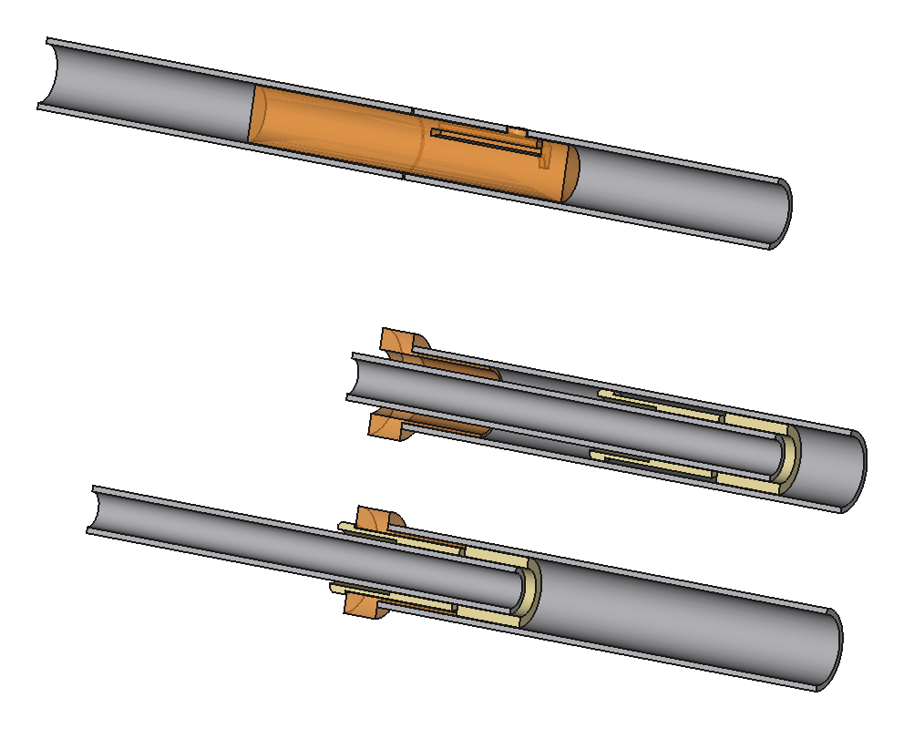

# Зарядник митральезы: вафля и гребёнка шомполов

Съёмный зарядник досылает все пульки разом: 16 или 19, со стороны дула. Он не часть митральезы. Перед
зарядкой его вставляют в концы направляющих каркаса, после зарядки снимают. Модель лежит в
`mitrailleuse/loader.py` (FreeCAD), отчёт и STL — в `exports/loader/`.

## Почему только с дула и так длинно

В модуле v4.4 сзади ствола стоит клапан (кольцо седла с носиком и диафрагма), казённика нет. Пулька
досылается до носика седла, туда, где её рисует модель модуля (`ball`): это 271.7 мм от торца ствола.
Дульные насадки (215 мм, канал Ø30) на митральезе остаются, поэтому шомпол проходит ещё и их, итого 487 мм
от торца насадки. Шомпол должен быть жёстким на всю эту длину. Телескоп (см. «Складывание») делает его короче только в
переноске, в работе длина та же. Поэтому зарядник длинный: 961 мм от концов направляющих до верха ручек,
651 мм перед торцами насадок.

Сначала рассматривался вариант «воздухом»: колпак на вафлю и 1.2–1.5 бар с редуктора, ~25 см. От него
отказались, выбрана гребёнка (2026-10-21).

## Как устроен

| Деталь | Сколько | Что это |
|---|---|---|
| ножка | 4, общие | алюминиевая трубка 12 × 1, 865 мм из трёх частей по 288 мм на муфтах, на осях направляющих (R 104, 45°) |
| пятка | 4, общие | печать: шип Ø9.6 × 25 в канал направляющей (12 × 1, канал Ø10, торец вровень с передней плитой), буртик на её торце, гнездо под ножку |
| колпачок ножки | 4, общие | печать: не даёт гребёнке соскочить с ножек вперёд |
| вафля | на 16 или на 19 | печать, 30 мм: гнездо Ø24.2 на ствол, в нём три ребра до Ø23.0 держат пульку (0.8 мм натяга). Сзади выточка Ø32.6 × 6 садится на торец насадки, поэтому гнездо стоит на оси канала. Четыре ушка скользят по ножкам |
| гребёнка | на 16 или на 19 | печатная плита 12 мм с бобышками под шомполы, длинными ушками на ножках и двумя боковыми лапками под ручки |
| шомпол | 16 или 19 | телескоп: наружная алюминиевая трубка 14 × 1 × 267 мм вклеена в бобышку, внутренняя 8 × 1 × 287 мм выдвигается из неё и держится защёлкой. Печатные детали на шомпол: нос, стопорное кольцо, защёлка |
| чашечка | 16 или 19 | печать, Ø22.5 на конце шомпола: 0.65 мм на сторону в канале Ø23.8. Широкая, потому что мягкая пулька обтекает тонкий пруток (стеклопластиковый пруток на пробе прокручивался и уходил мимо неё). Неглубокая лунка 1.5 мм держит пульку по центру в свободной насадке, скошенный нос находит раструб насадки в ствол |
| ручка | 2, общие | печать, Ø26 × 100, стоит вперёд на лапке гребёнки, по винту M5 |

Ход 515 мм. Глубину задаёт упор, а не пулька: в конце хода гребёнка ложится задней гранью на лицо вафли, и
чашечка останавливается в 1 мм от того места, где пулька лежит на носике седла. Вафлю можно набить
заранее и носить несколько, как обоймы.

Вес по модели: 1.9 кг на 16 и 2.1 кг на 19 (вафля и гребёнка при 0.6 г/см³). Из них шомполы 0.75–0.9 кг,
ножки 0.3 кг.

## Складывание

Для переноски зарядник складывается, стыки на печатных защёлках, клея и резинок в них нет.

- **Шомпол — телескоп с защёлкой.** Наружная трубка 14 × 1 вклеена в бобышку гребёнки, на её нижнем конце
  вклеен печатный нос: фланец Ø18 и канал Ø10.8. Через нос ходит внутренняя трубка 8 × 1 с чашечкой. На её
  верхнем конце вклеено стопорное кольцо Ø11.8: через канал носа оно не проходит, и внутренняя трубка не
  выпадает. Под ним вклеена защёлка: два лепестка (паз 3 мм), на каждом зуб до Ø11.8. Когда шомпол
  выдвигается, зубы проходят канал по скосу 45° и выскакивают под носом. Тогда нос зажат между кольцом и
  зубами, а при досылке зубы упираются в его торец плоской стороной: опора 0.5 мм на сторону, 16 мм² на
  шомпол, 6 МПа при 100 Н. Лепесткам хватает 0.6 мм зазора, чтобы утопить зубы на 0.5.
  - Разложить: держать гребёнку чашечками вниз и встряхнуть. Все шомполы выпадут до кольца и щёлкнут.
  - Сложить: сжать зубы пальцами под носом и задвинуть внутреннюю трубку. У сложенного шомпола чашечка
    стоит у носа, а кольцо выходит из бобышки на 4 мм. Гребёнка с шомполами — 299 мм.
  - Усилие защёлки надо подобрать на первом шомполе (высота зуба, `TELE["nub"]`).
- **Ножка из трёх частей по 288 мм.** В нижнюю часть стыка вклеена печатная втулка Ø9.7 × 60. Её верхняя
  половина входит в следующую часть, а лепесток с пипкой Ø3.6 щёлкает в отверстие Ø4, просверленное в
  стенке в 20 мм от торца. Пипка на 0.1 мм ниже поверхности трубки, так что ушки гребёнки и вафли едут
  поверх неё. Чтобы разобрать, утопить пипку пальцем и потянуть.
- Ручки откручиваются (по M5), вафля идёт отдельно.

Сложенный, без вафли: 317 × 242 × 186 мм (по модели, `folded` в отчёте). Собирается за минуту.



## Порядок зарядки

1. Разложить зарядник: соединить ножки, прикрутить ручки, встряхнуть гребёнку чашечками вниз, чтобы
   все шомполы щёлкнули.
2. Отпустить гашетку и открыть ключом кран сброса. Две заряженные наперёд камеры стравятся через свои
   отверстия ([`rotor.md`](rotor.md)), перед дулами становится безопасно.
3. Поставить митральезу дулом вверх. Надеть вафлю на ножки со стороны пяток, вставить пятки в
   направляющие.
4. За 5–10 с дожать гребёнку за ручки до упора и чуть подержать.
5. Вытянуть гребёнку, снять зарядник с пустой вафлей, закрыть кран сброса.

## Воздух за пулькой и сила

Тугая пулька работает как поршень, а ствол сзади закрыт. При сброшенном пилоте диафрагма отходит, и канал
с камерой становятся одним объёмом: канал 130 см³, камера 100 см³ и ~5 см³ сверху, всего 235 см³. Когда
пулька доходит до седла, остаётся 114 см³.

| Глубина от дула, мм | Давление за пулькой, бар | На одну пульку, Н |
|---|---|---|
| 100 | 0.23 | 10 |
| 200 | 0.61 | 27 |
| 272 (до седла) | 1.06 | 47 |

Это без утечек и без трения. Стравить этот воздух можно только через отверстие в диафрагме, пилот и
ниппель зарядки при открытом кране сброса: поэтому заряжать надо медленно. С какого давления ниппель
открывается назад, неизвестно.

Трение тугой пульки в канале не мерили. В расчёте `RAM_LOAD` = 100 Н на пульку: 47 Н воздуха и столько
же на трение. Внутренняя трубка 8 × 1 при этом держит с запасом 13 (продольный изгиб при 1319 Н: из носа она торчит на
266 мм, конец ведёт канал). Но вся гребёнка тогда требует 1600 Н на 16 и 1900 Н на 19, а это втрое больше, чем
дадут руки с весом тела (~500 Н). Поэтому сначала надо измерить силу на одном стволе
([`human-todo.md`](human-todo.md)). Если выйдет больше ~25–30 Н на пульку, на гребёнку ставится
храповой привод от пистолета для герметика (10–18 : 1). Рамка, вафля и гребёнка для него те же, но
ножкам тогда нужна защёлка в направляющих: привод тянет зарядник с митральезы.

## Не проверено в модели

- Пятки держат зарядник только шипом в канале направляющей, защёлки нет. Для ручной досылки это не
  нужно: дулом вверх зарядник прижат к митральезе.
- Вафля перед установкой держится на ножках только посадкой ушек (Ø12.4 на 12): дулом вверх она лежит
  на насадках.
- Обвязка насадок в эскизе концепта (тонкая лента за 26–30 мм от торцов) в модели насадки не нарисована.
  Вафля начинается за 6 мм от торца, так что ленте она не мешает.

## Картинки

Обычный рендер показывает гребёнку в начале хода. В конце хода, с пульками на седле и разрезом через ось:

```sh
xvfb-run -a -s "-screen 0 2560x1600x24" env LANG=C.UTF-8 LC_ALL=C.UTF-8 LOADER_AT_STOP=1 \
    SCRIPT=mitrailleuse/loader.py OUT=exports/loader/stop_left.png VIEW=left freecad tools/render_view.py
```
