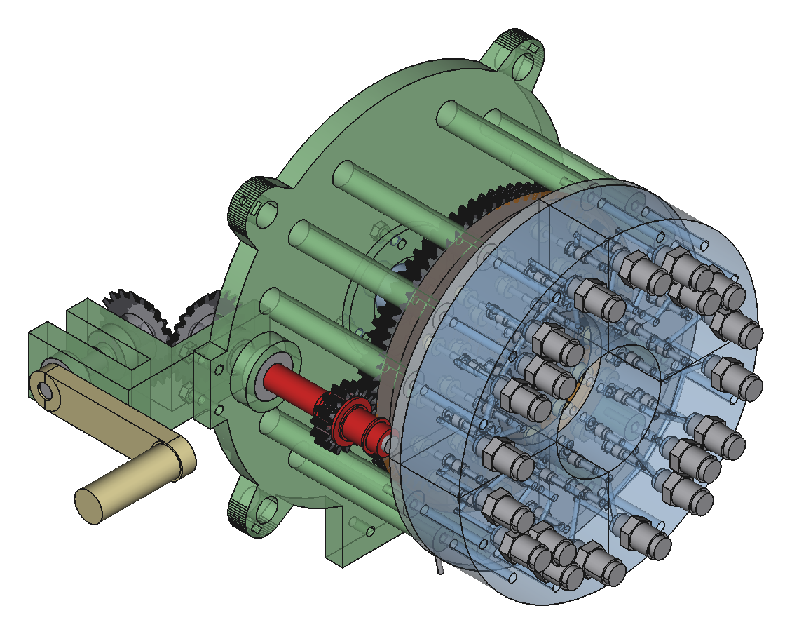

# Пакет стволов: симметричные кольца на 15–19

Расчёт на 2026-10-19 для модуля v4.4: труба камеры Ø38, шаг 40, шпильки M3 на R 21.5 по обе стороны
модуля (180° между ними). Кругляш — описанный круг по трубам камер Ø38. Раскладки лежат в
`mitrailleuse/pack_layouts.py` (J–N), их рисует `python3 mitrailleuse/pack_layouts.py`.

## Сравнение

| Раскладка | Стволов | Кругляш | Площадь круга на ствол | Шпильки |
|---|---|---|---|---|
| G. Соты 19 (сейчас) | 19 | Ø198 | 16.2 см² | все на 30 / 210°, плита есть |
| 4 × 4 вразбежку | 16 | Ø212 | 22.1 см² | все на 30 / 210° |
| K. Кольца 5 + 10 | 15 | **Ø180** | 16.9 см² | влезают, между шпильками 1.4 мм |
| J. Кольца 4 + 12 | 16 | Ø192.5 | 18.2 см² | влезают, до трубы ≥ 5 мм |
| L. Кольца 1 + 4 + 12 | 17 | Ø192.5 | 17.1 см² | влезают, до трубы ≥ 3 мм |
| M. Кольца 6 + 12 | 18 | Ø192.5 | 16.2 см² | впритык, между шпильками 1.1 мм |
| N. Кольца 1 + 6 + 12 | 19 | Ø192.5 | 15.3 см² | **не влезают** при шаге 40 |

Внешнее кольцо из 12 стоит вплотную (R 77.3), поэтому J, L, M и N одного диаметра. Площадь на ствол
у сот G и у 6 + 12 одна и та же; меньше её только у N, но там шпильки M3 на R 21.5 упираются
в соседние трубы при любом развороте (перебор с шагом 5–10°). Для N нужно переносить шпильки
или раздвигать внешнее кольцо, и тогда выигрыш у сот пропадает.

## Геометрия колец

- K, 5 + 10: внутреннее 5 на R 34.0, внешнее 10 на R 71.0, повёрнуто на 18°.
- J, 4 + 12: квадрат 4 на R 28.3 (45°), внешнее 12 на R 77.3 (0°).
- L, 1 + 4 + 12: центр, 4 на R 40, внешнее 12 на R 77.3, повёрнуто на 15°.
- M, 6 + 12 и N, 1 + 6 + 12: 6 на R 40, внешнее 12 на R 77.3, повёрнуто на 15°.

Шаг 40 выдержан везде, проверено расстояние между всеми центрами.

## Разворот шпилек

Угол — от радиуса модуля (от центра пакета через ось модуля), одинаковый у всех модулей кольца.
Зазор «до трубы» — от края шпильки Ø3 до соседней трубы Ø38.

- J: внутренние по радиусу (0°), внешние 40°.
- K: внутренние 0°, внешние 50°.
- L: центр 30°, четвёрка 60°, внешние 45°.
- M: внутренние 0°, внешние через один 50° и 40°.

## Плита

`mitrailleuse/pack_plate.py` строит плиту под J (`plate_j_rings_4_12.stl`): шпильки по кольцам из
`TIE_TURNS`, круг Ø200.5, одной деталью. Перемычка от отверстия шпильки до ствола 7.1 мм, как у G,
между отверстиями шпилек 6.2 мм. Остальные раскладки (K–N) в `TIE_TURNS` не внесены и плит пока не имеют.

## Каркас (концепт A)

`mitrailleuse/pack_frame.py` рисует каркас пакета уже деталями, а не массами: две печатные плиты на четырёх
алюминиевых направляющих. Модули в нём настоящие: генератор строит v4.4 из
`module/stage3v4_coaxial_chamber.py` (как библиотеку) и ставит его в раскладки J и G с разворотом шпилек.

- **Задняя плита** охватывает задние пробки. Её задний торец лежит в плоскости заднего торца пробки, поэтому уши
  заднего ярма (они выходят за трубу Ø38) ложатся на плиту: вперёд модуль не уйдёт.
- **Передняя плита** охватывает фланцы передних пробок. На её передний торец ложатся уши переднего ярма: назад
  модуль не уйдёт. Между торцами плит 269.4 мм.
- Плиты — упоры рядом с цепочкой модуля (гайка — ярмо — пробка), а не в ней. Ярмо по-прежнему сидит на своей
  пробке, шпильки и гайки те же, в v4.4 ничего не меняется. Уши одного ярма ложатся на плиту площадью 77 мм².
- В плите на каждый модуль отверстие Ø38.6 и два паза под шпильки (шпилька в 0.5 мм от отверстия, поэтому это
  один вырез), повёрнутые, как в разделе «Разворот шпилек». Самая тонкая перемычка 1.4 мм, между соседними
  трубами. Толщина 10 мм, Ø198 (16) и Ø207 (19) плюс четыре проушины, на стол Bambu влезает.
- **Направляющие** — 4 алюминиевые трубы 12 × 1 на R 104 под 45°, одни и те же у 16 и 19. Длина 478 мм: от заднего
  торца плиты головки (z −238, раздел «Задняя рама») до переднего торца передней плиты. До ушей ярм, гаек и фитингов не меньше 4.7 мм (у 16).
- Плиты держатся на направляющих винтами M3 × 8 без головки (по одному в проушине), через гайку в кармане на
  верхней грани. Пока винты отпущены, плиты ездят по направляющим.
- Боковая нагрузка посередине между плитами, поделённая на четыре направляющие (10 кг при 3 g), даёт в них
  52 МПа при пределе 150. Ручка на них не опирается: она стоит на своих плитах (раздел ниже).

Сборка: плиты свободно надеты на направляющие. Сердечник модуля (пробки, труба, кольцо седла, ствол) вставляется
спереди через переднюю и заднюю плиты, пока задний торец пробки не встанет вровень с задней плитой. Потом модуль
собирается на месте, как в его докстринге: ярма, дульный хомут, шпильки спереди насквозь, гайки, винты хомута. Затем плиты
разводятся до упора в ярма, и винты затягиваются. Трубы камер надо резать в один упор: разброс их длины и есть
люфт модуля между плитами.

Печать: PETG, 5 стенок, 60 % gyroid, как ярма модуля, `sh mitrailleuse/pack_frame_plates.sh` (только на Mac).

## Опора в центре тяжести

`mitrailleuse/carry_mount.py` рисует, за что митральезу несут и ставят: верхнюю ручку, ушки ремня и площадку
триноги. Всё стоит на двух **плитах ЦТ**, таких же, как плиты каркаса (отверстия вокруг труб камер, пазы шпилек,
проушины направляющих, винты без головки). Они стоят на z 25 и z 155, в 130 мм друг от друга вокруг z 90. Центр
тяжести по эскизу концепта A на z 86 (16 стволов) и z 92 (19), то есть между ними. Нагрузка идёт сразу в трубы
камер, а через них в заднюю и переднюю плиты: направляющие её не несут. 10 кг при 3 g дают в трубе камеры 0.3 МПа.
Если баланс сместится (головка, насадки), пару плит вместе с ручкой можно сдвинуть по направляющим.

- У каждой плиты ЦТ четыре выступа, одинаковые у 16 и 19. Сверху и снизу выступ с отверстием M4 под лапы ручки
  и площадки. По бокам выступ с проушиной Ø10 под карабин ремня, на x ±112.
- **Ручка** общая для 16 и 19: рукоять 28 × 30, 108 мм в свету между лапами, под ней 39 мм до пакета (у 16).
  Каждая лапа — колодка с карманом, в который сверху входит выступ плиты. Боковые стенки кармана не дают лапе
  повернуться. Через лапу и выступ проходит болт M4 × 25, гайка в кармане на лапе.
- **Площадка триноги** общая: те же две лапы снизу и балка между ними. В кармане на балке стоит гайка 3/8″-16
  под винт тяжёлой штативной головки, винт входит снизу.
- Болты: 10 кг при 3 g — 147 Н на болт, смятие выступа 3.3 МПа.
- **Открыто: площадка не поворачивается.** Поворачивать должна голова штатива, но у владельца старый
  фотоштатив без головы (верх разбит, винт там 1/4″). Задумка: вертлюг (палец M8 в двух 608 и упорная шайба,
  барашек-тормоз) и вилка, а площадка становится люлькой с поперечной осью M8 под ЦТ и фрикционами по бокам.
  Ось наклона на ~150 мм ниже оси пакета, ЦТ над ней, так что без тормоза ствол заваливается. Для точной наводки
  позже можно добавить винт наклона. Низ вертлюга — переходник под штатив, рисовать по фото. Под фотоголову
  с 1/4″ годится и нынешняя площадка с переходной втулкой 3/8″ → 1/4″.

Печать: PETG, как плиты каркаса. Плит ЦТ нужно две на пакет (`a16_cg_plate.stl` или `a19_cg_plate.stl` дважды),
ручка и площадка печатаются на боку. Столы: `sh mitrailleuse/pack_frame_plates.sh` (только на Mac).

## Задняя рама (концепт A)

`mitrailleuse/rear_frame.py` ставит огневую головку стенда В (`rotor_bench.py`, `docs/rotor.md`) в ружьё как есть,
только четвертей блока четыре. Что прошло на стенде, переходит в ружьё без переделки. Задняя рама одна на 16 и 19.

- **Плита головки** печатная, Ø196 плюс проушины направляющих, 10 мм, на z −238…−228. Её передний торец —
  это верх основания стенда: на нём то же, что на основании. Корпус вала ротора на трёх M4 с гайками сзади,
  бобышка промвала с нижним 608, стойка оси рычага и 12 стоек на R78 (по три на четверть) высотой 83 мм. На
  стойки ложатся четыре направляющие плиты и четыре блока, в каждую стойку винт M4 × 50 сверху через блок.
  Верх блоков на z −105, фитинги до z −87. Плита держится на направляющих так же, как плиты пакета: винт M3
  без головки в проушине, гайка в кармане спереди. Снизу у плиты лапа с двумя отверстиями M4 под будущую
  рукоять, справа ухо под коробку конических. Лежит на столе задним торцом, стойками вверх.
- **Направляющие** теперь идут от заднего торца плиты головки, 478 мм. Под каждым винтом M3 плиты головки и
  задней плиты пакета в трубе сверлится лунка Ø2.5. Рукоять, какой бы она ни была, тянет раму как коробку:
  плиты и направляющие работают вместе, и в каждой трубе получается осевая сила. 150 Н на рукояти (приложены
  примерно в 60 мм за плитой и в 170 мм под осью) плюс головка (1.6 кг) при 3 g дают 46 Н·м у задней плиты,
  это 157 Н вдоль трубы. Голый винт без головки такую силу может не удержать, а винт в лунке держит её
  смятием стенки (около 560 Н).
- **Коробка конических** — коробка стенда без двух колонн. Её дно (там верхний 608 промвала) лежит на заднем
  торце плиты, два M4 насквозь. Промвал — шпилька M8 длиной 112 мм: от гайки проскальзывающей муфты через
  бобышку и плиту в коробку. Ось ручки на z −278 справа, ручка R70 в своём круге проходит в 38 мм от плиты,
  направляющих и головки.
- **Рычаг стопора** — рычаг стенда, развёрнутый. Ось, штифт и конец под тягу стоят на одной линии через
  штифт, поэтому толчок паза по-прежнему идёт в ось. Тяга тянет конец вниз (он за штифтом, 52 мм от оси при
  30 до штифта) и проходит между стойками внизу. Рычаг поворачивается на 11.5°, тяга идёт на 10.4 мм, штифт
  выходит на 1 мм за обод диска. Отпустили — пружина возвращает тягу, штифт падает в следующий паз.
- **Тяга** — заглушка: стальная проволока Ø2.5 от рычага вниз до точки под лапой плиты, x 0, y −128,
  z −202. Её конец гашетка должна тянуть вниз на 10.5 мм с силой около 9 Н (оценка по стенду) плюс пружина.

**Рукоять и гашетка не нарисованы нарочно:** вид ещё не выбран (лопатки и гашетка под большой палец, как у
«Максима», рукоять кремнёвого пистолета или что-то ещё). Какой бы она ни была, она крепится к лапе плиты
(или лапа переделывается под неё) и тянет конец тяги, как сказано выше. Если тянуть рукоять назад с силой
150 Н в 72 мм под лапой, лапа гнётся на 11 МПа. Концы тяги получат окончательные размеры после стенда В: он
покажет, сколько на самом деле ходит штифт и какой силой его держать.

Эскиз концепта (`mitrailleuse_concepts.py`) ещё рисует головку массами на z −143, с направляющими от z −150.
Теперь головка стоит на 85 мм дальше назад, и ЦТ ружья тоже сдвигается назад. Прикидка, не расчёт: около 1.6 кг
на 85 мм при 10 кг всего дают ≈15 мм, то есть ЦТ около z 71 (16) и z 77 (19). Он всё ещё между плитами ЦТ (z 25 и 155), и пару
можно сдвинуть по направляющим. Пересчитать, когда появятся кожух и вход.

Печать: PETG, 5 стенок, 60 % gyroid. Плита головки, рычаг и коробка конических печатаются
`sh mitrailleuse/rear_frame_plates.sh` (только на Mac). Детали самой головки берутся из `exports/rotor_bench/`:
блок и направляющая плита по четыре, остальное по одному.
