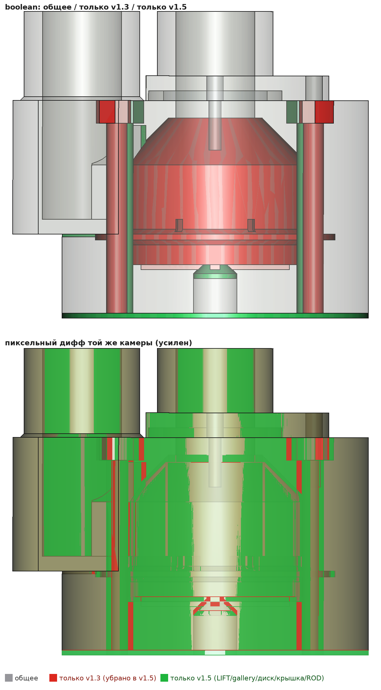
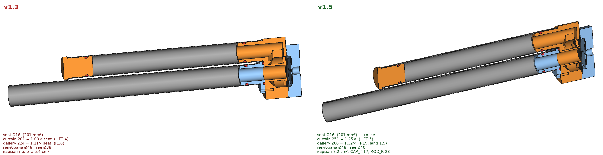

# Почему v1.3 на 2 бар слабее соосного v4.4

Разбор по отчётам `freecadcmd` (2026-11-12), без правок геометрии. Стенд:
v4.4 dump отлично; v1.3 стреляет, но к 2 атм сильно падает скорость истечения
(`docs/status.md`, `docs/human-todo.md`).

Числа — строки `flow path` / `dead volume` / `opens when` генераторов
`module/stage3_qev.py` (v1.1), `module/stage3_v13.py` (OVERRIDE → тот же отчёт),
`module/stage3v4_coaxial_chamber.py` (v4.4). Все проверки `[OK]`.

## Сводка потока

| | v1.1 бок-о-бок | v1.3 бок-о-бок | v4.4 соосный |
|---|---:|---:|---:|
| SEAT_D | 13 | 16 | 16 |
| A_seat, mm² | 133 | 201 | 201 |
| LIFT, mm | 4.0 | 4.0 | 2.9 |
| A_curtain = π·SEAT_D·LIFT | 163 (1.23× seat) | **201 (1.00×)** | 146 (0.72×) |
| window / gallery entry | window 185 (1.40×) | window 240 (1.19×) | entry 390 (1.94×) |
| gallery / sock annulus | gallery 266 (2.00×) | **gallery 224 (1.11×)** | annulus 334 (1.66×) |
| узкое место (min) | seat 133 | seat=curtain 201 | curtain 146 |
| free dia / open_ratio | Ø38 / 84 % | Ø38 / 78 % | Ø24.6 / 49 % |
| dead за седлом, cm³ | 7.4 | **11.3** | **4.3** |
| pilot pocket, cm³ | 5.4 | 5.4 | 1.7 |

v1.3 относительно v1.1: седло +51 % площади, curtain ровно в ноль к седлу,
gallery с 2.00× до 1.11× (седло съело кольцо галереи: `seat_out_r` 8.5 → 10 при
`GALLERY_R = 18`), dead +53 % (тот же туннель BODY+фланец+носик × большее Ø).
`GALLERY_R`, `LIFT`, `WINDOW_*` не трогали — выросло только `SEAT_D` (и кольца).

## Почему «больше седло» не помогло именно у 2 бар

1. **Лимит уже не седло.** У v1.1 горло — седло (133), запас по curtain/window/gallery
   1.2–2.0×. У v1.3 три площади почти равны (201 / 201 / 240 / 224): прирост седла
   упирается в curtain и gallery. «Плохо расширилось» = седло выросло, подход нет.

2. **Неполный подъём бьёт сильнее.** Curtain = seat только при полном LIFT = 4.
   Сила открытия при сброшенном пилоте ∝ `A_dia − A_seat_eff`: v1.1 ≈ 957 mm²,
   v1.3 ≈ 880 (−8 %), на единицу curtain 5.86 → 4.38 (−25 %). При малом P
   (2 бар) абсолютная сила мала, резина не обязана выбрать весь карман →
   эффективный curtain < 201, весь выигрыш седла съедается.

3. **Dead volume.** За седлом до шара: v1.3 11.3 cm³ против 4.3 у v4.4 (и 7.4 у v1.1).
   Длинный Ø16 туннель бок-о-бок смягчает фронт давления на шар; соосный седло
   почти у ствола.

4. **Топология, не площадь.** У v4.4 curtain меньше (146), но камера кормит седло
   кольцом (annulus 334, entry 390), без окна 90° и узкой галереи. При том же
   SEAT_D=16 соосный на 2 бар ощущается живее — стенд это и показал.

5. **Падение P в камере во время выстрела.** Пока камера пустеет, ΔP на узкой
   gallery растёт в доле: давление у curtain ниже, чем в трубе. На высоком P
   запаса хватает; к 2 бар схема «седло=curtain≈gallery» голодает первой.
   Отношение пилот/камера (`open_ratio` 78 %) само по себе открытие не ломает
   (порог мягче, чем у v4.4 с 49 %) — узкое место именно тракт после открытия.

Чистый `A_throat` у v1.3 больше, чем curtain v4.4 (201 vs 146): одним седлом
отставание не объяснить. Решают подход + dead + полнота подъёма на низком P.

## Если когда-нибудь чинить бок-о-бок

Не тащить в прод-пистоль по умолчанию. Прикидка (риски — на стенде):

| Рычаг | Зачем | Риск / проверка |
|---|---|---|
| `SEAT_D` обратно ~13–14 | вернуть запас gallery/curtain, меньше dead | потеря пиковой площади; сравнить с v1.1 на том же 2 бар |
| `GALLERY_R` 18 → ≥20 | gallery снова ≥1.4× seat | корпус/стержни M4, free dia, bead; перепечатать body+cap |
| `LIFT` 4 → ~5 | curtain ≥1.25× seat | stretch резины на Ø38; карман крышки; неполный подъём всё ещё возможен |
| `SEAT_LAND` 2 → 1.5 (как v4.4) | чуть gallery и open_ratio | прочность губы, печать |
| укоротить dead (носик/высота body) | ближе к соосной «жёсткости» фронта | стык казённика, кольца, пистолетная посадка |
| тоньше / bleed диафрагмы | быстрее/полнее подъём | герметичность clamp, заряд пилота между выстрелами |

Одного `LIFT` мало: gallery останется 1.11×. Одной gallery мало: curtain в ноль.
Имеет смысл связка **чуть меньше седло или больше gallery+lift**, не «ещё Ø18».

## v1.5 — тот же Ø16, но подход подрос

Ортогональный разрез с наложением (серое = общее, красное = только v1.3,
зелёное = только v1.5). Сверху boolean тел, снизу усиленный пиксельный дифф
той же камеры — иначе +1 мм gallery/LIFT почти не читается глазом:

Рядом без диффа (для масштаба): 

Файла v1.4 нет; сразу `module/stage3_v15.py` (OVERRIDE поверх механики v1.3).
`freecadcmd`, все проверки `[OK]`:

| | v1.3 | **v1.5** |
|---|---:|---:|
| seat / curtain / window / gallery | 201 / 201 / 240 / 224 | 201 / **251** / 240 / **266** |
| к seat | 1.00 / 1.19 / 1.11 | **1.25 / 1.19 / 1.32** |
| free dia / open_ratio | Ø38 / 78 % | Ø40 / 81 % |
| dead / pocket, cm³ | 11.3 / 5.4 | 11.3 / 7.2 |

Рычаги: `GALLERY_R` 19, `LIFT` 5, `SEAT_LAND` 1.5, `DIA_D` 48, `BEAD_R` 22,
`ROD_R` 28, `CAP_T` 17, `BLEED_R` 14, `JIG_BLANK` 50. `BODY_R` 31 как был.
Dead не ужали — носик/высота корпуса те же; это следующий рычаг, если стенд
покажет мягкий фронт.

Не default пистоля (`VALVE = "v13"` не трогать, пока нет стенда v1.5 на 2 бар).

## Вердикт

- **Чинить продакшен на v1.3 — нет.** На 2 бар он уже проиграл соосному.
- **v1.5** — кандидат «починить бок-о-бок с Ø16» без ужимания седла; печатать
  body+cap+диск и сравнить с v1.3 / v4.4 на 2 бар.
- **Пистоль пока:** **v1.1** или соосный stub; на v1.5 — только после стенда.
