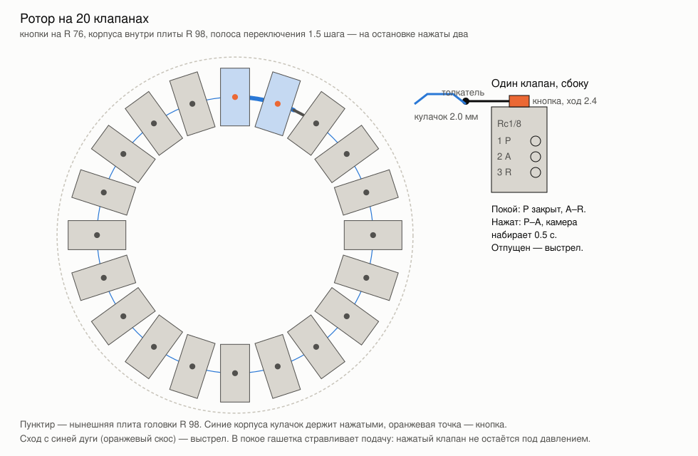
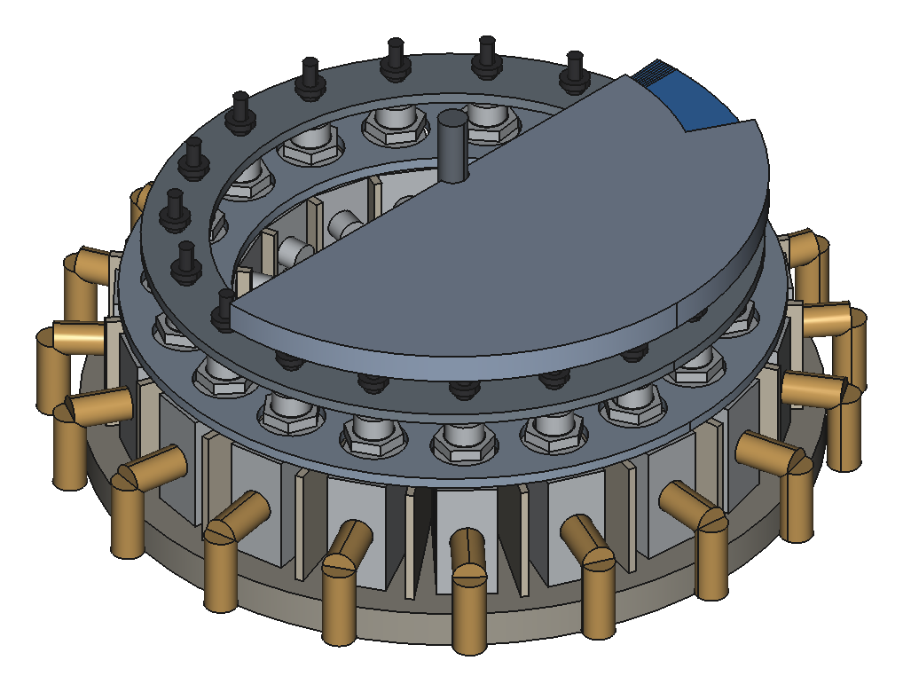
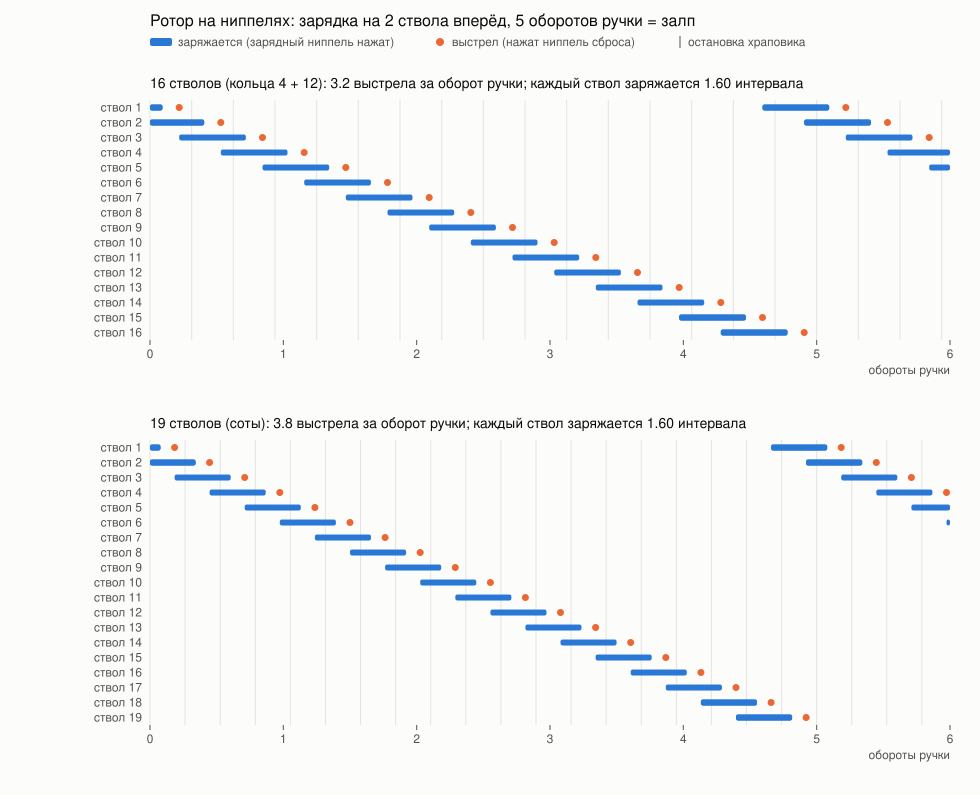
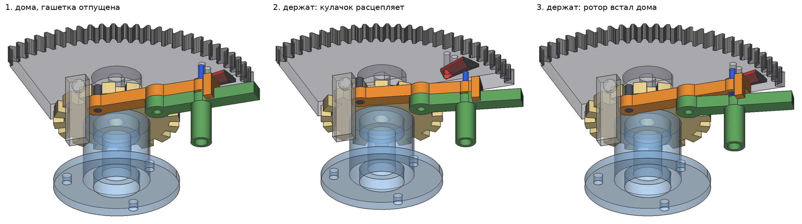
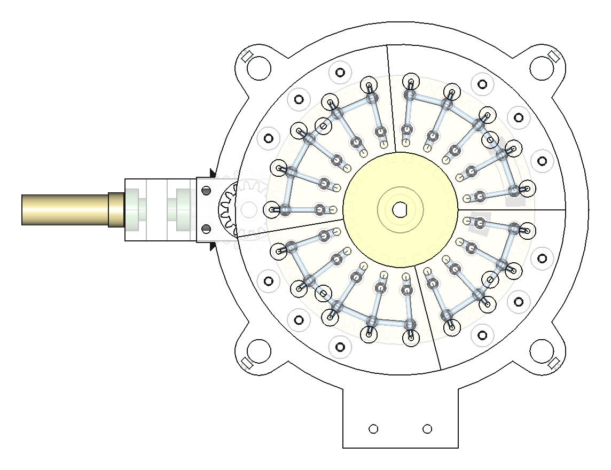

# Ротор митральезы (концепт A)

## Стенд Б провален (2026-11-10)

Ниппели 5V1 на стенде Б текут сильно: головка на них не держит воздух. В ружьё эта схема не идёт.
Печатать стенд Б ещё раз и стенд В (ниппельный ротор) не надо. Файлы остаются: `head_bench.py`,
`rotor_bench.py`, `rotor_timing.py`, и задняя рама пока стоит на ниппельной головке. Раздел
«Ниппели» ниже — как это было посчитано, не образец для новой головки.

Дальше — головка на 19 стволов из покупных кнопочных клапанов 3/2. Куплено 20, один запасной.
Клапаны заказаны, в руках их ещё нет.

## Клапаны: один на ствол, короткое нажатие

Чертёж с заказа совпадает с Koganei TAC2-31P: кнопка с пружинным возвратом, три порта Rc1/8
на двух противоположных узких гранях (P и R на одной, A на другой), корпус 31.8 × 16 мм,
вместе с кнопкой 45.8 мм, кнопка Ø10.6 на резьбе M12×1, два отверстия Ø5.2
в 9.2 мм от середины широкой грани. На чертеже у кнопки стоит 2.4: в каталоге TAC2 это ход, не
размер корпуса — 0.8 мм предхода, 0.8 переключения, 0.8 перебега. Каталог ещё: сечение 5.5 мм²
(Cv 0.27), 55 г, давление 0.05–0.9 МПа, до 5 Гц. Это числа каталога, не замер приехавшей детали.
Клон может отличаться. На фото корпуса выбито TAC2 31V: в каталоге это рычаг с фиксацией, он
не возвращается сам. На том же фото кнопка круглая и под гайкой видна пружина, как у 31P.
Кулачок рассчитан на пружинный возврат. Когда деталь приедет, первое — отпущенная кнопка сама
встаёт обратно. Если остаётся нажатой, этот кулачок её не отпустит. Пока деталь не обмерена,
в FreeCAD головку не рисовать
([`human-todo.md`](human-todo.md)).

Нормально открытый или закрытый по наклейке неизвестно, и для этого семейства это не свойство
корпуса. Каталог прямо говорит: покой зависит от обвязки.

- Подача в 1(P), сброс в 3(R), пилот из 2(A) — нормально закрытый. В покое P закрыт, A соединён
  с R: пилот пустой, камера пустая. Нажали — P соединяется с A, камера набирается через отверстие
  Ø1.0 в диафрагме. Отпустили — пилот стравливается в R, модуль стреляет.
- Подача в 3(R), сброс в 1(P) — наоборот, нормально открытый: в покое пилот под давлением.

Нам нужен первый вариант. Тогда ствол под давлением только пока кнопка нажата, и нажатие короткое:
кулачок прошёл — и отпустил. Если у приехавшего клапана никакая обвязка не даёт «покой = пилот на
сброс, нажатие = подача в пилот», под ротор он не подходит. Это первая проверка, ещё до кольца.

Дренаж модуля Ø1.0 имеет сечение 0.79 мм², у клапана по каталогу 5.5 мм², в семь раз больше.
Время зарядки по-прежнему задаёт дренаж: на стенде v1.1 камера 100 см³ набиралась около 0.5 с.
Клапан это время не сокращает. Сброс пилота он как раз ускоряет: оценка, не замер — около 1 мс на
1 см³ воздуха при 2 бар, если течь критическая. Хлопок модуля должен быть не хуже, чем от
отдельного клапана на стенде v1.1. Проверить на одном клапане и одном модуле.

Числа кольца и кулачка считает `mitrailleuse/valve_rotor.py` (обычный Python). Эскиз головки
на 19 — [чертёж](img/valve_rotor.svg). Радиусы на нём посчитаны, осевые зазоры, толкатель и
толщина диска условные: клапаны ещё не обмерены.

### Как стоят

Кнопка смотрит на ротор. Порты не столбцом на одной грани. На чертеже заказа и на фото корпуса
узкие грани стоят напротив друг друга: на одной два выхода, 1(P) и 3(R), на другой один, 2(A).
Широкие грани 31.8 мм — только отверстия Ø5.2.

По окружности корпус занимает 16 мм, по радиусу 31.8. Тогда грань с одним портом A смотрит
наружу, к модулю, а грань с P и R — внутрь кольца, в дырку плиты. Между внутренними углами
соседей 3 мм пластика: карман, отверстия Ø5.2 не используются. Кнопка по центру корпуса
(на чертеже она посередине; сверить, когда приедет).

| | 16 | 19 | 20 (не строим) |
|---|---|---|---|
| радиус кнопок | 63.8 | 73.0 | 76.0 |
| шаг по кнопкам | 25.1 | 24.1 | 23.9 |
| корпус, от оси | 47.9…79.7 | 57.1…88.9 | 60.1…91.9 |

Строим 19. Колонка 20 — проверка, что в ту же плиту влезли бы и все купленные корпуса. Все три
кольца влезают в нынешнюю плиту головки R 98. У девятнадцати снаружи корпуса остаётся 9 мм
до края плиты. Туда выходит один уголок с порта A, под него плиту подрезать. P и R смотрят
внутрь, в отверстие R 57, и стоят один над другим вдоль оси кнопки: влезут ли два уголка друг
над другом, видно по шагу портов на приехавшей детали. Направляющие R 104 кончаются на плите,
головка за ними, так что за R 104 они не задевают.

Если корпус повернуть и пустить 31.8 мм по окружности, порты смотрят на соседей, а кольцо уже
не влезает в плиту: кнопки на R 96 / 112 / 118, корпус снаружи до R 104 / 120 / 126. Так не ставим.

Винт M5 в отверстие Ø5.2 требует стенку около 8 мм. Такое кольцо для 16 ещё внутри плиты (кнопки
R 77, корпус до R 93), для 19 и 20 корпус вылезает за R 98 (до R 104 и R 108). Пока клапаны
держат карманом и планкой, не винтами в стенку.

Каталожная масса 55 г: 880 г на 16, 1045 г на 19, 1100 г на 20, без фитингов. Это не взвешено.

### Кулачок

Один торцевой кулачок, толкатель с носиком Ø3 в центр кнопки. Носик маленький, чтобы момент
входа на скос не размазывался по Ø10.6 самой кнопки. Клапан возвращает кнопку своей пружиной,
отдельное уплотнение толкателя не нужно: течь, которая убила стенд Б, здесь внутри покупного
корпуса.

Кулачок давит на 2.0 мм. Переключение по каталогу заканчивается на 1.6, упор на 2.4: окно 0.8 мм,
и цепь «ротор — толкатель — кнопка» должна попадать в ±0.3 мм. У толкателя жёсткий упор, чтобы
он не продавил кнопку дальше 2.4, даже если цепь короче расчёта. Пружинный носик ниппеля (натяг
12 Н) сюда не переносится: усилие кнопки неизвестно и может быть больше.

Скос 6 мм на подъём 2.0 мм, это 18°. Дальше два кулачка на одном кольце. Оба считаны на зарядку
0.5 с.

**Держать.** Полоса, где кнопка уже переключена, — 1.5 шага. Пока она длится 0.5 с, темп 3.0
выстрела/с: залп 5.3 с на 16 и 6.3 с на 19, ручку не быстрее 0.94 и 0.79 об/с. Это тот же темп,
что у ниппельного ротора (там было 3.1). На остановке кулачок держит две кнопки полностью и не
стоит на скосе: до скоса 5.1 мм у 16 и 4.8 у 19 и 20, носику Ø3 хватает. Эти два ствола в этот
момент заряжены. Поэтому подачу открывает гашетка, отдельным краном, не из этих двадцати:
отпустили — коллектор подачи уходит через жиклёр Ø0.5,
и нажатые стволы сливаются обратно, не стреляя. Путь тот же, что у тихого слива ниппелей (дренаж
Ø1.0, потом жиклёр Ø0.5; клапан между ними широкий). Старый счёт «пилот не падает ниже 0.94,
модуль открывается ниже 0.73, слив 5–9 с» был про ниппель. Повторить на одном клапане, не
принимать за уже проверенное.

Пока гашетку держат, под давлением только эти полтора-два ствола, и каждый — около половины
секунды. Остальные пустые: их кнопки отпущены, пилоты на сбросе.

**Зазор.** Кулачок короче шага, и ротор умеет встать так, что ни одна кнопка не нажата. Подачу
тогда можно не отсекать. За это платит темп: скосы съедают шаг, и при тех же 0.5 с зарядки
выходит 0.60 выстрела/с на 16 (залп 27 с) и 0.54 на 19 (залп 35 с). Это запасной кулачок, если
кран на гашетке не понравится. В ружьё пока считаем первый.

Усилие кнопки не измерено. Момент ниже — если считать, что полное усилие лежит на кулачке везде,
где толкатель его касается (на скосе так больше, чем будет). Трение 0.2, как у ниппельного
ротора. На ручке те же 5:1 и R 70, чтобы сравнивать. Осевая сила — сколько клапанов кулачок
держит сразу; от числа стволов она не растёт.

| усилие кнопки | 16: ротор / ручка / ось | 19: ротор / ручка / ось |
|---|---|---|
| 15 Н | 0.70 Н·м / 2.0 Н / 30 Н | 0.80 Н·м / 2.3 Н / 30 Н |
| 25 Н | 1.17 Н·м / 3.3 Н / 50 Н | 1.34 Н·м / 3.8 Н / 50 Н |
| 40 Н | 1.87 Н·м / 5.3 Н / 80 Н | 2.14 Н·м / 6.1 Н / 80 Н |

У ниппельного ротора на 5 бар выходило 1.61 Н·м и 4.6 Н на ручке при 16. Даже при 40 Н на кнопке
ручка здесь того же порядка: одновременно забирается на скос только один толкатель.

На кольце 19 клапанов, двадцатый — запасной. На 16 стволов из той же покупки осталось бы четыре.
Кольцо на 20 в таблицу входит только как проверка посадки; головку на 20 не делаем.

### Головка

Концепт, не печать: `mitrailleuse/valve_head.py`. Клапаны ещё не обмерены, высоту кнопки 12.5 мм
скрипт берёт с чертежа заказа (габарит 45.8 минус корпус). Заднюю раму под эту головку не
перекладывать, пока деталь не сверена.

Плита — нынешний диск R 98 толщиной 10 мм, без ушек и лапы: они остаются на раме. На задней
грани обойма из рёбер 2.2 мм между корпусами. Сверху кольцо-прижим с отверстиями под гайки:
клапан зажат между плитой и прижимом, кнопка торчит в отверстие. Снаружи на каждый A надет
уголок, он уходит за край плиты и поворачивает к стволам. P и R смотрят внутрь кольца, на
чертеже они в 9.5 мм друг над другом; на картинке это короткие патрубки, коллекторы ещё не
нарисованы.

Толкатель Ø4 с носиком Ø3 стоит на кнопке. У свободной кнопки до плоскости диска 0.3 мм, чтобы
кулачок её не тёр. Подъём диска 2.3 мм: 0.3 на этот зазор и 2.0 на нажатие. Фланец толкателя
упирается в направляющее кольцо на 2.2 мм, раньше упора самого клапана на 2.4. Вал Ø8, тот же,
что был на стенде В. Редуктор 5:1, разобщитель и стопор к кнопкам не привязаны и переносятся,
когда головка будет сверена с деталью.

На картинке у диска срезана половина и окно над синим подъёмом. В модели диск целый. Синий
сектор держит две кнопки.

## Ниппели (стенд Б, провален)

Как головка была задумана до стенда Б. В головке стоят только ниппели (золотники 5V1, как в
`archive/stage4v2_schrader.py`). Числа считает `mitrailleuse/rotor_timing.py` (обычный Python, без
FreeCAD): он печатает таблицу и рисует [диаграмму фаз](img/rotor_timing.svg). Модель — в
`mitrailleuse/mitrailleuse_concepts.py` (детали `Port_stator`, `Valve_cores`, `Core_pushers`,
`Return_springs`, `Rotor`, `Detent_wheel`), там же отчёт с проверками.

## Как устроено (ниппели)

На каждый ствол в неподвижном блоке головки стоят два ниппеля на одной радиальной линии. Шланг от
пилота модуля подходит к фитингу спереди блока, канал от него ведёт к обоим ниппелям.

- **Ниппель зарядки** (на радиусе 60). С внутренней стороны у него кольцевой канал подачи, со стороны
  штока — линия пилота под толкателем, толкатель уплотнён кольцом. Толкатель нажал — пилот, а через
  отверстие в диафрагме и камера, заряжаются. Толкатель ушёл — подача сама прижимает ниппель.
- **Ниппель сброса** (на радиусе 42). Изнутри линия пилота, со стороны штока воздух. Толкатель нажал —
  пилот стравливается, и модуль стреляет. Толкатель ушёл — давление пилота сам ниппель и закрывает.
- **Толкатель** — печатный стержень в направляющем отверстии блока. Спереди у него подпружиненный
  носик, сзади грибок Ø7, который ездит по ротору. Между блоком и грибком стоит возвратная пружина.
- **Ротор** — торцевой кулачок за блоком, на нём две приподнятые дуги со скосом вверх и скосом вниз.
  Длинная на радиусе 60 держит нажатыми толкатели зарядки двух следующих стволов. Короткая на
  радиусе 42 стоит за ней и нажимает толкатель сброса того ствола, который стреляет.

## Как толкатель нажимает и отпускает

- **Нажать.** Скос вверх поднимает толкатель на 2.0 мм. Грибок стоит в 0.2 мм от основания кулачка,
  а допуск цепочки «ротор — толкатель — седло ниппеля» ±0.4 мм. Поэтому шток ниппеля утоплен на
  1.4–2.2 мм, а полностью ниппель открыт уже при 1.2 мм. Если шток упрётся раньше (у типового ниппеля
  на 1.8 мм), носик сожмётся до 0.4 мм из своего 1 мм. Пружина носика с натягом 12 Н, что больше
  усилия ниппеля 7.5 Н, так что носик не проседает, пока шток не упёрся. Ниппель при этом получает
  не больше 16 Н.
- **Отпустить.** На скосе вниз возвратная пружина (5 Н на упоре, 7 Н в нажатом положении) отводит
  толкатель на упор, это вдвое больше трения кольца толкателя зарядки (около 2 Н). Ниппель
  закрывается сам: своей пружиной около 3 Н, а с давлением на внутренней стороне ещё и давлением.
  Толкатель зарядки вдобавок выталкивает давление пилота под ним.
- **На упоре** грибок не касается кулачка, поэтому пружины всех остальных толкателей ротор не тормозят.

Сначала был нарисован паз Т-образного сечения, который сам вытягивал толкатель (десмодромный
привод). От него отказались: ниппель закрывается сам, и пружины на толкателе достаточно.

Ротор, блок с ниппелями и храповик у 16 и у 19 свои: дорожки рассчитаны на шаг ниппелей, поэтому
выстрелы идут равномерно.

## Зарядка наперёд

Каждый ствол по очереди проходит под дорожками:

1. Длинная дорожка нажимает толкатель зарядки. Ствол заряжается около 1.55 интервала между выстрелами.
2. Дорожка уходит, толкатель зарядки отпущен. Около 0.2 шага ствол стоит заряженным, оба ниппеля
   закрыты.
3. Короткая дорожка нажимает толкатель сброса, ствол стреляет.

Одновременно заряжаются только два ствола. Остальные пустые: их пилоты после выстрела остались без
давления, а подачи у них нет.

| | 16 стволов | 19 стволов |
|---|---|---|
| шаг ниппелей: сброс / зарядка | 16.5 / 23.6 мм | 13.9 / 19.8 мм |
| зазор между толкателями Ø9 на круге сброса | 7.5 мм | 4.9 мм |
| дорожки: зарядки / сброса | 42 / 13 мм | 36 / 11 мм |
| скос дорожек при ходе 2.0 мм | 19° / 26° | 22° / 30° |
| выстрелов за оборот ручки | 3.2 | 3.8 |
| темп при зарядке 0.5 с | до 3.1 выстр/с | до 3.1 выстр/с |
| залп | 5.2 с | 6.1 с |
| ручку крутить не быстрее | 0.97 об/с | 0.82 об/с |

Другие варианты: один ствол наперёд даёт 1.2 выстр/с, три — 5.2 выстр/с. Время зарядки 0.5 с взято
со стенда v1.1 (отверстие Ø1.0, камера 100 см³). Если крутить ручку быстрее, стволы стреляют
недозаряженными, но без сбоев.

Цикл одного ствола в движении рисует `python3 mitrailleuse/rotor_cycle_gif.py 16` (или `19`):
GIF в `exports/rotor_cycle/`. Давления на нём — набросок, а не расчёт.

## Фиксатор и гашетка

- **Храповой фиксатор** — колесо с N зубьями пилой на валу ротора и подпружиненный плунжер. Он
  ставит ротор так, что ни один толкатель не стоит на скосе дорожки: два ствола заряжены, у
  выстрелившего нажат сброс.
- Зуб пилой пускает ротор только вперёд. **Докрутить ротор до следующего зуба он не может:** плунжер
  10 Н на колесе R25 со скосом 15° даёт 0.07 Н·м, а толкатели на скосах держат ротор с моментом до
  1.6 Н·м. Если отпустить гашетку между зубьями, ротор может встать с полунажатым ниппелем. Поэтому
  муфта должна размыкаться только на зубе: защёлка на тяге гашетки, которая отпускает её раз за шаг.
  Это ещё не нарисовано.
- **Гашетка** включает кулачковую муфту между редуктором 5:1 и валом ротора. Если её отпустить,
  ручка крутится вхолостую.

## Стенд Б: один ствол на ползуне

Стенд собран и 2026-11-10 провален: ниппели текут сильно. Ниже — как его делали, не как повторять.

`mitrailleuse/head_bench.py` (FreeCAD): один порт головки в развёртку, чтобы проверить пневматику на
модуле v4.4 до того, как печатать круглую головку. Порядок испытаний — в `docs/test-plan.md`, раздел
«Mitrailleuse head, bench B».

- **Блок** с двумя ниппелями на одной линии, 18 мм друг от друга, как на роторе. Внутри напечатаны
  каналы: подача сбоку к ниппелю зарядки, пилот от полости под ниппелем зарядки к фитингу сверху (шланг
  к модулю) и к ниппелю сброса, выхлоп ниппеля сброса Ø4 наружу. Под ниппелем зарядки кольцо 3×1.5 на
  штоке толкателя. Отдельного порта под манометр нет (убран 2026-11-07 — манометра нет; если понадобится,
  его ставят тройником в линию подачи).
- **Толкатель** — стальной пруток Ø3 в печатном ползунке, зажат винтом M3: зазор до штока ниппеля
  (0.5 мм) выставляется руками, пружины в носике на стенде нет. Возвратная пружина держит ползунок на
  кулачке.
- **Ползун** с двумя дорожками кулачка ротора в развёртке на шаг 16.5 мм. Щелчки на шести остановках:
  ждёт, зарядка, зарядка, оба закрыты, сброс, выстрелил. Ход 66 мм.

Печать: `sh mitrailleuse/head_bench_plates.sh` — блок из PETG как герметичная деталь (6 стенок, 60 % гироид),
остальное стоит дома на столе и печатается из PLA (4 стенки, 25 % гироид): жёстче и точнее PETG. Ползунка два из
одного STL.

Отверстия под резьбу напечатаны гладкими: под ниппели Ø4.5 × 4 мм, их прогнать метчиком 5V1 (он есть в ключе для
золотников «4 в 1»); под фитинги G1/8 Ø8.8 × 8 мм, прогнать метчиком G1/8. Ниппель вкручивается снизу, через полость
под ним, тем же ключом и без усилия: герметичность даёт его резиновая манжета на конусе-седле, а не резьба.

Купить на один стенд (кроме модуля):

| что | сколько |
|---|---|
| ниппели 5V1 | 2 (из пачки на 100) |
| цанговый фитинг G1/8 на трубку 4 мм, прямой | 2 (блок и модуль) |
| фитинг G1/8 под трубку подачи стенда | 1 |
| тройник на трубку подачи, шаровой кран G1/8, заглушка G1/8 (просверлить Ø0.5) | по 1 |
| трубка ПУ 4×2.5 | 1 м |
| кольцо 3×1.5 NBR | 5 |
| пруток стальной Ø3 | 2 отрезка по 24 мм |
| пружина сжатия 0.6×6×12 (проволока × наружный Ø × длина) | 2 |
| ключ для золотников «4 в 1» (в нём метчик 5V1 под резьбу золотника) | 1; метчик G1/8 — тот же, что под порт пилота модуля |
| винт M3×50 и установочный винт M3×4 | 4 и 2 |

## Стенд В: ротор под четвертью головки

`mitrailleuse/rotor_bench.py` (FreeCAD): настоящий ротор на 16 стволов крутится горизонтальной ручкой
через коническую пару 1:1 и редуктор 5:1 под четвертью блока головки (4 порта). Он проверяет то, чего не
проверить на ползуне: усилие на ручке, осевую нагрузку на ротор и остановку на шаге, когда отпускают
гашетку. Порядок испытаний — в `docs/test-plan.md`, раздел «Mitrailleuse head, bench C».

**Стенд собран из деталей итоговой головки.** Своё у стенда только основание со стойками, рычаг гашетки
и коробка конической пары. Всё остальное после испытаний переходит в ружьё как есть:

| в головку | что это |
|---|---|
| ротор, стопорный диск, шестерня 75 | пакет на валу Ø8 с лыской, ступица на ступице |
| корпус вала | фланцевая труба с двумя 608, на верхнем подшипнике стоит весь пакет; в ружье крепится к раме тем же фланцем |
| четверть блока и её направляющая плита | в головке их четыре: R30…86, по 4 порта, свои подача, пилоты и выхлоп; три винта M4 на R78 |
| толкатели, штифты, пружины, ниппели, фитинги | как на стенде Б, 8 комплектов |
| шестерня 15 с проскальзывающей муфтой | на промвале M8 |
| пара конических 20 зубьев и ручка | конические — те же, что в селекторе (`ratling/params.py`) |
| рычаг стопора со штифтом Ø4, кулачок разобщителя | в ружье рычаг стопора ведёт свой рычаг гашетки от тяги |

На стенде коробка конической пары стоит там, где у головки нет блока. В ружье она уходит за плиту
головки, промвал проходит сквозь плиту, а рычаг стопора развёрнут под тягу от гашетки
(`mitrailleuse/rear_frame.py`, `docs/pack.md`, «Задняя рама»).

**Остановка на шаге сделана иначе, чем в концепте.** Вместо кулачковой муфты и храповика здесь стопор
и проскальзывающая муфта:

- На валу ротора стоит диск с 16 пазами. В пазы под пружиной заходит стальной штифт Ø4 на рычаге
  стопора, его ведёт рычаг гашетки (ниже, «Один залп на нажатие»). Гашетка нажата — штифт вынут, ротор крутится. Отпустили — штифт едет по ободу и падает в
  следующий паз, и ротор встаёт ровно на шаге, ни один толкатель не на скосе (до ближайшего скоса 3.4°,
  люфт в пазу 1.7°). Нагрузка от паза проходит через ось рычага, поэтому гашетку держать легко: около
  7 Н.
- Шестерня 15 зубьев свободно сидит на промежуточном валу M8 между двумя резиновыми шайбами, их
  прижимает пружина с гайкой. Пока ротор стоит, ручка проскальзывает с моментом 0.42 Н·м, это 6 Н на
  ручке. Гайкой подбирается момент: в 1.3 раза больше, чем нужно ротору.

Кулачковая муфта, которая отпускает только на шаге, либо заклинивает при включении, либо отпускает где
попало, а храповик слишком слабый. Если стопор и муфта сработают на стенде, их можно перенести в концепт.

### Один залп на нажатие (разобщитель)

Раньше ротор крутился, пока держат гашетку, и после залпа пошёл бы на второй круг по пустым стволам. Теперь
он сам встаёт дома после N выстрелов, даже если гашетку не отпустили. Чтобы дать следующий залп, гашетку
надо отпустить и нажать снова.

- **Два рычага на одной оси.** Сверху рычаг стопора со штифтом Ø4, под ним рычаг гашетки. За осью (22 мм от
  неё, с другой стороны от штифта) их сцепляет штифт сцепки: винт M3 × 10 головкой вниз в бобышке рычага
  гашетки, под головкой пружина 0.5 × 6 × 12, снизу бобышку закрывает установочный винт M8. Пружина держит
  штифт на 2 мм в отверстии рычага стопора. На нём сверху лежит свободный толкатель, пруток Ø3 × 13, его
  верх на 3 мм выше рычага.
- **Кулачок разобщителя** привинчен двумя M3 к низу шестерни 75, на R45…62. Раз за оборот он скосом 30°
  вдавливает толкатель на 2.5 мм, и штифт сцепки уходит на 0.5 мм под рычаг стопора. Рычаг стопора
  отцеплен, своя пружина (0.5 × 6 × 20, на стойке снаружи штифта) бросает штифт на обод диска, и он падает в
  паз дома. Ротор встаёт, ручка проскальзывает в муфте.
- **Когда расцепляет.** За 0.69 шага до дома у 16 и за 0.73 у 19. К этому моменту паз предыдущего шага уже
  прошёл штифт (на 6.9° у 16 и 5.1° у 19), поэтому ротор не встанет на шаг раньше. А кулачок уходит с
  толкателя за 6.9° (5.1°) до дома, поэтому при следующем нажатии он не мешает.
- **Сброс сам.** Пока гашетку держат, штифт сцепки стоит под рычагом стопора, разница углов 11.5°, это
  4.4 мм на R22. Отпустили — рычаг гашетки возвращается и ложится на упор рычага стопора, отверстие снова
  над штифтом, пружина вталкивает его. Толкатель, вдавленный кулачком, едет назад в канавке рычага гашетки.
- **Перегрузку держит муфта.** Залп кончился, а ручку продолжают крутить, хоть резко: ротор держит тот же
  стопорный штифт, что и при отпущенной гашетке, а ручка проскальзывает в муфте с моментом 0.42 Н·м (6 Н
  на ручке у 16, 6.5 Н у 19). Больше этого до штифта не доходит. На то, чтобы вдавить толкатель, уходит около
  5 Н, это 0.30 Н·м на роторе. Вместе с толкателями головки выходит 1.92 Н·м у 16 и 2.04 Н·м у 19, это меньше
  момента муфты (2.10 и 2.26), так что сам разобщитель муфту не сорвёт.
- **Гашетка** теперь держится с силой около 8.4 Н у 16 и 8.9 Н у 19 (было 6.7 и 7.2): к штифту в нагруженном
  пазу добавилась пружина рычага стопора. Ход тот же, 14 мм.

Силы пружин и трения взяты типовые, их надо проверить на стенде (`docs/test-plan.md`, bench C, шаг 1a).

Печать: всё в той ориентации, в какой выгружено; коробка конической пары лежит на боку, кулачок
разобщителя — стороной к шестерне. Основание 245 × 142 мм.

Купить на стенд В (кроме модулей):

| что | сколько |
|---|---|
| подшипник 608 | 6 (вал ротора, промвал, вал ручки — по 2) |
| пруток стальной Ø8 | 75 мм с лыской 0.8 мм (вал ротора) и 55 мм (вал ручки) |
| шпилька M8 | 105 мм, гайки M8 — 2, шайбы 8×16 — 2 |
| трубка 12×8 или напечатанная распорка | 29.5 мм |
| шайба 8×12×1 под внутреннее кольцо 608 | 4 |
| стопорное кольцо на вал 8 | 2 |
| пружина сжатия под M8, ~70 Н в сборе длиной 12 мм (например 1.6×14×20) | 1 |
| резиновые шайбы 9×22 (прокладки или вырезать из листа 1.5 мм) | 2 |
| штифт стальной Ø4×14, винт M4×30 с шайбой (ось рычагов) | по 1 |
| разобщитель: винт M3×10 с цилиндрической головкой, установочный винт M8×6, пружины 0.5×6×12 и 0.5×6×20 | по 1 |
| винт M3×12 потай с гайкой (кулачок на шестерню) | 2 |
| винты M4×50 (блок и плита в стойки) | 3 |
| винты M4×16 с гайками (корпус вала), M4×20 (коробка) | 3 и 2 |
| ниппели 5V1, кольца 3×1.5 | 8 и 6 |
| пруток стальной Ø3 | 8 отрезков по 24 мм и 1 по 13 мм (толкатель сцепки) |
| пружина сжатия 0.6×6×12 | 9 (8 толкателей и рычаг гашетки) |
| установочный винт M3×4 (толкатели), M3×6 (конические, ручка) | 8 и 3 |
| цанговый фитинг G1/8 | 5 (подача и четыре пилота), или заглушки и манометры вместо модулей |

**Вал ротора на корпусных подшипниках (решено, ещё не нарисовано).** Вал ротора ставим не на два 608
в печатной трубе, а на два фланцевых корпусных подшипника KFL08 (вал 8 мм). Вал зажимают их
установочные винты, поэтому стопорные кольца не нужны. Самоустанавливающийся вкладыш прощает
перекос печатной рамы, а стальной корпус держит осевую нагрузку от толкателей лучше пластика.
Промвал и вал ручки остаются на 608: нагрузки там мало. Корпус вала в `mitrailleuse/rotor_bench.py`
перерисовать под фланцы по замерам купленных деталей (шаг отверстий, высота, вылет ступицы с
винтами): у разных производителей они немного отличаются. Тогда в списке выше меняется вот что:
608 нужно 4 вместо 6, KFL08 2, а стопорных колец и шайб 8×12×1 под вал ротора не нужно.

## Головка на 19 стволов

Тот же генератор `mitrailleuse/rotor_bench.py` с `ROTOR_N = 19` рисует головку на 19: свой ротор (дорожки по
`rotor_timing.py` на 19) и стопорный диск на 19 пазов. Шестерни, корпус вала, муфта, стопор и привод те же,
что у 16. Пакет пишется в `exports/rotor_bench19/`.

- **Блоки.** 19 на четыре не делится, поэтому блоков четыре разных по ширине: три на 5 портов (94.7°) и один
  на 4 порта (75.8°). Блок на 4 порта — тот же, что стоит на стенде В при 19. Порт, канал и фитинги у каждого
  порта те же, что у 16. Меньше только шаг: 13.9 мм на круге сброса и 19.8 мм на круге зарядки.
- **Стенки** проверены в модели для обоих блоков. Между гнёздами ниппелей соседних портов 8.2 мм (у 16 —
  10.8), между пилотами соседних портов 10.4 мм (у 16 — 13.0), каналы от болтов 9.6 мм, от краёв блока 3.0 мм.
  Толкатели Ø8 и пружины Ø6 на круге сброса стоят в 5.8 мм друг от друга (у 16 — 8.4).
- **Стойки.** В каждом блоке три стойки на R78, между первыми четырьмя портами, всего 12, как у 16. Поэтому
  у 19 своя плита головки: стойки стоят под другими углами. Промвал на 180° попадает на стык блоков,
  стоек рядом с ним нет.
- **Подача** — по фитингу G1/8 на блок, между портами 1 и 2 блока, итого 4.
- **Задняя рама** с этой головкой собирается так же: `rear_frame.py` с `HEAD_N = 19`
  (`exports/rear_frame19/`). Все проверки рамы прошли: рычаг, тяга, ручка и направляющие от головки
  не ближе, чем у 16. Головка с рамой весит около 1.7 кг (у 16 — 1.6).
- **Ручка:** до 5.0 Н при ходе (1.74 Н·м на роторе), стопорный штифт держит 84 Н, гашетка отпускает его
  усилием около 7.2 Н (у 16 — 4.6 Н, 78 Н, 6.7 Н).

## Сброс давления

Кран с ключом на входе перекрывает подачу и стравливает кольцевой канал через жиклёр Ø0.5. Ниппель
зарядки в обратную сторону работает как обратный клапан, как ниппель в шине при накачке. Поэтому
заряженные пилоты и камеры сливаются через свои ниппели зарядки в канал и дальше через жиклёр, где
бы ни стоял ротор. Давление в пилоте не падает ниже 0.94 от давления в камере, а клапан модуля
открывается только ниже 0.73, так что стволы не стреляют. Слив занимает 5–9 с.

## Силы

- Толкатель давит на ниппель с силой около 7.5 Н при 5 бар: пружина ниппеля 3 Н плюс давление на
  седло Ø3.4. На кулачок добавляется возвратная пружина, до 7 Н.
- Толкатель зарядки уплотнён кольцом на штоке Ø3. Давление пилота под ним выталкивает его назад с
  силой 3.5 Н при 5 бар, и эта сила тоже ложится на кулачок. Кольцо надо ставить именно на тонкий шток:
  на бобышке Ø9 эта сила была бы 32 Н.
- На роторе самое большое сопротивление — когда толкатели въезжают на скосы. Это 1.61 Н·м у 16 и
  1.74 Н·м у 19 стволов, а на ручке 4.6–5.0 Н на плече 70 мм, без потерь в шестернях. На скосе вниз
  пружины толкают ротор вперёд, в расчёте это не учтено.

## Если поднять давление

От давления растут только силы на толкателях. Пружины и фиксатор от него не зависят, поэтому момент на
роторе растёт медленно. Числа печатает `rotor_timing.py`.

| давление | ниппель | шток толкателя зарядки | 16: ротор / ручка | 19: ротор / ручка |
|---|---|---|---|---|
| 2 бар | 4.8 Н | 1.4 Н | 1.41 Н·м / 4.0 Н | 1.51 Н·м / 4.3 Н |
| 5 бар | 7.5 Н | 3.5 Н | 1.61 Н·м / 4.6 Н | 1.74 Н·м / 5.0 Н |
| 7 бар | 9.4 Н | 4.9 Н | 1.75 Н·м / 5.0 Н | 1.89 Н·м / 5.4 Н |
| 10 бар | 12.1 Н | 7.1 Н | 1.95 Н·м / 5.6 Н | 2.12 Н·м / 6.1 Н |

- **Носик толкателя.** Его натяг 12 Н должен быть больше усилия ниппеля, а при 10 бар ниппель
  требует 12.1 Н, и носик начнёт проседать раньше, чем откроется ниппель. Выше 7 бар нужна пружина
  носика жёстче, и тогда упёршийся ниппель получит больше 16 Н.
- **Возврат** давление не ухудшает. Толкатель зарядки давление выталкивает само, а у толкателя
  сброса со стороны штока воздух.
- **Темп** почти не меняется. Через отверстие Ø1.0 поток критический: расход растёт пропорционально
  давлению, как и нужная масса воздуха, поэтому камера наполняется примерно за то же время. Это
  оценка, её надо проверить на стенде.
- **Главное ограничение не в роторе.** Модуль и печатные детали рассчитаны на 5 бар (решение в
  `docs/status.md`), так что подъём выше 5 бар упирается в них, а не в ротор.

## Экономика ниппелей

| | 16 стволов | 19 стволов |
|---|---|---|
| ниппелей в ружье | 32 | 38 |
| купить с полным запасным комплектом | 100 шт., 90–180 ₽ | 100 шт., 90–180 ₽ |
| пружины носика и возвратные, кольца толкателей зарядки | ~224 ₽ | ~266 ₽ |
| срабатываний каждого ниппеля за залп | 1 | 1 |

Ниппели 5V1 на Ozon продаются по 100 шт. за 88–177 ₽, то есть 0.9–1.8 ₽ за штуку. Пружины и кольца
посчитаны по 2–3 ₽ за штуку, это прикидка. Ресурс ниппеля производители не публикуют, есть только
испытание на циклы в ISO 14960-1. Поэтому ресурс, усилие и ход штока надо мерить на стенде.

Готовые механические клапаны 3/2 с толкателем и своей пружиной (AirTAC S3, SMC VM132-M5, Festo
F-3-M5) в шаг ниппелей 13.9 мм не вставали, и на ружьё выходили в 20–50 тыс. ₽. Заказанные
двадцать — другие: они стоят своим кольцом, не в шаге ниппелей (раздел «Клапаны» в начале).

## Что проверить

Числа ниппеля (ход штока, пружина, седло) и пружин толкателя взяты типовые, как в `archive/stage4v2_schrader.py`. Их надо
перемерить на купленных ниппелях.

- Расход через ниппель зарядки: успевает ли камера за 0.5 с, если подача идёт через ниппель.
- Ниппель сброса: достаточно ли быстро стравливается пилот, чтобы клапан хлопал, а не открывался
  медленно.
- Толкатель зарядки на кольце: не течёт ли, сколько тянет, хватает ли возвратной пружины.
- Ниппель: усилие и ход штока, где упирается, сколько циклов выдерживает.
- Тихий слив через ниппели зарядки и жиклёр: `docs/test-plan.md`, раздел «charge time and the quiet
  dump».
