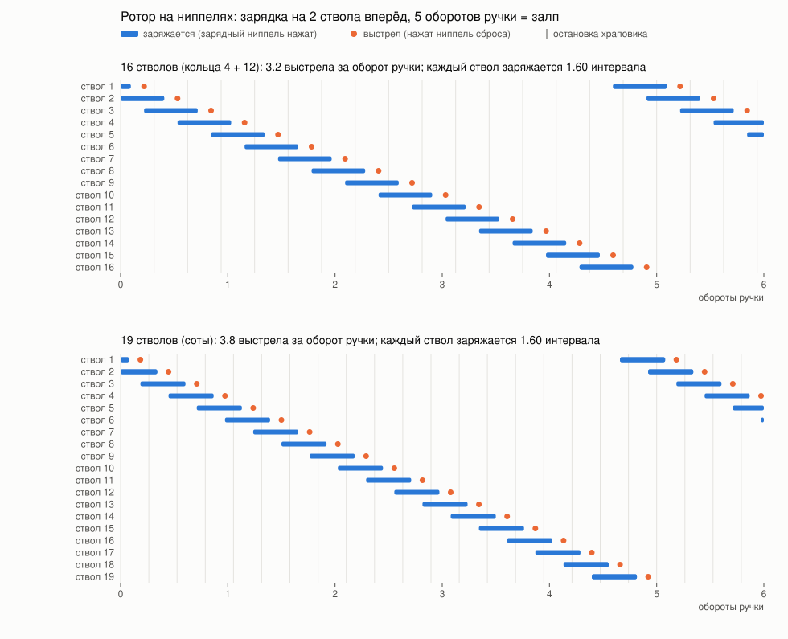

# Ротор митральезы (концепт A)

Как огневая головка митральезы заряжает и спускает стволы. В головке стоят только ниппели (золотники
5V1, как в `mitrailleuse/stage4v2_schrader.py`). Числа считает `mitrailleuse/rotor_timing.py` (обычный
Python, без FreeCAD): он печатает таблицу и рисует [диаграмму фаз](img/rotor_timing.svg). Модель — в
`mitrailleuse/mitrailleuse_concepts.py` (детали `Port_stator`, `Valve_cores`, `Core_pushers`,
`Return_springs`, `Rotor`,
`Detent_wheel`), там же отчёт с проверками.

## Как устроено

На каждый ствол в неподвижном блоке головки стоят два ниппеля на одной радиальной линии. Шланг от
пилота модуля подходит к фитингу спереди блока, канал от него ведёт к обоим ниппелям.

- **Ниппель зарядки** (на радиусе 60). С внутренней стороны у него кольцевой канал подачи, со стороны
  штока — линия пилота под толкателем, толкатель уплотнён кольцом. Толкатель нажал — пилот, а через
  отверстие в диафрагме и камера, заряжаются. Толкатель ушёл — подача сама прижимает ниппель.
- **Ниппель сброса** (на радиусе 42). Изнутри линия пилота, со стороны штока воздух. Толкатель нажал —
  пилот стравливается, и модуль стреляет. Толкатель ушёл — давление пилота сам ниппель и закрывает.
- **Толкатель** — печатный стержень в направляющем отверстии блока. Спереди у него подпружиненный
  носик, сзади грибок Ø7, который ездит по ротору. Между блоком и грибком стоит возвратная пружина.
- **Ротор** — торцевой кулачок за блоком, на нём две приподнятые дуги со скосом вверх и скосом вниз.
  Длинная на радиусе 60 держит нажатыми толкатели зарядки двух следующих стволов. Короткая на
  радиусе 42 стоит за ней и нажимает толкатель сброса того ствола, который стреляет.

## Как толкатель нажимает и отпускает

- **Нажать.** Скос вверх поднимает толкатель на 2.0 мм. Грибок стоит в 0.2 мм от основания кулачка,
  а допуск цепочки «ротор — толкатель — седло ниппеля» ±0.4 мм. Поэтому шток ниппеля утоплен на
  1.4–2.2 мм, а полностью ниппель открыт уже при 1.2 мм. Если шток упрётся раньше (у типового ниппеля
  на 1.8 мм), носик сожмётся до 0.4 мм из своего 1 мм. Пружина носика с натягом 12 Н, что больше
  усилия ниппеля 7.5 Н, так что носик не проседает, пока шток не упёрся. Ниппель при этом получает
  не больше 16 Н.
- **Отпустить.** На скосе вниз возвратная пружина (5 Н на упоре, 7 Н в нажатом положении) отводит
  толкатель на упор, это вдвое больше трения кольца толкателя зарядки (около 2 Н). Ниппель
  закрывается сам: своей пружиной около 3 Н, а с давлением на внутренней стороне ещё и давлением.
  Толкатель зарядки вдобавок выталкивает давление пилота под ним.
- **На упоре** грибок не касается кулачка, поэтому пружины всех остальных толкателей ротор не тормозят.

Сначала был нарисован паз Т-образного сечения, который сам вытягивал толкатель (десмодромный
привод). От него отказались: ниппель закрывается сам, и пружины на толкателе достаточно.

Ротор, блок с ниппелями и храповик у 16 и у 19 свои: дорожки рассчитаны на шаг ниппелей, поэтому
выстрелы идут равномерно.

## Зарядка наперёд

Каждый ствол по очереди проходит под дорожками:

1. Длинная дорожка нажимает толкатель зарядки. Ствол заряжается около 1.55 интервала между выстрелами.
2. Дорожка уходит, толкатель зарядки отпущен. Около 0.2 шага ствол стоит заряженным, оба ниппеля
   закрыты.
3. Короткая дорожка нажимает толкатель сброса, ствол стреляет.

Одновременно заряжаются только два ствола. Остальные пустые: их пилоты после выстрела остались без
давления, а подачи у них нет.

| | 16 стволов | 19 стволов |
|---|---|---|
| шаг ниппелей: сброс / зарядка | 16.5 / 23.6 мм | 13.9 / 19.8 мм |
| зазор между толкателями Ø9 на круге сброса | 7.5 мм | 4.9 мм |
| дорожки: зарядки / сброса | 42 / 13 мм | 36 / 11 мм |
| скос дорожек при ходе 2.0 мм | 19° / 26° | 22° / 30° |
| выстрелов за оборот ручки | 3.2 | 3.8 |
| темп при зарядке 0.5 с | до 3.1 выстр/с | до 3.1 выстр/с |
| залп | 5.2 с | 6.1 с |
| ручку крутить не быстрее | 0.97 об/с | 0.82 об/с |

Другие варианты: один ствол наперёд даёт 1.2 выстр/с, три — 5.2 выстр/с. Время зарядки 0.5 с взято
со стенда v1.1 (отверстие Ø1.0, камера 100 см³). Если крутить ручку быстрее, стволы стреляют
недозаряженными, но без сбоев.

Цикл одного ствола в движении рисует `python3 mitrailleuse/rotor_cycle_gif.py 16` (или `19`):
GIF в `exports/rotor_cycle/`. Давления на нём — набросок, а не расчёт.

## Фиксатор и гашетка

- **Храповой фиксатор** — колесо с N зубьями пилой на валу ротора и подпружиненный плунжер. Он
  ставит ротор так, что ни один толкатель не стоит на скосе дорожки: два ствола заряжены, у
  выстрелившего нажат сброс.
- Зуб пилой пускает ротор только вперёд. **Докрутить ротор до следующего зуба он не может:** плунжер
  10 Н на колесе R25 со скосом 15° даёт 0.07 Н·м, а толкатели на скосах держат ротор с моментом до
  1.6 Н·м. Если отпустить гашетку между зубьями, ротор может встать с полунажатым ниппелем. Поэтому
  муфта должна размыкаться только на зубе: защёлка на тяге гашетки, которая отпускает её раз за шаг.
  Это ещё не нарисовано.
- **Гашетка** включает кулачковую муфту между редуктором 5:1 и валом ротора. Если её отпустить,
  ручка крутится вхолостую.

## Стенд Б: один ствол на ползуне

`mitrailleuse/head_bench.py` (FreeCAD): один порт головки в развёртку, чтобы проверить пневматику на
модуле v4.4 до того, как печатать круглую головку. Порядок испытаний — в `docs/test-plan.md`, раздел
«Mitrailleuse head, bench B».

- **Блок** с двумя ниппелями на одной линии, 18 мм друг от друга, как на роторе. Внутри напечатаны
  каналы: подача сбоку к ниппелю зарядки, пилот от полости под ниппелем зарядки к фитингу сверху (шланг
  к модулю), к ниппелю сброса и к манометру сбоку, выхлоп ниппеля сброса Ø4 наружу. Под ниппелем
  зарядки кольцо 3×1.5 на штоке толкателя.
- **Толкатель** — стальной пруток Ø3 в печатном ползунке, зажат винтом M3: зазор до штока ниппеля
  (0.5 мм) выставляется руками, пружины в носике на стенде нет. Возвратная пружина держит ползунок на
  кулачке.
- **Ползун** с двумя дорожками кулачка ротора в развёртке на шаг 16.5 мм. Щелчки на шести остановках:
  ждёт, зарядка, зарядка, оба закрыты, сброс, выстрелил. Ход 66 мм.

Купить на один стенд (кроме модуля):

| что | сколько |
|---|---|
| ниппели 5V1 | 2 (из пачки на 100) |
| цанговый фитинг G1/8 на трубку 4 мм, прямой | 2 (блок и модуль) |
| фитинг G1/8 под трубку подачи стенда | 1 |
| манометр 0–6 или 0–10 бар, Ø40, G1/8 | 1 |
| тройник на трубку подачи, шаровой кран G1/8, заглушка G1/8 (просверлить Ø0.5) | по 1 |
| трубка ПУ 4×2.5 | 1 м |
| кольцо 3×1.5 NBR | 5 |
| пруток стальной Ø3 | 2 отрезка по 24 мм |
| пружина сжатия 0.6×6×12 (проволока × наружный Ø × длина) | 2 |
| винт M3×50 и установочный винт M3×4 | 4 и 2 |

## Стенд В: ротор под четвертью головки

`mitrailleuse/rotor_bench.py` (FreeCAD): настоящий ротор на 16 стволов крутится горизонтальной ручкой
через коническую пару 1:1 и редуктор 5:1 под четвертью блока головки (4 порта). Он проверяет то, чего не
проверить на ползуне: усилие на ручке, осевую нагрузку на ротор и остановку на шаге, когда отпускают
гашетку. Порядок испытаний — в `docs/test-plan.md`, раздел «Mitrailleuse head, bench C».

**Стенд собран из деталей итоговой головки.** Своё у стенда только основание со стойками, рычаг гашетки
и коробка конической пары. Всё остальное после испытаний переходит в ружьё как есть:

| в головку | что это |
|---|---|
| ротор, стопорный диск, шестерня 75 | пакет на валу Ø8 с лыской, ступица на ступице |
| корпус вала | фланцевая труба с двумя 608, на верхнем подшипнике стоит весь пакет; в ружье крепится к раме тем же фланцем |
| четверть блока и её направляющая плита | в головке их четыре: R30…86, по 4 порта, свои подача, пилоты и выхлоп; три винта M4 на R78 |
| толкатели, штифты, пружины, ниппели, фитинги | как на стенде Б, 8 комплектов |
| шестерня 15 с проскальзывающей муфтой | на промвале M8 |
| пара конических 20 зубьев и ручка | конические — те же, что в селекторе (`ratling/params.py`) |
| стопорный штифт Ø4 | в ружье его вынимает своя тяга гашетки |

На стенде коробка конической пары стоит там, где у головки нет блока. В ружье она уходит за плиту
головки, промвал проходит сквозь плиту, а рычаг стопора развёрнут под тягу от гашетки
(`mitrailleuse/rear_frame.py`, `docs/pack.md`, «Задняя рама»).

**Остановка на шаге сделана иначе, чем в концепте.** Вместо кулачковой муфты и храповика здесь стопор
и проскальзывающая муфта:

- На валу ротора стоит диск с 16 пазами. В пазы под пружиной заходит стальной штифт Ø4 на рычаге
  гашетки. Гашетка нажата — штифт вынут, ротор крутится. Отпустили — штифт едет по ободу и падает в
  следующий паз, и ротор встаёт ровно на шаге, ни один толкатель не на скосе (до ближайшего скоса 3.4°,
  люфт в пазу 1.7°). Нагрузка от паза проходит через ось рычага, поэтому гашетку держать легко: около
  7 Н.
- Шестерня 15 зубьев свободно сидит на промежуточном валу M8 между двумя резиновыми шайбами, их
  прижимает пружина с гайкой. Пока ротор стоит, ручка проскальзывает с моментом 0.42 Н·м, это 6 Н на
  ручке. Гайкой подбирается момент: в 1.3 раза больше, чем нужно ротору.

Кулачковая муфта, которая отпускает только на шаге, либо заклинивает при включении, либо отпускает где
попало, а храповик слишком слабый. Если стопор и муфта сработают на стенде, их можно перенести в концепт.

Печать: всё в той ориентации, в какой выгружено; коробка конической пары лежит на боку. Основание
245 × 131 мм.

Купить на стенд В (кроме модулей):

| что | сколько |
|---|---|
| подшипник 608 | 6 (вал ротора, промвал, вал ручки — по 2) |
| пруток стальной Ø8 | 75 мм с лыской 0.8 мм (вал ротора) и 55 мм (вал ручки) |
| шпилька M8 | 105 мм, гайки M8 — 2, шайбы 8×16 — 2 |
| трубка 12×8 или напечатанная распорка | 29.5 мм |
| шайба 8×12×1 под внутреннее кольцо 608 | 4 |
| стопорное кольцо на вал 8 | 2 |
| пружина сжатия под M8, ~70 Н в сборе длиной 12 мм (например 1.6×14×20) | 1 |
| резиновые шайбы 9×22 (прокладки или вырезать из листа 1.5 мм) | 2 |
| штифт стальной Ø4×14, винт M4×20 с шайбой (ось рычага) | по 1 |
| винты M4×50 (блок и плита в стойки) | 3 |
| винты M4×16 с гайками (корпус вала), M4×20 (коробка) | 3 и 2 |
| ниппели 5V1, кольца 3×1.5 | 8 и 6 |
| пруток стальной Ø3 | 8 отрезков по 24 мм |
| пружина сжатия 0.6×6×12 | 9 (8 толкателей и рычаг) |
| установочный винт M3×4 (толкатели), M3×6 (конические, ручка) | 8 и 3 |
| цанговый фитинг G1/8 | 5 (подача и четыре пилота), или заглушки и манометры вместо модулей |

**Вал ротора на корпусных подшипниках (решено, ещё не нарисовано).** Вал ротора ставим не на два 608
в печатной трубе, а на два фланцевых корпусных подшипника KFL08 (вал 8 мм). Вал зажимают их
установочные винты, поэтому стопорные кольца не нужны. Самоустанавливающийся вкладыш прощает
перекос печатной рамы, а стальной корпус держит осевую нагрузку от толкателей лучше пластика.
Промвал и вал ручки остаются на 608: нагрузки там мало. Корпус вала в `mitrailleuse/rotor_bench.py`
перерисовать под фланцы по замерам купленных деталей (шаг отверстий, высота, вылет ступицы с
винтами): у разных производителей они немного отличаются. Тогда в списке выше меняется вот что:
608 нужно 4 вместо 6, KFL08 2, а стопорных колец и шайб 8×12×1 под вал ротора не нужно.

## Сброс давления

Кран с ключом на входе перекрывает подачу и стравливает кольцевой канал через жиклёр Ø0.5. Ниппель
зарядки в обратную сторону работает как обратный клапан, как ниппель в шине при накачке. Поэтому
заряженные пилоты и камеры сливаются через свои ниппели зарядки в канал и дальше через жиклёр, где
бы ни стоял ротор. Давление в пилоте не падает ниже 0.94 от давления в камере, а клапан модуля
открывается только ниже 0.73, так что стволы не стреляют. Слив занимает 5–9 с.

## Силы

- Толкатель давит на ниппель с силой около 7.5 Н при 5 бар: пружина ниппеля 3 Н плюс давление на
  седло Ø3.4. На кулачок добавляется возвратная пружина, до 7 Н.
- Толкатель зарядки уплотнён кольцом на штоке Ø3. Давление пилота под ним выталкивает его назад с
  силой 3.5 Н при 5 бар, и эта сила тоже ложится на кулачок. Кольцо надо ставить именно на тонкий шток:
  на бобышке Ø9 эта сила была бы 32 Н.
- На роторе самое большое сопротивление — когда толкатели въезжают на скосы. Это 1.61 Н·м у 16 и
  1.74 Н·м у 19 стволов, а на ручке 4.6–5.0 Н на плече 70 мм, без потерь в шестернях. На скосе вниз
  пружины толкают ротор вперёд, в расчёте это не учтено.

## Если поднять давление

От давления растут только силы на толкателях. Пружины и фиксатор от него не зависят, поэтому момент на
роторе растёт медленно. Числа печатает `rotor_timing.py`.

| давление | ниппель | шток толкателя зарядки | 16: ротор / ручка | 19: ротор / ручка |
|---|---|---|---|---|
| 2 бар | 4.8 Н | 1.4 Н | 1.41 Н·м / 4.0 Н | 1.51 Н·м / 4.3 Н |
| 5 бар | 7.5 Н | 3.5 Н | 1.61 Н·м / 4.6 Н | 1.74 Н·м / 5.0 Н |
| 7 бар | 9.4 Н | 4.9 Н | 1.75 Н·м / 5.0 Н | 1.89 Н·м / 5.4 Н |
| 10 бар | 12.1 Н | 7.1 Н | 1.95 Н·м / 5.6 Н | 2.12 Н·м / 6.1 Н |

- **Носик толкателя.** Его натяг 12 Н должен быть больше усилия ниппеля, а при 10 бар ниппель
  требует 12.1 Н, и носик начнёт проседать раньше, чем откроется ниппель. Выше 7 бар нужна пружина
  носика жёстче, и тогда упёршийся ниппель получит больше 16 Н.
- **Возврат** давление не ухудшает. Толкатель зарядки давление выталкивает само, а у толкателя
  сброса со стороны штока воздух.
- **Темп** почти не меняется. Через отверстие Ø1.0 поток критический: расход растёт пропорционально
  давлению, как и нужная масса воздуха, поэтому камера наполняется примерно за то же время. Это
  оценка, её надо проверить на стенде.
- **Главное ограничение не в роторе.** Модуль и печатные детали рассчитаны на 5 бар (решение в
  `docs/status.md`), так что подъём выше 5 бар упирается в них, а не в ротор.

## Экономика ниппелей

| | 16 стволов | 19 стволов |
|---|---|---|
| ниппелей в ружье | 32 | 38 |
| купить с полным запасным комплектом | 100 шт., 90–180 ₽ | 100 шт., 90–180 ₽ |
| пружины носика и возвратные, кольца толкателей зарядки | ~224 ₽ | ~266 ₽ |
| срабатываний каждого ниппеля за залп | 1 | 1 |

Ниппели 5V1 на Ozon продаются по 100 шт. за 88–177 ₽, то есть 0.9–1.8 ₽ за штуку. Пружины и кольца
посчитаны по 2–3 ₽ за штуку, это прикидка. Ресурс ниппеля производители не публикуют, есть только
испытание на циклы в ISO 14960-1. Поэтому ресурс, усилие и ход штока надо мерить на стенде.

Готовые механические клапаны 3/2 с толкателем и своей пружиной (AirTAC S3, SMC VM132-M5, Festo
F-3-M5) стоят от $6 за штуку, на ружьё это 20–50 тыс. ₽. К тому же их корпус не помещается в шаг
13.9 мм у 19 стволов. Поэтому они не подходят.

## Что проверить

Числа ниппеля (ход штока, пружина, седло) и пружин толкателя взяты типовые, как в `stage4v2_schrader.py`. Их надо
перемерить на купленных ниппелях.

- Расход через ниппель зарядки: успевает ли камера за 0.5 с, если подача идёт через ниппель.
- Ниппель сброса: достаточно ли быстро стравливается пилот, чтобы клапан хлопал, а не открывался
  медленно.
- Толкатель зарядки на кольце: не течёт ли, сколько тянет, хватает ли возвратной пружины.
- Ниппель: усилие и ход штока, где упирается, сколько циклов выдерживает.
- Тихий слив через ниппели зарядки и жиклёр: `docs/test-plan.md`, раздел «charge time and the quiet
  dump».
