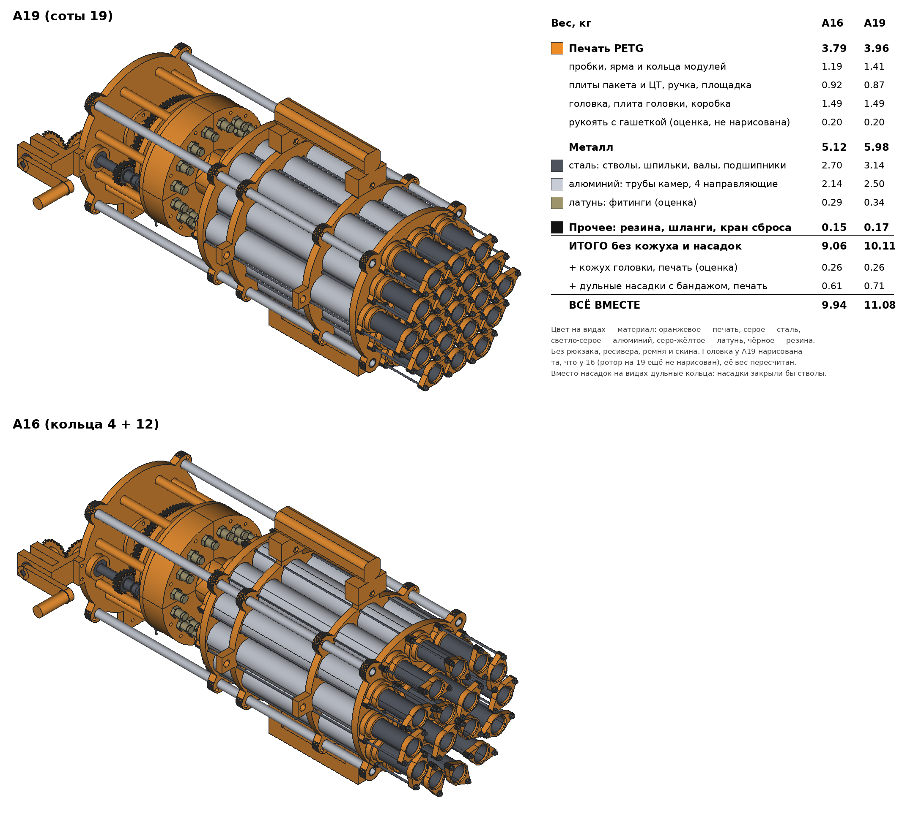

# Вес: митральеза v4.4 (16 и 19 стволов) и пистолет

Митральеза пересчитана 2026-10-20 по деталям: модули, каркас, опора, головка и задняя рама. Пистолет и
модуль посчитаны 2026-10-18. Стволы стальные (решено 2026-10-18); алюминиевая колонка у модуля и пистолета
оставлена для сравнения.

## Итог

| Изделие | Вес |
|---|---|
| Митральеза A16 (кольца 4 + 12), рабочая | **9.06 кг** |
| Митральеза A19 (соты 19), рабочая | **10.11 кг** |
| То же с кожухом головки и дульными насадками | 9.94 / 11.08 кг |
| Пистолет (курковый, 6 стволов) | **1.27 кг** (алюминиевые стволы 0.93) |

В митральезу не входят рюкзак, ресивер, шланг до рюкзака, ремень и скин. Задняя рама и головка взяты из
PR #13 (влит 2026-10-20); рукоять с гашеткой из него убрали, она пока оценкой. В пистолет не входит отделка (EVA, бинт, колба, краска)
и шланг до ресивера.

По материалу (A16 / A19): печать PETG 3.79 / 3.96 кг, металл 5.12 / 5.98 (сталь 2.70 / 3.14, алюминий
2.14 / 2.50, латунь 0.29 / 0.34), прочее (резина, шланги, кран сброса) 0.15 / 0.17. Больше половины веса —
металл, и почти весь он в модулях: стволы и трубы камер.

Картинка: `tools/weights_picture.py` (виды, FreeCAD с GUI) и `tools/weights_sheet.py` (таблица, Pillow).

## Как считал

- Модуль: `module/stage3v4_coaxial_chamber.py` прогнан во FreeCAD 1.0.2, все проверки `[OK ]`
  (камера 101 см³, труба камеры 263 мм, ствол 300 мм, шпильки 2 × M3 × 362 мм).
- Печать: свой упрощённый «слайсер» по STL: срез каждые 0.2 мм (плита 0.24 мм), стенки 0.43 мм, 5 слоёв
  сверху и 3 снизу сплошные, внутри заполнение профиля (`tools/print_mass.py`). Профили те же, что в `module/stage3v4_plates.sh` и
  `mitrailleuse/make_plates.sh`. Плотность PETG 1.27, PLA 1.26; герметичный профиль с потоком 1.05.
  Проверка на пистолете: по этой оценке его печать 489 г, Bambu Studio дал 485 г
  (`pistol/build/README.md`), по столам 186/51/157/95 против 186/48/157/94.
- Трубы по сечению: сталь 7.85 г/см³, алюминий 2.70 г/см³.
- Помечено «оценка» то, что взято по типовым каталожным весам, а не из модели.

## Модуль v4.4 (один)

| Деталь | Как | Вес, г |
|---|---|---|
| Задняя пробка | PETG, герметичный (6 стенок, 100 %) | 31.9 |
| Кольцо седла | PETG, герметичный | 9.0 |
| Передняя пробка | PETG, герметичный | 17.2 |
| Заднее ярмо | PETG, прочный (5 стенок, 60 %) | 8.4 |
| Переднее ярмо | PETG, прочный | 3.5 |
| Дульное кольцо | PETG, прочный | 4.1 |
| **Печать итого** | | **74.1** |
| Труба камеры 38 × 1.5, 263 мм | алюминий (по v4.4) | 122.3 |
| Шпильки M3 × 362, 2 шт. | сталь, 44 г/м | 31.8 |
| Гайки M3 и шайбы, по 6 шт. | сталь | 3.1 |
| O-кольца 2 × 29×3, 24×2.5, 20×2 и мембрана Ø31 × 1.5 | резина 1.3 г/см³ | 4.2 |
| Фитинг пилота G1/8 | оценка | 8 |
| **Без ствола** | | **243.6** |
| Ствол 25 × 0.59, 300 мм | сталь / алюминий | 106.5 / 36.6 |
| **Модуль** | сталь / алюминий | **350.0 / 280.2** |

Конус для колец и шаблон мембраны — инструмент, в вес не входят.

## Митральеза (концепт A)

Расчёт на 2026-10-20. Что откуда:

- **Модули** — по 350 г, таблица выше (модуль с тех пор не менялся, его печать пересчитана тем же
  слайсером: 74.1 г, сошлось до 0.1 г).
- **Каркас** (`pack_frame.py`) и **опора** (`carry_mount.py`, PR #11) — детали из main. Направляющие
  уже по PR #13: 478 мм вместо 390, головка теперь сидит на их заднем конце.
- **Головка** — детали стенда В (`rotor_bench.py`), которые по PR #13 переходят в ружьё как есть:
  четыре четверти блока и четыре направляющие плиты, ротор, шестерни, стопорный диск, корпус вала,
  толкатели, конические и ручка. Ротор и стопорный диск нарисованы только на 16; для 19 взяты те же
  массы плюс 6 комплектов порта (штифт, ниппель, пружина, толкатель) и 3 фитинга.
- **Задняя рама** (`rear_frame.py`, PR #13): плита головки, коробка конической пары, рычаг стопора
  с тягой. Рукоять с гашеткой перед вливанием PR убрали (на плите остался прилив под неё): она в оценке
  по снятому варианту.
- **Оценка** — то, чего ещё нет деталями: рукоять с гашеткой, кран сброса с ключом
  и шланг подачи. Кожух
  головки (печатная оболочка 2 мм из эскиза концепта, 263 г) и дульные насадки (`muzzle_sleeve` модуля
  вместо дульного кольца, плюс бандаж из эскиза) вынесены отдельно: без них ружьё работает.

Печать везде как в `pack_frame_plates.sh` и `rear_frame_plates.sh`: PETG, 5 стенок, 60 % gyroid. Для
деталей головки своего профиля в репо нет, взят тот же.

| Узел | A16, г | A19, г |
|---|---|---|
| Модули v4.4 (16 / 19 × 350) | 5600 | 6650 |
| **Каркас пакета** | **459** | **441** |
| задняя и передняя плиты | 274 | 255 |
| 4 направляющие 12 × 1 × 478, алюминий | 179 | 179 |
| 8 винтов M3 × 8 без головки с гайками | 7 | 7 |
| **Опора в центре тяжести** | **674** | **645** |
| 2 плиты ЦТ | 324 | 295 |
| ручка | 148 | 148 |
| площадка триноги | 171 | 171 |
| винты M3, 4 болта M4 × 25 с гайками, гайка 3/8″ | 32 | 32 |
| **Головка, печать** | **1017** | **1019** |
| 4 четверти блока | 599 | 599 |
| 4 направляющие плиты | 117 | 117 |
| ротор | 110 | 110 (как у 16) |
| шестерни 75 и 15 | 105 | 105 |
| стопорный диск, корпус вала | 44 | 44 |
| конические 20 × 2 и ручка | 30 | 30 |
| толкатели (32 / 38) | 13 | 15 |
| **Головка, покупное** | **521** | **562** |
| ниппели 5V1, штифты Ø3 × 24, пружины, установочные винты (32 / 38) | 95 | 113 |
| цанговые фитинги G1/8 (20 / 23, по 8 г — оценка) | 160 | 184 |
| 6 подшипников 608 | 72 | 72 |
| вал ротора Ø8, шпилька M8 промвала, вал ручки, стопорный штифт | 89 | 89 |
| муфта: гайки, шайбы, пружина, резиновые шайбы, кольца | 30 | 30 |
| 12 × M4 × 50, 3 × M4 × 16 с гайками | 75 | 75 |
| **Задняя рама (PR #13)** | **492** | **492** |
| плита головки | 417 | 417 |
| коробка конической пары | 51 | 51 |
| рычаг стопора | 4 | 4 |
| болты M4, винты M3 без головки, тяга Ø2.5 | 21 | 21 |
| **Ещё не нарисовано (оценка)** | **294** | **296** |
| рукоять с гашеткой, болты и пружина (снятый вариант PR #13: 197 + 4 + 12) | 213 | 213 |
| шланги пилотов ПУ 4 × 2.5, 1.22 / 1.42 м — уже нарисованы (`pilot_hoses.py`), 1.2 г/см³ | 11 | 13 |
| кран сброса с ключом, шланг подачи, фитинг | 70 | 70 |
| **Итого, рабочая** | **9057** | **10105** |
| кожух головки (оценка по эскизу) | +263 | +263 |
| дульные насадки вместо дульных колец, бандаж | +610 | +710 |
| **Всё вместе** | **9930** | **11078** |

Что заметно:

- Всё, кроме модулей, весит 3.5 кг, почти как 10 модулей. Больше всего — головка (1.5 кг, из них
  четверти блока 0.6 кг) и плита головки (0.42 кг). Печать при 60 % заполнения; если блоки головки
  печатать герметично, как пробки модуля (6 стенок, 100 %), они потяжелеют на ~280 г.
- Эскиз концепта (`mitrailleuse_concepts.py`) давал 7.9 / 9.0 кг вместе с кожухом и насадками, потому что
  считал печать по 0.6 г/см³ и головку маленьким диском. Детали тяжелее на ~2 кг.
- Фитинги головки посчитаны по 8 г (латунные цанговые G1/8). Пластиковые легче вдвое: −80…−90 г.
- Ремень с карабинами не считан (обычно 100–200 г).

Прошлый расчёт (2026-10-18) брал только модули и одну плоскую плиту пакета: 5.63 / 6.69 кг.

Чем можно облегчить A16 (на бумаге, не нарисовано; 2026-10-20):

- заполнение 20 % вместо 60 % у деталей без воздуха (плиты, опора, рукоять, плита головки): −0.5 кг,
  с блоками головки до −0.85;
- ручка прямо на плитах каркаса, без двух плит ЦТ: около −0.25 кг;
- пластиковые цанговые фитинги вместо латунных: −0.1 кг;
- меньше стволов: около 365 г на ствол с его портом головки, 12 стволов — 7.6 кг.
- Труба камеры 38 × 1.0 (−0.64 кг) отпадает: такой трубы в продаже нет (владелец, 2026-10-20).

## Пистолет (курковый вариант)

| Статья | Стальные стволы, г | Алюминиевые стволы, г |
|---|---|---|
| Печать, 4 стола (`pistol/build/README.md`) | 485 | 485 |
| Стволы 6 × 200 мм, труба 25 × 0.6 | 433 | 149 |
| Камера-ось 258 мм, та же труба | 93 | 32 |
| Клапан сброса AirTAC M3R110-06 (оценка) | 60 | 60 |
| Фитинги, тройник, глушитель (оценка) | 27 | 27 |
| Манометр Ø25 (оценка) | 20 | 20 |
| Трубки PU внутри (6/4 ~0.2 м, 4/2.5 ~0.5 м) | 9 | 9 |
| Уплотнения клапана v1.1: 4 × M4 × 50 с гайками, мембрана, кольца, 6 резиновых шайб | 40 | 40 |
| Ось курка Ø8 × 84, пруток Ø3 ~130 мм | 40 | 40 |
| Пружины (2 торсионные, 2 от ручки) | 10 | 10 |
| Винты, гайки, шпилька M6, ~20 саморезов | 43 | 43 |
| Клей (эпоксидка, циакрин) | 10 | 10 |
| **Итого** | **1270** | **925** |

Камера-ось из той же трубы, что и стволы, поэтому в алюминиевой колонке она тоже алюминиевая.
Если ось оставить стальной, алюминиевый вариант тяжелее на 61 г (≈ 0.99 кг).
